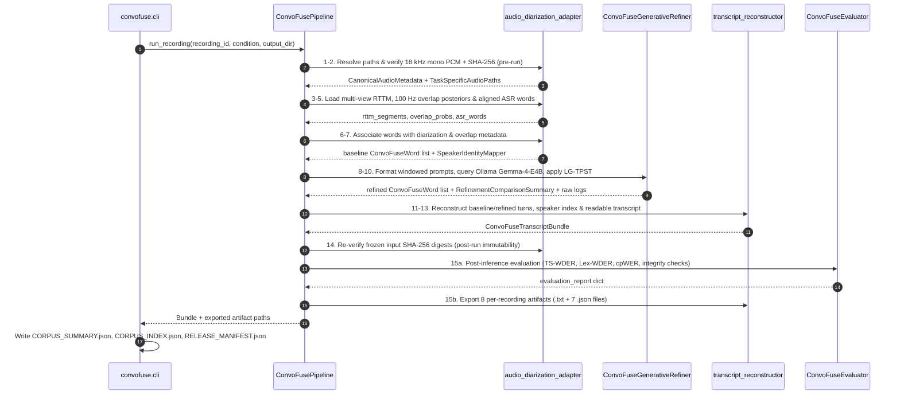

# ConvoFuse System & Module Architecture

**ConvoFuse** ([`convofuse/`](convofuse/)) is a modular, CLI-first Python framework that implements the unified conversational intelligence workflow of the **Multi-View Speaker Representation Learning** project. It separates inference from post-run evaluation, enforces cryptographic input provenance, and produces deterministic chronological conversation transcripts and machine-readable evaluation bundles.

---

## 1. End-to-End Architectural Overview

```mermaid
flowchart TB
    subgraph CLI_Layer["CLI Entry Point (convofuse/cli.py)"]
        Args["CLI Arguments\n--mode {frozen_replay, custom_inputs}\n--recording / --all-recordings\n--condition {auto, E20, condition_j}\n--unconstrained / --output-dir"]
    end

    subgraph Orchestrator["Pipeline Orchestrator (convofuse/pipeline.py)"]
        Pipe["ConvoFusePipeline.run_recording()\n15-Stage Deterministic Execution"]
    end

    subgraph Adapter_Layer["Audio & Multi-View Diarization Adapter (convofuse/audio_diarization_adapter.py)"]
        AudioProc["CanonicalAudioProcessor\n16 kHz Mono PCM + Finite Verification + SHA-256"]
        DualPath["TaskSpecificAudioPaths\n- dfn.wav -> TitaNet-Large (192-D)\n- 16k_mono.wav -> WeSpeaker ResNet293-LM (256-D)\n- normalized.wav -> WhisperX Large-v3 + Wav2Vec2 CTC"]
        RTTMLoad["Frozen / Custom RTTM & Overlap Loader\n- Stage 5B.4 E20 (R01) / Stage 5A.1 Cond J (R02-R08)\n- Stage 5B.2 100 Hz Pyannote Overlap Posteriors"]
        WordAssoc["associate_words_with_diarization()\nMax Interval Overlap + 0.5s Midpoint Collar + UNK + Overlap Stats"]
    end

    subgraph Refinement_Layer["Safeguarded Generative Refiner (convofuse/generative_refiner.py)"]
        SpkMap["SpeakerIdentityMapper (convofuse/contracts.py)\nSPEAKER_00..N <-> <speaker:1..N+1> | UNK <-> <speaker:0>"]
        Ollama["OllamaDiarizationLMClient\ndiarizers-community/DiarizationLM-Gemma-4-E4B-v1 (Q4_K_M)"]
        LGTPST["ConvoFuseGenerativeRefiner (LG-TPST)\n1. Strict Parser (extract_text_and_spk_strict)\n2. Levenshtein Word-Preserving Transfer\n3. UNK Invariance Guard\n4. Overlap Protection Guard (ovl >= 0.50)\n5. Locality Gate (Interior Run >= 3 words / >= 1.0s)"]
    end

    subgraph Reconstruction_Layer["Chronological Transcript Reconstructor (convofuse/transcript_reconstructor.py)"]
        Turns["group_words_into_turns()\nChronological Turn Merging + Overlap Metadata"]
        SpkSum["build_speaker_summaries()\nSpeaking Duration, Turn/Word Counts, Overlap Ratios"]
        Format["format_readable_transcript() & export_convofuse_artifacts()\n- <rec_id>__transcript.txt & <rec_id>__transcript.json\n- words / turns / speakers / comparison / manifest JSONs"]
    end

    subgraph Evaluation_Layer["Post-Inference Evaluator (convofuse/evaluator.py)"]
        Eval["ConvoFuseEvaluator.evaluate()\n(Strict Post-Inference Ground-Truth Isolation)\n- TS-WDER (assigned & all_ref)\n- Lex-WDER & cpWER\n- Oracle Beneficial/Harmful/Neutral Audit\n- Word, Timestamp, UNK & SHA-256 Verification"]
    end

    Args --> Pipe
    Pipe --> AudioProc --> DualPath --> RTTMLoad --> WordAssoc
    WordAssoc --> SpkMap --> Ollama --> LGTPST
    LGTPST --> Turns --> SpkSum --> Format
    Format -. "Post-Inference Only" .-> Eval
```

---

## 2. Module-by-Module Specification

### 2.1 [`convofuse/contracts.py`](convofuse/contracts.py) — Data Contracts & Identity Mapping
Defines the immutable data structures and speaker-mapping contracts shared across all pipeline stages:
- **`ExecutionMode`**: Enum distinguishing `FROZEN_INPUT_REPLAY` (replaying frozen Stage 1–5B acoustic/ASR artifacts for `R01`–`R08`) and `FULL_PROCESSING` (custom user-supplied audio, ASR word JSON, and RTTM files).
- **`RefinementDecisionStatus` & `RefinementReason`**: Enums enumerating every word-level refinement outcome (`ACCEPTED`, `REJECTED`, `ABSTAINED`, `UNCHANGED`) and granular safeguard code (`ACCEPTED_VALIDATED_TRANSFER`, `REJECTED_UNKNOWN_SPEAKER_MAPPING`, `REJECTED_UNSUPPORTED_OVERLAP_CORRECTION`, `ABSTAINED_LOCALITY_GATE`, `ABSTAINED_PRESERVE_UNK`, `UNCHANGED_BASELINE_CONFIRMED`).
- **`SpeakerIdentityMapper`**: Deterministic bidirectional mapper between canonical speaker IDs (`SPEAKER_00`, `SPEAKER_01`, ...) and DiarizationLM prompt tags (`<speaker:1>`, `<speaker:2>`, ...). Strictly isolates `UNK` as `<speaker:0>` so `UNK` is never conflated with `<speaker:1>`.
- **`ConvoFuseWord`**: Word-level record containing `word_index`, `word`, `start`, `end`, `asr_confidence`, `speaker_baseline`, `speaker_refined`, `speaker`, `refinement_status`, `refinement_reason`, `is_overlapping_speech`, `overlapping_speakers`, `frame_overlap_prob_mean`, and `frame_overlap_prob_max`.
- **`ConvoFuseTurn`**: Chronological speaker turn aggregating contiguous words assigned to the same speaker within `max_pause_sec = 1.5s`, along with turn duration, word indices, mean ASR confidence, and overlap metadata.
- **`ConvoFuseSpeakerSummary`**: Per-speaker aggregate index (speaking time, turn count, word count, overlap ratio, first/last appearance timestamps).
- **`ConvoFuseProcessingManifest`**: Provenance manifest recording git commit, execution mode, input file paths and SHA-256 digests, model identifiers, runtime telemetry, and verification flags (`ground_truth_used_during_inference = False`).
- **`ConvoFuseTranscriptBundle`**: Top-level container serialized to `<rec_id>__transcript.json`.

### 2.2 [`convofuse/audio_diarization_adapter.py`](convofuse/audio_diarization_adapter.py) — Canonical Audio & Multi-View Diarization Adapter
Bridges canonical audio conditioning, multi-view diarization RTTMs, frame-level overlap posteriors, and CTC-aligned ASR words:
- **`CanonicalAudioProcessor`**: Verifies or extracts 16 kHz mono 16-bit PCM WAV (`pcm_s16le`, `t = 0.000s`), checks sample finiteness (`np.isfinite`), and computes SHA-256 digests.
- **`TaskSpecificAudioPaths`**: Resolves the three task-specific audio conditioning paths for each recording:
  1. `dfn_wav` (`DeepFilterNet3` denoised) $\rightarrow$ `TitaNet-Large` (192-D)
  2. `mono_16k_wav` (raw unenhanced 16 kHz mono) $\rightarrow$ `WeSpeaker ResNet293-LM` (256-D) & Pyannote 3.1 overlap posteriors
  3. `normalized_wav` (EBU R128 `-20 LUFS`) $\rightarrow$ `Faster-Whisper Large-v3` ASR & `Wav2Vec2` CTC alignment
- **`resolve_benchmark_recording_inputs()`**: Selects the validated diarization RTTM (`Stage 5B.4 E20` on `R01_sara_sharif`; `Stage 5A.1 Condition J` on `R02`–`R08`), frozen WhisperX aligned word JSON (`stage2_baseline/outputs/asr/`), and Stage 5B.2 100 Hz Pyannote overlap posterior cache (`stage5b_2_overlap/cache/pyannote_raw/`).
- **`associate_words_with_diarization()`**: Assigns each aligned ASR word to a canonical speaker (`SPEAKER_00`, `SPEAKER_01`, ..., or `UNK`) via maximum positive interval overlap (`0.5s` midpoint collar fallback) and computes multi-speaker RTTM overlap flags (`is_overlapping_speech`, `overlapping_speakers`) and frame-level overlap posterior statistics (`frame_overlap_prob_mean`, `frame_overlap_prob_max`).

### 2.3 [`convofuse/generative_refiner.py`](convofuse/generative_refiner.py) — Safeguarded Generative Speaker Refinement (`LG-TPST`)
Executes local `diarizers-community/DiarizationLM-Gemma-4-E4B-v1` (`Q4_K_M` via Ollama) with five deterministic post-processing safeguards:
1. **Strict Prompt & Completion Parser (`extract_text_and_spk_strict`)**: Segments words into bounded windows (`max_segment_chars = 1600`, `max_words_per_segment = 220`), formats `<speaker:k>` prompts ending with ` --> `, and parses completions without silent fallback on malformed or missing tags.
2. **Transcript-Preserving Levenshtein Alignment (`tpst_align_segment`)**: Aligns completion tokens against the immutable input words and transfers only speaker tags; the original word strings and `[start, end]` timestamps are never modified.
3. **Strict `UNK` Invariance Guard**: Blocks both assigning `UNK` (`<speaker:0>`) to a known word and reassigning a baseline `UNK` word to any active speaker (`REJECTED_UNKNOWN_SPEAKER_MAPPING` / `ABSTAINED_PRESERVE_UNK`).
4. **Simultaneous Overlap Guard**: Rejects speaker reassignments on words inside multi-speaker RTTM overlap or where `frame_overlap_prob_max >= 0.50` (`REJECTED_UNSUPPORTED_OVERLAP_CORRECTION`).
5. **Locality Gate (`LG-TPST`)**: Computes contiguous candidate change runs and abstains (`ABSTAINED_LOCALITY_GATE`) when a proposed run spans $\ge 3$ words or $\ge 1.0\text{s}$ inside an acoustically stable interior segment (`> 0.35s` from any diarization segment boundary and not a single-word backchannel).

### 2.4 [`convofuse/transcript_reconstructor.py`](convofuse/transcript_reconstructor.py) — Chronological Transcript Reconstructor & Exporter
- **`group_words_into_turns()`**: Merges chronologically ordered words with identical speaker attributions into readable turns (splitting when inter-word pause exceeds `max_pause_sec = 1.5s`), preserving `UNK` turns and aggregating turn-level overlap metadata.
- **`build_speaker_summaries()`**: Computes speaking duration, turn count, word count, overlap ratio, and active time range for every speaker (`SPEAKER_00..N` and `UNK`).
- **`format_readable_transcript()`**: Generates the human-readable chronological transcript (`<rec_id>__transcript.txt`) with metadata header, speaker summary index, `[HH:MM:SS.mmm – HH:MM:SS.mmm] SPEAKER_XX: ...` turn lines, and explicit `# [OVERLAP_METADATA: ...]` annotations on turns with overlapping speech.
- **`export_convofuse_artifacts()`**: Writes the 8 per-recording output files (`__transcript.txt`, `__transcript.json`, `__words.json`, `__turns.json`, `__speakers.json`, `__comparison.json`, `__processing_manifest.json`, and `__evaluation_report.json`).

### 2.5 [`convofuse/evaluator.py`](convofuse/evaluator.py) — Post-Inference Evaluator
- **`ConvoFuseEvaluator`**: Invoked strictly **after** `ConvoFuseTranscriptBundle` generation completes, and only when reference RTTM and reference JSON files exist.
- Computes baseline and refined `Timestamp WDER (assigned & all_ref)`, `Lexical WDER`, and `cpWER`, classifies every accepted word change into `Beneficial`, `Harmful`, or `Neutral`, and verifies `word_sequence_intact`, `timestamp_sequence_intact`, `unk_invariance_verified`, and `frozen_inputs_sha256_verified`.

### 2.6 [`convofuse/pipeline.py`](convofuse/pipeline.py) & [`convofuse/cli.py`](convofuse/cli.py) — Orchestration & CLI Packaging
- **`ConvoFusePipeline.run_recording()`**: Executes the 15-stage deterministic pipeline for a single recording (`FROZEN_INPUT_REPLAY` or `FULL_PROCESSING`) and returns `(ConvoFuseTranscriptBundle, exported_paths)`.
- **`ConvoFusePipeline.run_benchmark_corpus()`**: Runs all 8 benchmark recordings (`R01`–`R08`) and compiles `CORPUS_SUMMARY.json`.
- **`convofuse/cli.py`**: Provides the command-line interface (`python -m convofuse.cli`), generates `CORPUS_INDEX.json` and `RELEASE_MANIFEST.json` (with per-file SHA-256 hashes and byte sizes), and returns a non-zero exit code (`1`) on any missing input, runtime failure, or integrity violation.

---

## 3. 15-Stage Execution Sequence

---

## 4. Dependencies on Frozen Research Stages

In `FROZEN_INPUT_REPLAY` mode (`--mode frozen_replay`, default), `convofuse` reads frozen, SHA-256-verified artifacts from [`research_stages/`](research_stages/) without modifying them:

| Upstream Stage Artifact | Path Pattern in `research_stages/` | Role in ConvoFuse |
| :--- | :--- | :--- |
| **Canonical Audio Views (Stage 1)** | `stage1_data_prep/work/processed/{16k_mono,normalized,dfn}/<rec_id>.wav` | Audio duration, sample finiteness, and SHA-256 verification |
| **Aligned WhisperX ASR Words (Stage 2)** | `stage2_baseline/outputs/asr/<rec_id>/words.json` | Immutable word sequence, `[start, end]` timestamps, and ASR confidence |
| **Multi-View Diarization RTTM (Stage 5A.1 / 5B.4)** | `stage5b/stage5b_4_fresh_diarization/r01_pilot/outputs/rttm/R01_sara_sharif__E20.rttm` (`R01`) and `stage5a_1/outputs/rttm/condition_j/<rec_id>.rttm` (`R02`–`R08`) | Baseline multi-view acoustic speaker segments |
| **100 Hz Frame Overlap Posteriors (Stage 5B.2)** | `stage5b/stage5b_2_overlap/cache/pyannote_raw/<rec_id>.npz` | Frame-level overlap probabilities (`frame_overlap_prob_mean`, `frame_overlap_prob_max`) |
| **Gold Reference Annotations (Stage 1, Post-Inference Only)** | `stage1_data_prep/manifest/annotations_Frozen_v1/{rttm,json}/<rec_id>.{rttm,json}` | Used strictly inside `convofuse/evaluator.py` after inference finishes |
