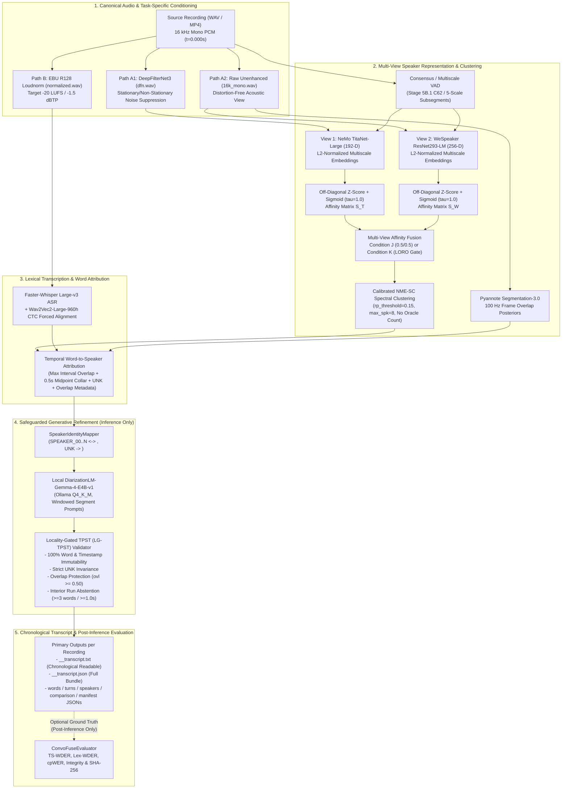

# Multi-View Speaker Representation Learning

## ConvoFuse: Dual-Path Multi-View Speaker Diarization, Word Attribution, and Generative Refinement for Conversational Intelligence

**Multi-View Speaker Representation Learning** is a research repository for speaker representation learning, speaker diarization, word-level speaker attribution, and context-aware generative post-processing on real-world, non-stationary Body-Worn Camera (BWC) and multi-talker conversational recordings.

The primary deliverable of this repository is **ConvoFuse** ([`convofuse/`](convofuse/)), a CLI-first research framework (`python -m convofuse.cli`) that synthesizes the audited contributions of Stages 1 through 6.1 into a reproducible conversational transcript and evaluation workflow.

---

## 1. Problem Statement & Motivation

Conversational intelligence on Body-Worn Camera (BWC) and field audio faces four compounding failure modes that standard single-branch transcription and diarization pipelines fail to resolve simultaneously:

1. **Asymmetric Preprocessing Sensitivity Across Neural Backbones**: Spectral speech enhancement (`DeepFilterNet3`) suppresses non-stationary siren, wind, and crowd noise for some speaker encoders (`TitaNet-Large`), yet introduces spectral subtraction artifacts that significantly degrade encoders trained with heavy additive noise augmentation (`WeSpeaker ResNet293-LM`) and distort ASR acoustic models (`Faster-Whisper Large-v3`).
2. **Incompatible Multi-Encoder Affinity Scales**: Different speaker verification architectures exhibit distinct off-diagonal cosine similarity distributions (`TitaNet-Large` off-diagonal $\mu=0.0887, \sigma=0.1610$ vs `WeSpeaker ResNet293-LM` $\mu=0.2341, \sigma=0.1492$). Naive averaging of unnormalized affinity matrices causes severe under-clustering and speaker collapse under eigengap spectral clustering.
3. **Single-Stream ASR vs. Multi-Speaker Acoustic Overlap**: Monoaural CTC-aligned ASR (`WhisperX` / `Faster-Whisper Large-v3` + `Wav2Vec2-Large-960h-LV60-Self`) emits a single chronological word sequence per timestamp interval. Heuristic second-speaker overlap attribution in the acoustic diarization stream cannot recover a second lexical stream and risks corrupting word-level speaker transitions.
4. **Unconstrained LLM Post-Processing Drift**: While Large Language Models (`DiarizationLM`) can resolve lexical boundary split errors (e.g., short backchannels or turn transitions split across adjacent speaker segments), unconstrained generative rewrites risk modifying words, hallucinating speakers outside the discovered acoustic inventory, reassigning pre-VAD `UNK` tokens to active speakers, or overwriting legitimate overlapping speech turns.

### Core Research Questions

- **RQ1 (Task-Specific Dual-Path Conditioning)**: Does routing task-specific acoustic views (`DeepFilterNet3` for `TitaNet-Large`, raw `16 kHz` mono for `WeSpeaker ResNet293-LM`, and EBU R128 loudness normalization for `WhisperX` ASR) outperform uniform preprocessing across an 8-recording multi-speaker BWC benchmark (`R01`–`R08`)?
- **RQ2 (Multi-View Speaker Affinity Fusion)**: Do `TitaNet-Large` (192-D depthwise separable Conv1D) and `WeSpeaker ResNet293-LM` (256-D 2D residual CNN with large-margin fine-tuning) make statistically complementary verification errors (`58.03%` disjoint error pairs), and does off-diagonal Z-score normalized affinity fusion improve speaker verification (`ROC-AUC`, `HTER`), speaker count estimation (`MAE`), and downstream `DER` / `cpWER` without oracle speaker counts?
- **RQ3 (VAD Modernization & Overlap Attribution)**: How do calibrated multi-provider consensus VAD (`Stage 5B.1 C62`) and frame-level overlap posteriors (`Stage 5B.2` / `Stage 5B.4`) affect acoustic diarization (`DER`) versus lexical speaker-attributed transcription (`WDER`, `cpWER`)?
- **RQ4 (Safeguarded Generative Refinement)**: Can a local 4B-parameter instruction-tuned model (`diarizers-community/DiarizationLM-Gemma-4-E4B-v1`) governed by **Locality-Gated Transcript-Preserving Speaker Transfer (`LG-TPST`)** improve speaker-attributed word error rates while guaranteeing `100%` lexical, timestamp, and `UNK` invariance and strict ground-truth isolation?

---

## 2. Research Evolution: From Phase20 to ConvoFuse

This repository preserves the complete scientific progression from early exploratory phases through the audited multi-view research stages to the final **ConvoFuse** CLI deliverable:

| Generation / Stage | Primary Location | Scientific Scope & Role |
| :--- | :--- | :--- |
| **Historical Phase 1–20 Archive** | [`experiments/`](experiments/), [`phase20_standalone/`](phase20_standalone/) | Earlier single-recording (`bwc.wav`) dual-path ASR + NeMo MSDD baseline and standalone reproducibility reference. |
| **Forensic Research Audit** | [`research_audit/`](research_audit/) | End-to-end audit of the base paper (`arXiv:2607.24958v1`), identifying evaluation bias, single-recording overfitting, and preprocessing Coupling. |
| **Stage 1: Canonical Corpus** | [`research_stages/stage1_data_prep/`](research_stages/stage1_data_prep/) | Curated 8-recording BWC benchmark (`R01`–`R08`, `1,893.38s`, 2–9 speakers) with sample-accurate `16k_mono`, `normalized`, and `dfn` views and gold RTTM/JSON annotations. |
| **Stage 2: Legacy Baseline** | [`research_stages/stage2_baseline/`](research_stages/stage2_baseline/) | Audited legacy NeMo MSDD (`TitaNet-Large` + `MarbleNet` VAD) across `R01`–`R08` (`47.48%` Macro DER, `39.34%` Macro cpWER). |
| **Stage 3 & 4.1: Dual-Encoder Extraction & Preprocessing Asymmetry** | [`research_stages/stage3_dual_encoder/`](research_stages/stage3_dual_encoder/), [`research_stages/stage4_1/`](research_stages/stage4_1/) | Extracted `15,994` multiscale embeddings across 5 scales (`1.5s`–`0.5s`); proved `WeSpeaker ResNet293-LM` on raw `16k_mono` beats `dfn` by `-1.63 pp` Macro DER (`45.98%` vs `47.60%`, 95% CI `[-2.66%, -0.68%]`). |
| **Stage 5A.1 & 5A.1.2: Multi-View Affinity Fusion** | [`research_stages/stage5a_1_final_audit/`](research_stages/stage5a_1_final_audit/), [`research_stages/stage5a_1_2_freeze_closure/`](research_stages/stage5a_1_2_freeze_closure/) | Proved `58.03%` pairwise error complementarity across `9,489` verification pairs; introduced off-diagonal Z-score normalization + Equal Fusion (**Condition J**: `0.8450` ROC-AUC, `37.05%` cpWER, `1.250` Spk MAE) and LORO Reliability Gating (**Condition K**: `0.8458` ROC-AUC, `45.92%` Macro DER). |
| **Stage 5B.1–5B.4: VAD, Overlap & Speaker-Count Diagnostics** | [`research_stages/stage5b/`](research_stages/stage5b/) | Consensus VAD (`C62`), Pyannote 3.1 overlap posterior calibration (`V4.2.1`), NME-SC eigengap analysis, and the `R01` fresh diarization pilot (`E20`: `32.91%` DER; `E21`: `32.58%` DER). |
| **Stage 6 & 6.1: Generative Speaker Refinement** | [`research_stages/stage6_generative_refinement/`](research_stages/stage6_generative_refinement/) | Evaluated Gemini API failure modes and local `DiarizationLM-Gemma-4-E4B-v1` with `LG-TPST` across `R01`–`R08`. |
| **ConvoFuse Final Deliverable** | [`convofuse/`](convofuse/), [`convofuse_outputs/final_release/`](convofuse_outputs/final_release/) | Integrated CLI-first framework (`python -m convofuse.cli`) with remediated `UNK` invariance, overlap metadata exposure, chronological transcript reconstruction, and complete evaluation artifacts. |

---

## 3. ConvoFuse System Architecture



### Core Technical Pillars

1. **Task-Specific Dual-Path Audio Conditioning**:
   - **TitaNet-Large (`192-D`)** receives `DeepFilterNet3`-enhanced audio (`dfn.wav`), preventing noise-induced clustering collapse on severe BWC recordings (`R01_sara_sharif`).
   - **WeSpeaker ResNet293-LM (`256-D`)** receives raw `16 kHz` mono audio (`16k_mono.wav`), avoiding DFN spectral subtraction artifacts and lowering Macro DER by `-1.63 pp` (`45.98%` vs `47.60%`).
   - **Faster-Whisper Large-v3 + Wav2Vec2 CTC Alignment** receives EBU R128 loudness-normalized audio (`normalized.wav`, `-20 LUFS`).
2. **Off-Diagonal Z-Score Normalization & Multi-View Affinity Fusion**:
   - Standardizes off-diagonal cosine similarities per encoder (`Z = (S - mu_off) / sigma_off`) and maps via a logistic sigmoid (`1 / (1 + exp(-Z))`) before combining `TitaNet-Large` and `WeSpeaker ResNet293-LM` across 5 multiscale granularities (`[1.5s, 1.2s, 1.0s, 0.8s, 0.5s]`).
   - Supports **Condition J** (Equal-Weight `0.5 / 0.5` Fusion) and **Condition K** (Linear Clipped LORO Reliability Gate using `resnet293_l2_norm`, `dfn_noise_reduction_db`, and `vad_conf_mean` clipped to `[0.35, 0.65]`).
3. **Calibrated NME-SC Spectral Clustering (No Oracle Speaker Count)**:
   - Estimates the number of active speakers and cluster assignments automatically via Normalized Maximum Eigengap Spectral Clustering (`rp_threshold = 0.15`, `sparse_search = True`, `max_num_speakers = 8`).
4. **Word-to-Speaker Attribution & Honest Overlap Metadata**:
   - Assigns each CTC-aligned word to the speaker with maximum positive interval intersection (or nearest segment within a `0.5s` midpoint collar), preserving unassigned words strictly as `UNK`.
   - Exposes multi-speaker RTTM overlap intervals (`is_overlapping_speech`, `overlapping_speakers`) and Stage 5B.2 100 Hz Pyannote overlap posteriors (`frame_overlap_prob_mean`, `frame_overlap_prob_max`) directly in `<rec_id>__transcript.txt` and `<rec_id>__transcript.json` without fabricating a second lexical stream.
5. **Safeguarded Generative Speaker Refinement (`DiarizationLM-Gemma-4-E4B-v1` + `LG-TPST`)**:
   - Runs `diarizers-community/DiarizationLM-Gemma-4-E4B-v1` (`Q4_K_M` GGUF via local Ollama) with deterministic `SpeakerIdentityMapper` (`UNK` isolated as `<speaker:0>`, valid speakers mapped to `<speaker:1..K>`).
   - **Strict Safeguards**: Rejects any proposal that alters words or timestamps, attempts to reassign `UNK` (`REJECTED_UNKNOWN_SPEAKER_MAPPING` / `ABSTAINED_PRESERVE_UNK`), modifies overlapping speech (`frame_overlap_prob_max >= 0.50`, `REJECTED_UNSUPPORTED_OVERLAP_CORRECTION`), or rewrites multi-word acoustically stable interior runs (`>= 3` words or `>= 1.0s` far from diarization boundaries, `ABSTAINED_LOCALITY_GATE`).

---

## 4. Summary of Key Experimental Results

Full per-recording tables, bootstrap confidence intervals, and ablations are documented in [`EXPERIMENTAL_RESULTS.md`](EXPERIMENTAL_RESULTS.md).

### A. Multi-View Representation & Fusion Comparison (`R01`–`R08`, Audited Stage 5A.1.2 Freeze)

| System / Representation Condition | 6-Rec Verification ROC-AUC $\uparrow$ | 6-Rec Verification HTER (%) $\downarrow$ | 8-Rec Macro DER (`c=0`, ovl) (%) $\downarrow$ | 8-Rec Macro DER (`c=0.25`, no-ovl) (%) $\downarrow$ | Spk Count MAE $\downarrow$ | 8-Rec Macro cpWER (%) $\downarrow$ | 8-Rec Macro-SACC (%) $\uparrow$ |
| :--- | :---: | :---: | :---: | :---: | :---: | :---: | :---: |
| **Stage 2 Baseline** (Legacy NeMo MSDD `uniform_v1`) | — | — | 47.48% | 42.52% | 1.500 | 39.34% | 49.27% |
| **Condition A / H** (`TitaNet-Large` 192-D on `dfn` alone) | 0.8238 | 33.80% | 46.22% | 39.72% | 1.500 | 38.07% | 49.42% |
| **Condition B / I** (`WeSpeaker ResNet293-LM` 256-D on `16k_mono` alone) | 0.8230 | 32.40% | 45.98% | 38.94% | 1.625 | **36.44%** | 48.94% |
| **Condition J** (Normalized Equal Fusion: `0.5 TitaNet-DFN + 0.5 ResNet293-Mono`) | 0.8450 | 32.69% | 46.17% | 39.65% | **1.250** | 37.05% | **50.25%** |
| **Condition K** (Linear Clipped LORO Reliability Gate `w_t in [0.35, 0.65]`) | **0.8458** | **31.90%** | **45.92%** | 39.39% | 1.625 | 37.74% | 48.99% |

- **Pairwise Error Complementarity**: Across `9,489` clean within-recording turn pairs (`250` turns), `58.03%` (`2,077 / 3,579`) of unique verification errors are made by only one encoder (`Error Jaccard = 0.4197`).
- **Stage 5B.4 Fresh Diarization Pilot (`R01_sara_sharif`)**: Combining Stage 5B.1 Consensus VAD (`C62`) with Condition J Equal Fusion (`E20`) reduces `R01` fresh diarization `DER (c=0.0s)` from `38.06%` to **`32.91%`** (`Miss = 18.13%`, `FA = 1.35%`, `Conf = 13.42%`), and `E21` (`M4-DFN` overlap attribution) reaches **`32.58%`**.

### B. Generative Speaker Refinement (`R01`–`R08`, `DiarizationLM-Gemma-4-E4B-v1` + `LG-TPST`)

Executed via `python -m convofuse.cli --all-recordings --condition auto --output-dir convofuse_outputs/final_release`:

| Metric (Macro Average across `R01`–`R08`) | Acoustic Baseline | ConvoFuse Refined (`LG-TPST`) | Net $\Delta$ | Recording Outcome Breakdown (`R01`–`R08`) |
| :--- | :---: | :---: | :---: | :--- |
| **Concatenated Min-Permutation WER (`cpWER`)** $\downarrow$ | 37.23% | **36.98%** | **-0.25 pp** | **5 Improved** (`R02`, `R04`, `R05`, `R06`, `R08`), **2 Unchanged** (`R01`, `R07`), **1 Degraded** (`R03`) |
| **Lexical Word Diarization Error Rate (`Lex-WDER`)** $\downarrow$ | 13.29% | **13.22%** | **-0.07 pp** | **3 Improved** (`R02`, `R04`, `R05`), **3 Unchanged** (`R01`, `R07`, `R08`), **2 Degraded** (`R03`, `R06`) |
| **Timestamp Word Diarization Error Rate (`TS-WDER`)** $\downarrow$ | 16.11% | 16.36% | +0.25 pp | **0 Improved**, **6 Unchanged** (`R01`, `R02`, `R04`, `R05`, `R07`, `R08`), **2 Degraded** (`R03`, `R06`) |
| **Integrity Guarantees (`4,940` words)** | 100% | **100%** | **0 Violations** | `100%` Word Immutability, `100%` Timestamp Immutability, `100%` `UNK` Invariance, `100%` Input SHA-256 Match |

---

## 5. CLI Usage (`convofuse.cli`)

All commands run from the repository root using `./research_stages/.venv_phase20/bin/python` with `PYTHONPATH=.` and local Ollama serving `diarizationlm-gemma:latest`.

```bash
# 1. Inspect CLI options
PYTHONPATH=. ./research_stages/.venv_phase20/bin/python -m convofuse.cli --help

# 2. Run a single benchmark recording (e.g., R01_sara_sharif)
PYTHONPATH=. ./research_stages/.venv_phase20/bin/python -m convofuse.cli \
  --recording R01_sara_sharif \
  --condition auto \
  --output-dir convofuse_outputs/single_run

# 3. Reproduce the complete R01-R08 final release package
PYTHONPATH=. ./research_stages/.venv_phase20/bin/python -m convofuse.cli \
  --all-recordings \
  --condition auto \
  --output-dir convofuse_outputs/final_release

# 4. Run unconstrained DiarizationLM-Gemma ablation (disables LG-TPST locality gate)
PYTHONPATH=. ./research_stages/.venv_phase20/bin/python -m convofuse.cli \
  --recording R04_piers_robinson \
  --unconstrained \
  --output-dir convofuse_outputs/ablation_unconstrained

# 5. Process custom pre-extracted inputs (FULL_PROCESSING mode)
PYTHONPATH=. ./research_stages/.venv_phase20/bin/python -m convofuse.cli \
  --mode custom_inputs \
  --recording CUSTOM_01 \
  --audio-file /path/to/recording.wav \
  --asr-words-json /path/to/words.json \
  --rttm-file /path/to/diarization.rttm \
  --output-dir convofuse_outputs/custom_run
```

---

## 6. Primary Documentation & Deliverables

| Document | Purpose |
| :--- | :--- |
| [`FINAL_PROJECT_REPORT.md`](FINAL_PROJECT_REPORT.md) | Comprehensive technical narrative covering problem statement, base paper context, research audit, Stages 1–6.1, ConvoFuse architecture, transcript excerpts, results, limitations, and future work. |
| [`ARCHITECTURE.md`](ARCHITECTURE.md) | Detailed software and algorithmic architecture of [`convofuse/`](convofuse/), module specifications, execution sequence, and data contracts. |
| [`EXPERIMENTAL_RESULTS.md`](EXPERIMENTAL_RESULTS.md) | Complete provenance-verified tables for multi-view representations (Part A), generative refinement (Part B), and historical Phase20 appendix (Part C). |
| [`METRIC_DEFINITIONS.md`](METRIC_DEFINITIONS.md) | Mathematical formulations, units, averaging protocols, and script provenance for all verification, diarization, ASR, attribution, and integrity metrics. |
| [`REPRODUCIBILITY.md`](REPRODUCIBILITY.md) | Step-by-step environment verification, Ollama model checks, CLI reproduction commands, output layout, and automated verification suite. |
| [`convofuse_outputs/final_release/`](convofuse_outputs/final_release/) | Complete generated conversation transcripts (`__transcript.txt`, `__transcript.json`), evaluation reports, [`CORPUS_SUMMARY.json`](convofuse_outputs/final_release/CORPUS_SUMMARY.json), [`CORPUS_INDEX.json`](convofuse_outputs/final_release/CORPUS_INDEX.json), and [`RELEASE_MANIFEST.json`](convofuse_outputs/final_release/RELEASE_MANIFEST.json) for `R01`–`R08`. |

---

## 7. Repository Layout

```text
Multi-View-Speaker-Representation-Learning/
├── convofuse/                                  # Primary ConvoFuse Python package & CLI entry point
│   ├── cli.py                                  # CLI runner (--recording, --all-recordings, --mode custom_inputs)
│   ├── contracts.py                            # Data contracts, SpeakerIdentityMapper, provenance manifests
│   ├── audio_diarization_adapter.py            # Canonical 16 kHz audio, multi-view RTTM, overlap & word attribution
│   ├── generative_refiner.py                   # Ollama DiarizationLM-Gemma client & LG-TPST safeguard engine
│   ├── transcript_reconstructor.py             # Chronological turn grouping, speaker index & artifact export
│   ├── evaluator.py                            # Post-inference TS-WDER, Lex-WDER, cpWER & integrity verification
│   ├── pipeline.py                             # Unified 15-stage ConvoFusePipeline orchestrator
│   └── tests/                                  # Unit and integration smoke tests for ConvoFuse
├── convofuse_outputs/
│   └── final_release/                          # Final R01-R08 transcripts, JSON bundles, summary & release manifest
├── convofuse_docs/                             # Module-level technical design and reconciliation notes
├── research_audit/                             # Forensic audit of the legacy Phase 1-20 pipeline and base paper
├── research_stages/                            # Frozen, provenance-tracked research experiments (Stages 1 to 6.1)
│   ├── stage1_data_prep/                       # R01-R08 canonical audio views and reference annotations
│   ├── stage2_baseline/                        # Legacy NeMo MSDD baseline evaluation across R01-R08
│   ├── stage3_dual_encoder/                    # Multiscale TitaNet-Large & WeSpeaker ResNet293-LM extraction
│   ├── stage4_1/                               # Preprocessing asymmetry & bootstrap significance analysis
│   ├── stage5a_1_final_audit/                  # Off-diagonal Z-score normalization & multi-view fusion audit
│   ├── stage5a_1_2_freeze_closure/             # Authoritative Stage 5A.1.2 verification & downstream freeze
│   ├── stage5b/                                # Consensus VAD (5B.1), overlap (5B.2), spk count (5B.3), R01 pilot (5B.4)
│   └── stage6_generative_refinement/           # Gemini failure analysis & DiarizationLM-Gemma LG-TPST benchmark
├── phase20_standalone/                         # Historical standalone Phase20 release artifact (reference only)
├── app/                                        # Optional, non-deliverable FastAPI/Streamlit demonstration interface
├── README.md                                   # This root overview
├── FINAL_PROJECT_REPORT.md                     # Complete project report
├── ARCHITECTURE.md                             # ConvoFuse system & module architecture
├── EXPERIMENTAL_RESULTS.md                     # Authoritative empirical tables (Parts A, B, and C)
├── METRIC_DEFINITIONS.md                       # Formal metric definitions and provenance
└── REPRODUCIBILITY.md                          # Exact CLI reproduction and verification guide
```

### Note on `phase20_standalone/` and `app/`

- **Historical Reference ([`phase20_standalone/`](phase20_standalone/))**: Preserved intact as the frozen historical artifact of the earlier single-recording (`bwc.wav`) Phase20 baseline (`arXiv:2607.24958v1`). Its historical metrics are reported strictly in **Part C (Appendix)** of [`EXPERIMENTAL_RESULTS.md`](EXPERIMENTAL_RESULTS.md) with explicit dataset and protocol caveats.
- **Optional Demonstration Interface ([`app/`](app/))**: Kept intact as an optional, non-deliverable FastAPI/Streamlit UI demonstration ([`app/README.md`](app/README.md)). The primary research deliverable is the standalone CLI (`python -m convofuse.cli`).
