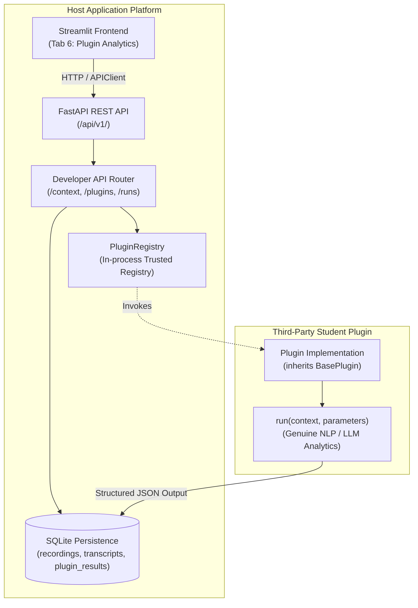

# CS698B Video Transcription & Conversational Intelligence Platform
## Developer API and Plugin Integration Guide (Stage 1.6.1)

**Audience:** Visiting CS698B student teams developing conversational intelligence, dialogue analysis, summarization, or NLP plugins to integrate into the host application.  
**Host Application:** FastAPI REST backend (`backend.main`) + Streamlit presentation frontend (`frontend.streamlit_app`).  
**Environment:** Python 3.10+, SQLite persistence, local-first execution.

---

## 1. Architecture Overview

The host platform provides high-accuracy conversational speech transcription with multi-dimensional confidence analytics. The speech pipeline operates autonomously on local hardware (NVIDIA RTX 4090 GPU), applying:
1. Faster-Whisper Large-v3 ASR
2. Wav2Vec2 CTC acoustic forced alignment
3. NeMo MSDD speaker diarization with TitaNet embeddings
4. Word-level speaker attribution and isotonic confidence calibration



---

## 2. Host Application Responsibilities vs. Plugin Responsibilities

| Responsibility | Handled By Host Platform | Handled By Third-Party Plugin |
| :--- | :--- | :--- |
| **Media Ingestion & Audio Prep** | Ingests audio/video, normalizes to 16kHz mono WAV, extracts SHA-256 hash. | None. Receives `recording_id` and metadata. |
| **Speech Recognition & Diarization** | Executes Whisper, Wav2Vec2 alignment, and NeMo diarization. | None. Consumes finalized transcript tokens and speaker turns. |
| **Confidence Scoring & Calibration** | Computes acoustic likelihoods, calibrated probabilities, ECE, Brier score. | Consumes calibrated confidence for quality-weighting or risk filtering. |
| **Canonical Data Ownership** | Maintains immutable `recordings` and `transcripts` tables. | Stores analytical outputs strictly in `plugin_results`. Never mutates canonical transcript data. |
| **UI Presentation** | Renders main tabs, audio player, transcript view, and plugin extension tab. | Renders structured analysis results inside the dedicated Plugin tab. |

---

## 3. Plugin Integration Model

The host platform supports two integration modalities:

1. **In-Tree Trusted Plugin Module (Preferred for Course Integration):**
   - Implement a Python class inheriting from `backend.plugins.base.BasePlugin`.
   - Register it on application startup via `PluginRegistry.register(my_plugin_instance)`.
   - The plugin executes in-process and is automatically discoverable via the REST API and the host Streamlit UI.
2. **REST API Client Integration (External Process):**
   - External services or Jupyter notebooks query `GET /api/v1/recordings/{recording_id}/context` to fetch words, turns, and speakers.
   - Run external NLP models, and inspect results via standard HTTP calls.

---

## 4. Trusted Plugin Registration Procedure

To mount an in-process plugin inside the host platform:

1. Create a Python module under `app/plugins/` (e.g. `app/plugins/topic_analyzer.py`).
2. Implement a subclass of `BasePlugin`.
3. Register the plugin instance:
   ```python
   from backend.plugins.registry import PluginRegistry
   from plugins.topic_analyzer import TopicAnalyzerPlugin

   # Register instance with the host registry
   PluginRegistry.register(TopicAnalyzerPlugin())
   ```
4. On startup, the host automatically exposes the plugin to `/api/v1/plugins` and mounts it in Streamlit Tab 6.

---

## 5. `BasePlugin` Contract

Every in-process plugin must inherit from [`BasePlugin`](file:///home/priyanka/chaitanya/Video-Transcription-with-Confidence-Analytics/app/backend/plugins/base.py) defined in `backend.plugins.base`:

```python
from abc import ABC, abstractmethod
from typing import Any, Dict
from engine.schemas import PluginContextResponse, PluginManifest

class BasePlugin(ABC):
    """Abstract interface defining the contract for trusted in-process plugins."""

    @property
    @abstractmethod
    def manifest(self) -> PluginManifest:
        """Return the immutable manifest describing this plugin."""
        pass

    @abstractmethod
    def run(self, context: PluginContextResponse, parameters: Dict[str, Any]) -> Dict[str, Any]:
        """Execute plugin analysis over the provided recording context.

        Parameters
        ----------
        context : PluginContextResponse
            Consolidated recording and transcript context (words, turns, speakers, vocabulary).
        parameters : Dict[str, Any]
            Validated hyperparameter options for the run.

        Returns
        -------
        Dict[str, Any]
            Structured result payload (must be standard JSON-serializable).
        """
        pass
```

---

## 6. Plugin Manifest Schema

```python
class PluginManifest(BaseModel):
    plugin_id: str             # Alphanumeric identifier (e.g. "meeting-summarizer")
    name: str                  # Human-readable title
    version: str = "1.0.0"     # SemVer version string
    description: str           # Detailed functional description
    author: str                # Student team attribution
    capabilities: list[str]    # Features: ['summarization', 'action_items', 'topics']
    input_requirements: list[str] = ["transcript"]
    output_types: list[str] = ["json"]
    api_version: str = "1.0.0" # Host API version compatibility
    enabled: bool = True       # Whether visible in UI
```

---

## 7. Developer API Endpoints Reference

### 7.1 Recording Context
- **Endpoint:** `GET /api/v1/recordings/{recording_id}/context`
- **Description:** Returns the complete, consolidated data bundle needed by downstream analytics.
- **Response Model:** `PluginContextResponse`
- **Status Codes:** `200 OK`, `404 Not Found`.

**Sample Response:**
```json
{
  "recording_id": "b1b3f780-94e9-490d-89f8-52945b84b31b",
  "filename": "bwc_msdd_e2e.wav",
  "duration_seconds": 175.43,
  "status": "ready",
  "has_transcript": true,
  "speakers": ["SPEAKER_00", "SPEAKER_01"],
  "total_words": 420,
  "mean_confidence": 0.892,
  "turns": [
    {
      "turn_id": "turn_001",
      "speaker": "SPEAKER_00",
      "start": 1.25,
      "end": 4.50,
      "text": "Officer Davis arriving on scene at 4th and Main.",
      "words": [
        {
          "word": "Officer",
          "start": 1.25,
          "end": 1.65,
          "speaker": "SPEAKER_00",
          "confidence": 0.941,
          "raw_confidence": 0.932
        }
      ],
      "avg_confidence": 0.941
    }
  ],
  "vocabulary": ["Officer Davis", "Miranda warning"],
  "metadata": {
    "size_bytes": 5613824,
    "sha256": "3e9b1...",
    "created_at": "2026-11-07T12:00:00Z"
  }
}
```

### 7.2 Plugin Discovery
- **Endpoint:** `GET /api/v1/plugins`
- **Description:** Enumerates all registered, enabled plugins.
- **Response Model:** `list[PluginManifest]`
- **Status Codes:** `200 OK`.

### 7.3 Unambiguous Job Status Retrieval
- **Endpoint:** `GET /api/v1/jobs/{job_id}`
- **Description:** Queries task progress strictly using `job_id`. Rejects `recording_id`.
- **Response Model:** `JobStatusResponse`
- **Status Codes:** `200 OK`, `404 Not Found`.

### 7.4 Plugin Run Dispatch
- **Endpoint:** `POST /api/v1/plugins/{plugin_id}/runs`
- **Request Body:**
  ```json
  {
    "recording_id": "b1b3f780-94e9-490d-89f8-52945b84b31b",
    "parameters": {
      "summary_length": "concise",
      "include_timestamps": true
    }
  }
  ```
- **Response Model:** `PluginAnalysisResult`
- **Status Codes:** `200 OK`, `400 Bad Request` (e.g. untranscribed recording), `404 Not Found`, `500 Internal Server Error`.

### 7.5 Plugin Result Retrieval
- **Endpoint:** `GET /api/v1/plugins/{plugin_id}/results/{recording_id}`
- **Description:** Retrieves the latest computed output for a plugin and recording.
- **Response Model:** `PluginAnalysisResult`
- **Status Codes:** `200 OK`, `404 Not Found`.

### 7.6 Typed Confidence Analytics
- **Endpoint:** `GET /api/v1/analytics/{recording_id}`
- **Response Model:** `AnalyticsResponse`
- **Status Codes:** `200 OK`, `404 Not Found`.

---

## 8. Concrete Reference Implementation Example

Here is a complete, working example of a dialogue action-item extractor plugin computing genuine metrics:

```python
# app/plugins/action_item_plugin.py
from typing import Any, Dict
from backend.plugins.base import BasePlugin
from engine.schemas import PluginContextResponse, PluginManifest


class ActionItemExtractorPlugin(BasePlugin):
    """Deterministic conversational plugin detecting task commitments and speaker turn density."""

    @property
    def manifest(self) -> PluginManifest:
        return PluginManifest(
            plugin_id="action-item-extractor",
            name="Conversational Action Item Extractor",
            version="1.0.0",
            description="Identifies actionable commitments (e.g. 'will follow up', 'need to check') across speaker turns.",
            author="Student Team 2",
            capabilities=["action_items", "turn_density"],
            input_requirements=["transcript"],
            output_types=["json"],
            api_version="1.0.0",
            enabled=True,
        )

    def run(self, context: PluginContextResponse, parameters: Dict[str, Any]) -> Dict[str, Any]:
        if not context.has_transcript or not context.transcript:
            raise ValueError("No transcript available.")

        trigger_phrases = ["will do", "will check", "follow up", "need to", "action item", "please review"]
        action_items = []

        for turn in context.turns:
            text_lower = turn.text.lower()
            for trigger in trigger_phrases:
                if trigger in text_lower:
                    action_items.append({
                        "speaker": turn.speaker,
                        "timestamp": turn.start,
                        "text": turn.text,
                        "detected_trigger": trigger,
                        "avg_turn_confidence": turn.avg_confidence,
                    })
                    break

        return {
            "recording_id": context.recording_id,
            "filename": context.filename,
            "total_action_items": len(action_items),
            "action_items": action_items,
            "speaker_turn_count": len(context.turns),
            "mean_transcript_confidence": context.mean_confidence,
        }
```

---

## 9. Streamlit Host Integration (Tab 6)

In the host Streamlit dashboard (`app/frontend/streamlit_app.py`), Tab 6 is named:  
`🧩 Conversational Intelligence (Plugin)`

### How Tab 6 Operates:
1. **Dynamic Discovery:** Calls `client.list_plugins()`. If no plugins are registered, it displays a static guidance notice.
2. **Interactive Selection:** When one or more plugins are registered, a dropdown allows the user to select the active plugin and inspect its manifest.
3. **Execution Control:** Clicking `🚀 Run Plugin Analysis` dispatches the execution request to `POST /api/v1/plugins/{plugin_id}/runs`.
4. **Structured Display:** Displays results using native Streamlit components (`st.json`, metrics, or custom visual cards) with genuine execution timings.
5. **No Synthetic Analytics:** When no plugin is installed or no analysis has been run for the selected recording, Tab 6 shows a clear informative notice rather than mock charts.

---

## 10. Security and Trust Boundaries

- **No Remote Code Execution:** The host platform does not dynamically import Python files from external network sources or parse arbitrary untrusted strings with `eval()` or `exec()`.
- **In-Process Privilege:** Registered in-process plugins run with the host process's privileges. Only trusted code authored by student teams should be registered.
- **Subsystem Isolation:** Plugins do not receive direct SQLite connection objects or GPU inference semaphores.
- **Transcript Immutability:** Plugins store outputs strictly in the `plugin_results` table. The host's `transcripts` table and filesystem results are strictly read-only for plugins.
- **Error Redaction:** Plugin runtime exceptions are intercepted, logged securely, and scrubbed of any secret tokens or host system paths before returning to the client.

---

## 11. Local Testing and Verification

To verify your plugin implementation:
```bash
# Activate course conda environment
conda activate cs698b_phase20

# Run developer API test suite
pytest app/tests/test_developer_api.py -v

# Run full application regression suite
pytest app/tests/ -v
```

All automated tests use an isolated temporary database (`test_app.db`) and temporary storage directories. No test execution will touch the live production database or files.
