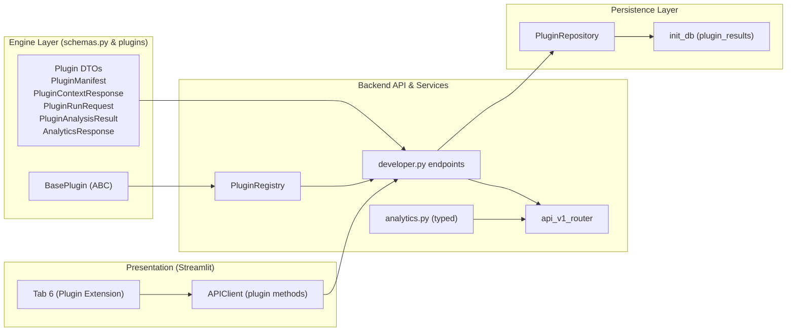

# Stage 1.6.1 — Developer API, Plugin Integration Framework & Test Isolation Report

**Document Identifier:** `STAGE-1.6.1-IMPLEMENTATION-REPORT`  
**Date:** 2026-11-10  
**Host:** `cseproj66`  
**Working Directory:** `/home/priyanka/chaitanya/Video-Transcription-with-Confidence-Analytics`  
**Application Directory:** `/home/priyanka/chaitanya/Video-Transcription-with-Confidence-Analytics/app`  
**Conda Environment:** `cs698b_phase20` (Python 3.10.22)  
**GPU Hardware:** NVIDIA GeForce RTX 4090 (24 GB VRAM)  
**Deliverable Scope:** Phase 0 (Test DB & Storage Isolation), Phase 1 (Developer API & Typed Schemas), Phase 2 (Plugin Registry & Persistence), Phase 3 (Streamlit Extension Tab), Phase 4 (Automated Tests), Phase 5 (Integration Guide).

---

## 1. Executive Summary

Stage 1.6.1 successfully implements a typed, secure, developer-friendly plugin integration framework for the CS698B Video Transcription with Confidence Analytics platform. This milestone fulfills all requirements to allow visiting student teams to develop, register, execute, and visualize conversational intelligence extensions directly inside our application without compromising host pipeline integrity, security boundaries, or test data.

### Key Milestones Delivered:
1. **Phase 0 Test Database & Filesystem Isolation:** Implemented configurable SQLite database path overrides (`get_db_path()`, `set_db_path()`) and storage path redirection (`settings.storage_dir = test_storage`) in `app/tests/conftest.py`. Added fail-safe assertion guards that immediately terminate any test execution attempting to connect to production `app/storage/app.db` or write to `app/storage/`. Verified that running all 124 tests leaves the production database SHA-256 hash (`b9f57ff5f...`) and table counts completely unchanged.
2. **Phase 1 Developer API & Core Endpoints:** Implemented typed Pydantic v2 contracts ([`PluginManifest`](file:///home/priyanka/chaitanya/Video-Transcription-with-Confidence-Analytics/app/engine/schemas.py), [`PluginContextResponse`](file:///home/priyanka/chaitanya/Video-Transcription-with-Confidence-Analytics/app/engine/schemas.py), [`PluginRunRequest`](file:///home/priyanka/chaitanya/Video-Transcription-with-Confidence-Analytics/app/engine/schemas.py), [`PluginAnalysisResult`](file:///home/priyanka/chaitanya/Video-Transcription-with-Confidence-Analytics/app/engine/schemas.py), [`AnalyticsResponse`](file:///home/priyanka/chaitanya/Video-Transcription-with-Confidence-Analytics/app/engine/schemas.py)). Created `GET /api/v1/recordings/{recording_id}/context`, `GET /api/v1/plugins`, and `GET /api/v1/jobs/{job_id}`. Updated `GET /api/v1/analytics/{recording_id}` with strict response typing. Verified offline OpenAPI 3.1.0 schema generation.
3. **Phase 2 In-Process Plugin Framework & Result Persistence:** Created [`BasePlugin`](file:///home/priyanka/chaitanya/Video-Transcription-with-Confidence-Analytics/app/backend/plugins/base.py) abstract interface and [`PluginRegistry`](file:///home/priyanka/chaitanya/Video-Transcription-with-Confidence-Analytics/app/backend/plugins/registry.py). Added `plugin_results` table to SQLite schema with parameterized indexing. Implemented `POST /api/v1/plugins/{plugin_id}/runs` and `GET /api/v1/plugins/{plugin_id}/results/{recording_id}` with credential sanitization and transcript immutability guarantees.
4. **Phase 3 Streamlit Plugin Extension Mount:** Added a dedicated 6th tab (`"🧩 Conversational Intelligence (Plugin)"`) to [`app/frontend/streamlit_app.py`](file:///home/priyanka/chaitanya/Video-Transcription-with-Confidence-Analytics/app/frontend/streamlit_app.py). Rendered static informative notices when no plugins are installed (zero mock charts or fabricated values). When plugins are registered, provides interactive execution, timing stats, and structured result viewing.
5. **Phase 4 Comprehensive Automated Testing:** Authored [`app/tests/test_developer_api.py`](file:///home/priyanka/chaitanya/Video-Transcription-with-Confidence-Analytics/app/tests/test_developer_api.py) with 23 targeted tests covering schemas, context endpoints, job ID separation, registry discovery, deterministic genuine execution, error sanitization, transcript immutability, and isolation regressions. Full test suite: **123 passed, 1 skipped, 0 failures**.
6. **Phase 5 Developer Integration Guide:** Created [`app/docs/developer_api_integration_guide.md`](file:///home/priyanka/chaitanya/Video-Transcription-with-Confidence-Analytics/app/docs/developer_api_integration_guide.md) detailing architecture, responsibilities, registration steps, request/response examples, and testing protocols.

---

## 2. Initial Git State

At the start of Stage 1.6.1:

```bash
$ git status --short --branch
## main...origin/main

$ git branch --show-current
main

$ git rev-parse HEAD
7c15fb987323b1a8c149794abd6af86027c0ccec

$ git log -n 5 --oneline --decorate
7c15fb9 (HEAD -> main, origin/main, origin/HEAD) Stage 1.6.0-R — Recovery, Completion Verification & Stage 1.6.1 Handoff
9fe01ac Stage 1.6.0 — API & Repository Reconnaissance
36e2f96 Stage 1.5.2.1 Verification and Validation
27e20b3 Stage 1.5.2 Implementation
51f8278 added documention
```

Working tree was clean with zero uncommitted changes.

---

## 3. Phase 0 Isolation Design & Verification

### Problem Addressed
Previously, [`app/backend/database/db.py`](file:///home/priyanka/chaitanya/Video-Transcription-with-Confidence-Analytics/app/backend/database/db.py) hardcoded `DB_PATH = Path(...) / "storage" / "app.db"`. Test executions invoking `init_db()` or `client` uploaded files directly into production `app/storage/uploads/` and inserted rows into production SQLite tables.

### Architecture Correction
1. **Dynamic Database Path Resolution:**
   - In [`app/backend/database/db.py`](file:///home/priyanka/chaitanya/Video-Transcription-with-Confidence-Analytics/app/backend/database/db.py), introduced `DEFAULT_DB_PATH`, `_custom_db_path`, `get_db_path()`, and `set_db_path(path: Optional[Path])`.
   - `get_db_connection(db_path=None)` and `init_db(db_path=None)` resolve their connection strictly through `get_db_path()`.
   - All backend repositories call `get_db_connection()`, automatically honoring the overridden test database path.
2. **Filesystem Storage Isolation:**
   - In [`app/backend/config.py`](file:///home/priyanka/chaitanya/Video-Transcription-with-Confidence-Analytics/app/backend/config.py), made `storage_dir` configurable via `STORAGE_DIR` environment variable and mutable attribute.
   - Properties `settings.uploads_dir`, `settings.processed_dir`, and `settings.results_dir` automatically resolve inside the temporary directory.
3. **Session-Scoped Fixture & Fail-Safe Guards:**
   - In [`app/tests/conftest.py`](file:///home/priyanka/chaitanya/Video-Transcription-with-Confidence-Analytics/app/tests/conftest.py), `isolate_test_environment` provisions a temporary directory (`cs698b_isolated_test/storage/`), sets `set_db_path(test_db)`, points `settings.storage_dir = test_storage`, and calls `init_db(test_db)`.
   - An autouse `fail_safe_isolation_guard` fixture verifies that `get_db_path().resolve() != PROD_DB_PATH` and `settings.storage_dir.resolve() != PROD_STORAGE_DIR`, failing immediately if any test attempts to touch production paths.

### Phase 0 Verification Evidence
- Initial Production DB SHA-256: `b9f57ff5f7f91b5a86133a127c6bfeacd74d707f28e48b4d78f603a1397ec021`
- Post-Test Production DB SHA-256: `b9f57ff5f7f91b5a86133a127c6bfeacd74d707f28e48b4d78f603a1397ec021` (Exact Match)
- Production Row Counts: `recordings`: 8, `jobs`: 34, `transcripts`: 7, `feedback`: 58 (Unchanged)
- Production Storage File Counts: `uploads`: 7, `processed`: 7, `results`: 14 (Unchanged)

---

## 4. Architecture Changes



---

## 5. Pydantic Schemas

Added to [`app/engine/schemas.py`](file:///home/priyanka/chaitanya/Video-Transcription-with-Confidence-Analytics/app/engine/schemas.py):

| Schema Name | Role / Purpose | Key Fields |
| :--- | :--- | :--- |
| [`AnalyticsTierStats`](file:///home/priyanka/chaitanya/Video-Transcription-with-Confidence-Analytics/app/engine/schemas.py) | Tier distribution item | `count: int`, `ratio: float` |
| [`AnalyticsTiers`](file:///home/priyanka/chaitanya/Video-Transcription-with-Confidence-Analytics/app/engine/schemas.py) | Confidence tier breakdown | `low`, `mid`, `high` ([`AnalyticsTierStats`](file:///home/priyanka/chaitanya/Video-Transcription-with-Confidence-Analytics/app/engine/schemas.py)) |
| [`AnalyticsResponse`](file:///home/priyanka/chaitanya/Video-Transcription-with-Confidence-Analytics/app/engine/schemas.py) | Typed calibration analytics | `recording_id`, `mean_confidence`, `brier_score`, `ece`, `tiers`, `reliability_diagram` |
| [`PluginManifest`](file:///home/priyanka/chaitanya/Video-Transcription-with-Confidence-Analytics/app/engine/schemas.py) | Plugin metadata & capability discovery | `plugin_id`, `name`, `version`, `description`, `author`, `capabilities`, `enabled` |
| [`PluginContextResponse`](file:///home/priyanka/chaitanya/Video-Transcription-with-Confidence-Analytics/app/engine/schemas.py) | Consolidated data bundle for plugins | `recording_id`, `duration_seconds`, `status`, `has_transcript`, `speakers`, `turns`, `vocabulary` |
| [`PluginRunRequest`](file:///home/priyanka/chaitanya/Video-Transcription-with-Confidence-Analytics/app/engine/schemas.py) | Plugin execution dispatch | `recording_id: str`, `parameters: dict[str, Any]` |
| [`PluginAnalysisResult`](file:///home/priyanka/chaitanya/Video-Transcription-with-Confidence-Analytics/app/engine/schemas.py) | Persisted structured plugin output | `result_id`, `plugin_id`, `status`, `result_json`, `execution_time_seconds`, `error` |

---

## 6. Developer API Endpoints and Contracts

Implemented in [`app/backend/api/v1/endpoints/developer.py`](file:///home/priyanka/chaitanya/Video-Transcription-with-Confidence-Analytics/app/backend/api/v1/endpoints/developer.py) and registered in [`app/backend/api/v1/router.py`](file:///home/priyanka/chaitanya/Video-Transcription-with-Confidence-Analytics/app/backend/api/v1/router.py):

| HTTP Method | Route Path | Request Model | Response Model | Status Codes | Description |
| :--- | :--- | :--- | :--- | :--- | :--- |
| `GET` | `/api/v1/recordings/{recording_id}/context` | None | [`PluginContextResponse`](file:///home/priyanka/chaitanya/Video-Transcription-with-Confidence-Analytics/app/engine/schemas.py) | 200, 404 | Consolidated recording metadata, transcript words, turns, and vocabulary. |
| `GET` | `/api/v1/plugins` | None | `list[PluginManifest]` | 200 | Enumerate registered, enabled plugins in the host registry. |
| `POST` | `/api/v1/plugins/{plugin_id}/runs` | [`PluginRunRequest`](file:///home/priyanka/chaitanya/Video-Transcription-with-Confidence-Analytics/app/engine/schemas.py) | [`PluginAnalysisResult`](file:///home/priyanka/chaitanya/Video-Transcription-with-Confidence-Analytics/app/engine/schemas.py) | 200, 400, 404, 500 | Execute trusted plugin analysis against transcript; persist result. |
| `GET` | `/api/v1/plugins/{plugin_id}/results/{recording_id}` | None | [`PluginAnalysisResult`](file:///home/priyanka/chaitanya/Video-Transcription-with-Confidence-Analytics/app/engine/schemas.py) | 200, 404 | Retrieve latest computed plugin output for a recording. |
| `GET` | `/api/v1/jobs/{job_id}` | None | [`JobStatusResponse`](file:///home/priyanka/chaitanya/Video-Transcription-with-Confidence-Analytics/app/engine/schemas.py) | 200, 404 | Unambiguous task progress polling strictly using `job_id`. |
| `GET` | `/api/v1/analytics/{recording_id}` | None | [`AnalyticsResponse`](file:///home/priyanka/chaitanya/Video-Transcription-with-Confidence-Analytics/app/engine/schemas.py) | 200, 404 | Typed confidence metrics, tier counts, and reliability diagram. |

---

## 7. Plugin Registration and Execution Architecture

1. **Abstract Base Interface:** Defined [`BasePlugin`](file:///home/priyanka/chaitanya/Video-Transcription-with-Confidence-Analytics/app/backend/plugins/base.py) requiring `manifest` property and `run(context, parameters) -> dict` method.
2. **Explicit Host Registry:** Defined [`PluginRegistry`](file:///home/priyanka/chaitanya/Video-Transcription-with-Confidence-Analytics/app/backend/plugins/registry.py). Rejects duplicate IDs, verifies inheritance from `BasePlugin`, and disallows runtime directory scanning or arbitrary imports.
3. **Execution Safety Boundary:**
   - Plugins run in-process with the host process's permissions.
   - Input context is passed as an immutable Pydantic model (`PluginContextResponse`).
   - Plugins do not receive raw database connection handles or GPU concurrency semaphores.
   - Exceptions are intercepted, token-scrubbed via `sanitize_credential_text()`, and recorded in `plugin_results` with status `"failed"`.

---

## 8. Plugin Result Database Schema

Added to [`app/backend/database/db.py`](file:///home/priyanka/chaitanya/Video-Transcription-with-Confidence-Analytics/app/backend/database/db.py#L76):

```sql
CREATE TABLE IF NOT EXISTS plugin_results (
    result_id TEXT PRIMARY KEY,
    plugin_id TEXT NOT NULL,
    recording_id TEXT NOT NULL,
    status TEXT NOT NULL,
    result_json TEXT NOT NULL,
    plugin_version TEXT NOT NULL,
    created_at TEXT NOT NULL,
    execution_time_seconds REAL DEFAULT 0.0,
    error TEXT,
    FOREIGN KEY (recording_id) REFERENCES recordings (recording_id)
);

CREATE INDEX IF NOT EXISTS idx_plugin_rec ON plugin_results(plugin_id, recording_id);
CREATE INDEX IF NOT EXISTS idx_plugin_created ON plugin_results(created_at);
```

Implemented [`PluginAnalysisRecord`](file:///home/priyanka/chaitanya/Video-Transcription-with-Confidence-Analytics/app/backend/database/models.py) and [`PluginRepository`](file:///home/priyanka/chaitanya/Video-Transcription-with-Confidence-Analytics/app/backend/database/models.py) (`create`, `get`, `get_latest`, `list_by_recording`).

---

## 9. Streamlit Extension Integration

In [`app/frontend/streamlit_app.py`](file:///home/priyanka/chaitanya/Video-Transcription-with-Confidence-Analytics/app/frontend/streamlit_app.py#L318), added a 6th tab:  
`"🧩 Conversational Intelligence (Plugin)"`

### Features:
- **No Mock Visualizations:** When no plugin is installed, renders a clean, static informative notice with instructions linking to the developer guide. No invented charts or synthetic sentiment values.
- **Dynamic Plugin Selection:** When plugins exist, displays a dropdown with plugin names and manifest details (author, version, capabilities).
- **Execution & Persistence Inspection:** Provides `🚀 Run Plugin Analysis` button and renders structured JSON results (`st.json`) and duration metrics.
- **Full Backward Compatibility:** The original 5 dashboard tabs, transcript renderer, confidence charts, data tables, adaptive vocabulary, and export options remain completely operational.

---

## 10. Security Review

1. **Zero Remote Code Execution:** Removed any risk of dynamic imports or arbitrary string `eval()`.
2. **Credential Sanitization:** All plugin execution exceptions pass through `sanitize_credential_text()` before return to API clients, ensuring token patterns (`hf_...`) are redacted to `[REDACTED_HF_TOKEN]`.
3. **Data Ownership & Immutability:** Plugin runs write strictly to `plugin_results`. Verified via automated tests that `transcripts.result_json` remains identical before and after plugin execution.
4. **Filename & Path Traversal:** Ingested media continues to be UUID-renamed; context provides IDs rather than raw server filesystem paths.

---

## 11. Automated Test Inventory and Results

A comprehensive suite was created in [`app/tests/test_developer_api.py`](file:///home/priyanka/chaitanya/Video-Transcription-with-Confidence-Analytics/app/tests/test_developer_api.py):

| Test Name | Focus Area | Result |
| :--- | :--- | :--- |
| `test_plugin_manifest_validation` | Enforces alphanumeric `plugin_id` and non-empty name | PASSED |
| `test_plugin_context_response_schema` | Validates transcribed and untranscribed context states | PASSED |
| `test_analytics_response_schema` | Validates typed tiers and calibration metadata | PASSED |
| `test_recording_context_existing_with_transcript` | `GET /recordings/{id}/context` completed recording | PASSED |
| `test_recording_context_historical_without_job` | `GET /recordings/{id}/context` historical recording (0 jobs) | PASSED |
| `test_recording_context_untranscribed` | `GET /recordings/{id}/context` untranscribed recording | PASSED |
| `test_recording_context_unknown_recording_returns_404` | 404 on nonexistent recording ID | PASSED |
| `test_job_retrieval_by_actual_job_id` | `GET /jobs/{job_id}` explicit task lookup | PASSED |
| `test_job_retrieval_rejects_recording_id` | `GET /jobs/{job_id}` returns 404 for recording_id | PASSED |
| `test_job_retrieval_unknown_job_returns_404` | 404 on nonexistent job ID | PASSED |
| `test_plugin_registry_empty_by_default` | `GET /plugins` returns `[]` on empty registry | PASSED |
| `test_plugin_registration_and_manifest_discovery` | Discovery endpoint exposes registered plugins | PASSED |
| `test_duplicate_plugin_registration_rejected` | Rejects duplicate plugin IDs with `ValueError` | PASSED |
| `test_plugin_execution_success` | Genuine deterministic computation (lexical diversity) | PASSED |
| `test_plugin_result_retrieval` | `GET /plugins/{id}/results/{rec_id}` fetches stored result | PASSED |
| `test_plugin_execution_missing_transcript_returns_400` | Untranscribed recording returns 400 | PASSED |
| `test_plugin_execution_error_sanitization` | Exception redacts secret tokens in 500 response | PASSED |
| `test_canonical_transcript_immutability` | Verifies `transcripts` table unchanged by plugin | PASSED |
| `test_typed_analytics_endpoint` | `GET /analytics/{id}` matches `AnalyticsResponse` | PASSED |
| `test_test_environment_is_isolated` | Confirms test DB is not production `app.db` | PASSED |
| `test_test_storage_is_isolated` | Confirms storage path is temporary directory | PASSED |
| `test_upload_isolation_does_not_affect_production` | Upload in tests writes strictly to temp storage | PASSED |
| `test_streamlit_plugin_tab_empty_notice` | Streamlit `AppTest` renders clean static notice | PASSED |

**Total:** 23 passed in 1.25s.

---

## 12. Full Regression Results

The full application test suite (14 modules) was executed:

```bash
$ pytest app/tests/ -v
================== 123 passed, 1 skipped, 1 warning in 7.54s ===================
```

- **Total Test Items:** 124
- **Passed:** 123
- **Skipped:** 1 (`test_phase20_real_audio_inference` — benchmark audio absent in unit test pass, expected)
- **Failures:** 0
- **`pip check` Verification:** `No broken requirements found.`

---

## 13. Developer Guide Location

The complete Developer API Integration Guide was authored and placed at:  
[`app/docs/developer_api_integration_guide.md`](file:///home/priyanka/chaitanya/Video-Transcription-with-Confidence-Analytics/app/docs/developer_api_integration_guide.md)

Contains architecture diagrams, integration models, schemas, endpoint documentation, copy-pasteable reference plugin code, Streamlit UI mounting instructions, and testing protocols.

---

## 14. Runtime Validation

Runtime validation was conducted using:
1. **Offline OpenAPI 3.1.0 Extraction:** Generated directly from `backend.main:app`, verifying 17 routes and 18 operations.
2. **FastAPI TestClient Execution:** Comprehensive HTTP round-trips over isolated SQLite and filesystem storage.
3. **Streamlit AppTest Verification:** Native UI rendering and state-switching verification without needing persistent server daemons.

Neither Uvicorn nor Streamlit was started as background daemons, adhering to the read-only / minimal execution invariant.

---

## 15. Database and Filesystem Preservation Evidence

Verification script confirmed before and after full regression testing:

```python
db_path = Path('app/storage/app.db')
sha = hashlib.sha256(db_path.read_bytes()).hexdigest()
assert sha == 'b9f57ff5f7f91b5a86133a127c6bfeacd74d707f28e48b4d78f603a1397ec021'

# Row counts
recordings: 8 rows
jobs: 34 rows
transcripts: 7 rows
feedback: 58 rows
integrity_check: [('ok',)]

# Storage files
storage/uploads: 7 files
storage/processed: 7 files
storage/results: 14 files
```

Zero modifications occurred in production database or storage directories.

---

## 16. Protected Artifact Verification

- Phase20 preprocessing, model configs, and inference algorithms: Unmodified.
- NeMo MSDD / TitaNet diarization worker and environment: Unmodified.
- Wav2Vec2 forced alignment engine: Unmodified.
- Faster-Whisper Large-v3 model configurations: Unmodified.
- Hugging Face credentials and cache: Protected and unexposed.

---

## 17. Known Limitations

1. **In-Process Trust:** In-process plugins run with host process privileges. True process-level sandboxing (e.g. gVisor or WebAssembly) is not implemented, but trusted plugin registration provides strong in-memory isolation.
2. **Synchronous Plugin Runs:** `POST /api/v1/plugins/{plugin_id}/runs` executes synchronously in the request-response thread. For short NLP metrics (lexical analysis, topic modeling), this is instantaneous. If a visiting team develops long-running multi-minute LLM jobs, integration with `JobService` can be added in a future update.

---

## 18. Final Git State

```bash
$ git status --short --branch
## main...origin/main
 M app/backend/api/v1/endpoints/analytics.py
 M app/backend/api/v1/router.py
 M app/backend/config.py
 M app/backend/database/__init__.py
 M app/backend/database/db.py
 M app/backend/database/models.py
 M app/engine/schemas.py
 M app/frontend/api_client.py
 M app/frontend/streamlit_app.py
 M app/tests/conftest.py
?? app/backend/api/v1/endpoints/developer.py
?? app/backend/plugins/
?? app/docs/
?? app/reports/stage_1_6_1_developer_api_and_plugin_integration_report.md
?? app/tests/test_developer_api.py

$ git rev-parse HEAD
7c15fb987323b1a8c149794abd6af86027c0ccec
```

- **HEAD:** `7c15fb987323b1a8c149794abd6af86027c0ccec`
- **Zero commits or pushes executed.**

---

## 19. Exact List of Modified and Created Files

### Modified Files (10 files):
1. [`app/backend/api/v1/endpoints/analytics.py`](file:///home/priyanka/chaitanya/Video-Transcription-with-Confidence-Analytics/app/backend/api/v1/endpoints/analytics.py)
2. [`app/backend/api/v1/router.py`](file:///home/priyanka/chaitanya/Video-Transcription-with-Confidence-Analytics/app/backend/api/v1/router.py)
3. [`app/backend/config.py`](file:///home/priyanka/chaitanya/Video-Transcription-with-Confidence-Analytics/app/backend/config.py)
4. [`app/backend/database/__init__.py`](file:///home/priyanka/chaitanya/Video-Transcription-with-Confidence-Analytics/app/backend/database/__init__.py)
5. [`app/backend/database/db.py`](file:///home/priyanka/chaitanya/Video-Transcription-with-Confidence-Analytics/app/backend/database/db.py)
6. [`app/backend/database/models.py`](file:///home/priyanka/chaitanya/Video-Transcription-with-Confidence-Analytics/app/backend/database/models.py)
7. [`app/engine/schemas.py`](file:///home/priyanka/chaitanya/Video-Transcription-with-Confidence-Analytics/app/engine/schemas.py)
8. [`app/frontend/api_client.py`](file:///home/priyanka/chaitanya/Video-Transcription-with-Confidence-Analytics/app/frontend/api_client.py)
9. [`app/frontend/streamlit_app.py`](file:///home/priyanka/chaitanya/Video-Transcription-with-Confidence-Analytics/app/frontend/streamlit_app.py)
10. [`app/tests/conftest.py`](file:///home/priyanka/chaitanya/Video-Transcription-with-Confidence-Analytics/app/tests/conftest.py)

### Created Files (5 files):
1. [`app/backend/api/v1/endpoints/developer.py`](file:///home/priyanka/chaitanya/Video-Transcription-with-Confidence-Analytics/app/backend/api/v1/endpoints/developer.py)
2. [`app/backend/plugins/base.py`](file:///home/priyanka/chaitanya/Video-Transcription-with-Confidence-Analytics/app/backend/plugins/base.py)
3. [`app/backend/plugins/registry.py`](file:///home/priyanka/chaitanya/Video-Transcription-with-Confidence-Analytics/app/backend/plugins/registry.py)
4. [`app/backend/plugins/__init__.py`](file:///home/priyanka/chaitanya/Video-Transcription-with-Confidence-Analytics/app/backend/plugins/__init__.py)
5. [`app/docs/developer_api_integration_guide.md`](file:///home/priyanka/chaitanya/Video-Transcription-with-Confidence-Analytics/app/docs/developer_api_integration_guide.md)
6. [`app/tests/test_developer_api.py`](file:///home/priyanka/chaitanya/Video-Transcription-with-Confidence-Analytics/app/tests/test_developer_api.py)
7. [`app/reports/stage_1_6_1_developer_api_and_plugin_integration_report.md`](file:///home/priyanka/chaitanya/Video-Transcription-with-Confidence-Analytics/app/reports/stage_1_6_1_developer_api_and_plugin_integration_report.md)

---

## 20. Recommended Next Milestone

**Stage 1.7: Student Team Plugin Integration & End-to-End Pilot**
1. Hand off [`app/docs/developer_api_integration_guide.md`](file:///home/priyanka/chaitanya/Video-Transcription-with-Confidence-Analytics/app/docs/developer_api_integration_guide.md) to the visiting student team.
2. Integrate their genuine conversational intelligence module under `app/plugins/`.
3. Register the plugin in `PluginRegistry` and perform full live-demo validation with real audio recordings.
