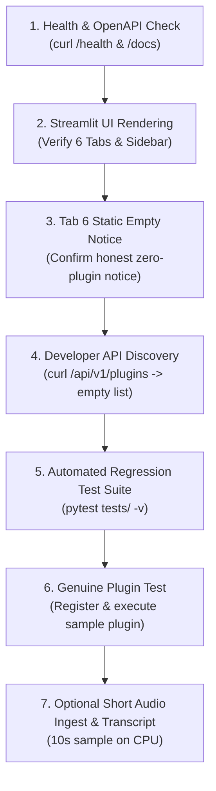

# CS698B Video Transcription & Conversational Intelligence Platform
## Local Deployment Readiness Guide & Runbook (Windows 11 + WSL2 Ubuntu + RTX 3050 4GB)

**Document Identifier:** `STAGE-1.6.1-LOCAL-DEPLOYMENT-GUIDE`  
**Date:** 2026-11-10  
**Target Architecture:** Local Developer Laptop (Windows 11 + WSL2 Ubuntu)  
**Host GPU:** NVIDIA GeForce RTX 3050 Laptop GPU (4096 MiB VRAM)  
**Host NVIDIA Driver:** 596.36 (Driver CUDA capability: 13.2)  
**Primary Application Root:** `app/`  
**Execution Context:** Local-first FastAPI backend + Streamlit frontend + SQLite + Developer API

---

## 1. Local Hardware & Target Environment Summary

| Hardware / Subsystem | Host Specification | Operational Constraint / Role |
| :--- | :--- | :--- |
| **Operating System** | Windows 11 Home/Pro (Build 22621+) | Host OS running WSL2 virtualized Linux container. |
| **Linux Environment** | WSL2 Ubuntu 22.04 LTS or 24.04 LTS | Primary POSIX runtime for application, Python, and PyTorch. |
| **GPU Hardware** | NVIDIA GeForce RTX 3050 Laptop GPU | 4096 MiB (4 GB) dedicated GDDR6 VRAM. |
| **NVIDIA Windows Driver** | Version 596.36 | Provides direct CUDA passthrough into WSL2 via `/usr/lib/wsl/lib`. |
| **CUDA Driver Support** | Up to CUDA 13.2 | Driver runtime compatibility; PyTorch will target stable CUDA 12.4. |
| **Memory Constraint** | **Strict 4 GB VRAM Ceiling** | **Cannot run full Whisper Large-v3 + NeMo MSDD concurrently on GPU.** CPU-first execution recommended for full stability. |

---

## 2. Runtime Platform Evaluation: WSL2 Ubuntu vs. Native Windows

### Architectural Decision: Deploy Exclusively Inside WSL2 Ubuntu

Running the application under **WSL2 Ubuntu** is strongly recommended over native Windows Python for the following reasons verified from the codebase:

1. **NeMo Diarization Worker Subprocess:**  
   [app/engine/nemo_diarizer.py](file:///home/priyanka/chaitanya/Video-Transcription-with-Confidence-Analytics/app/engine/nemo_diarizer.py#L20-L25) relies on spawning an isolated worker (`python -m engine.diarization_worker`) with POSIX process semantics, RTTM manifest creation, and Linux path handling. NVIDIA NeMo has severe build and runtime incompatibilities on native Windows (Cython extensions, `sox`, and `soundfile` backends).
2. **FFmpeg Subprocess Audio Pipeline:**  
   [`AudioService.prepare_16k_mono_audio()`](file:///home/priyanka/chaitanya/Video-Transcription-with-Confidence-Analytics/app/backend/services/audio_service.py#L114-L144) invokes `ffmpeg` with audio normalization filters (`loudnorm=I=-20:LRA=11:TP=-1.5`). On WSL2, FFmpeg is native, standard, and fast via `apt install ffmpeg`, avoiding Windows PATH and binary wrapper inconsistencies.
3. **PyTorch & Audio Wheel Compatibility:**  
   Pre-compiled PyTorch wheels with CUDA support (`torch==2.5.1+cu124`) install seamlessly on Linux with complete `torchaudio` and `pyannote.audio` support, whereas Windows PyTorch often suffers from compilation hurdles with speech dependencies (`torch-audiomentations`, `asteroid-filterbanks`).
4. **Zero Driver Installation Required in WSL2:**  
   Windows driver 596.36 automatically passes NVIDIA GPU access to WSL2 via the DirectX / WSL driver bridge (`/usr/lib/wsl/lib/libcuda.so`). **Never install the Linux NVIDIA display driver inside WSL2**, which would break the WSL2 GPU bridge.

---

## 3. Safe Source Code Transfer Procedure (Remote $\to$ Local)

> [!CRITICAL]
> **Do not clone `origin/main` expecting Stage 1.6.1 code.**  
> The Stage 1.6.1 Developer API and Plugin integration changes on the remote server (`cseproj66`) are currently **uncommitted** to prevent unreviewed Git history pollution. Simply running `git clone` will yield only Stage 1.6.0.

Follow this safe archive-based procedure to transfer the exact verified codebase to your local machine **without exposing credentials or copying live databases**:

### Step 3.1: Generate Clean Source Archive on Remote (`cseproj66`)

Execute on remote terminal:

```bash
cd /home/priyanka/chaitanya/Video-Transcription-with-Confidence-Analytics

# Create a clean archive excluding secrets, live database, user media, checkpoints, and caches
tar --exclude='app/.env' \
    --exclude='app/storage/*.db' \
    --exclude='app/storage/uploads/*' \
    --exclude='app/storage/processed/*' \
    --exclude='app/storage/results/*' \
    --exclude='**/__pycache__' \
    --exclude='**/.pytest_cache' \
    --exclude='*.pyc' \
    -czvf /tmp/cs698b_stage_1_6_1_clean_source.tar.gz app/
```

### Step 3.2: Transfer Archive to Windows Laptop via SCP

Execute on your local Windows PowerShell or WSL2 terminal:

```bash
# In local WSL2 terminal (replace username and remote host if using SSH alias)
scp priyanka@cseproj66:/tmp/cs698b_stage_1_6_1_clean_source.tar.gz ~/
```

### Step 3.3: Extract Archive into Local Project Directory

Inside WSL2 terminal:

```bash
mkdir -p ~/projects/Video-Transcription-with-Confidence-Analytics
cd ~/projects/Video-Transcription-with-Confidence-Analytics
tar -xzvf ~/cs698b_stage_1_6_1_clean_source.tar.gz
rm ~/cs698b_stage_1_6_1_clean_source.tar.gz
```

Verify that `app/storage/app.db` and `app/.env` do **not** exist in your local extract:

```bash
ls -la app/storage/
# Should only show .gitkeep or empty directories (uploads, processed, results)
```

---

## 4. WSL2 Environment & Dependency Installation Runbook

Execute all subsequent commands inside your **WSL2 Ubuntu terminal**.

### Step 4.1: Verify WSL2 System Dependencies & FFmpeg

```bash
sudo apt update && sudo apt install -y \
    build-essential \
    ffmpeg \
    git \
    curl \
    wget \
    libasound2-dev \
    libsndfile1

# Verify FFmpeg is present
ffmpeg -version | head -n 1
```

### Step 4.2: Verify NVIDIA CUDA Passthrough in WSL2

```bash
nvidia-smi
```

*Expected Output:* You should see `NVIDIA GeForce RTX 3050 Laptop GPU`, Driver `596.36`, and `CUDA Version: 13.2` reported by the driver bridge.

### Step 4.3: Install Miniconda (If Not Already Present in WSL2)

```bash
if ! command -v conda &> /dev/null; then
    mkdir -p ~/miniconda3
    wget https://repo.anaconda.com/miniconda/Miniconda3-latest-Linux-x86_64.sh -O ~/miniconda3/miniconda.sh
    bash ~/miniconda3/miniconda.sh -b -u -p ~/miniconda3
    rm ~/miniconda3/miniconda.sh
    ~/miniconda3/bin/conda init bash
    source ~/.bashrc
fi
```

### Step 4.4: Create Isolated Conda Environment (`cs698b_local`)

```bash
conda create -y -n cs698b_local python=3.10.14
conda activate cs698b_local
```

### Step 4.5: Install PyTorch with CUDA 12.4 Support

> [!NOTE]
> Even though `nvidia-smi` reports driver capability up to CUDA 13.2, PyTorch builds target stable CUDA 12.4. NVIDIA drivers maintain complete backward runtime compatibility.

```bash
pip install --upgrade pip setuptools wheel
pip install torch==2.5.1 torchvision==0.20.1 torchaudio==2.5.1 --index-url https://download.pytorch.org/whl/cu124
```

Verify PyTorch CUDA detection in WSL2:

```bash
python -c "import torch; print('PyTorch Version:', torch.__version__); print('CUDA Available:', torch.cuda.is_available()); print('Device Name:', torch.cuda.get_device_name(0) if torch.cuda.is_available() else 'None')"
```

*Expected Output:*
```text
PyTorch Version: 2.5.1+cu124
CUDA Available: True
Device Name: NVIDIA GeForce RTX 3050 Laptop GPU
```

### Step 4.6: Install Host Application Dependencies

Navigate to your local application directory and install dependencies:

```bash
cd ~/projects/Video-Transcription-with-Confidence-Analytics/app

# Install base dependencies
pip install \
    "fastapi>=0.110.0" \
    "uvicorn>=0.28.0" \
    "pydantic>=2.6.0" \
    "pydantic-settings>=2.2.0" \
    "streamlit>=1.30.0" \
    "altair>=5.0.0" \
    "pandas>=2.0.0" \
    "numpy>=1.24.0" \
    "scipy>=1.10.0" \
    "soundfile>=0.12.0" \
    "requests>=2.31.0" \
    "python-multipart>=0.0.9" \
    "pyyaml>=6.0.0" \
    "pytest>=8.0.0" \
    "httpx>=0.27.0"

# Install speech inference & alignment dependencies
pip install "faster-whisper>=1.0.0"
pip install "pyannote.audio>=3.1.0"
```

Verify dependency tree health:

```bash
pip check
# Output must be: "No broken requirements found."
```

---

## 5. Local Configuration & Storage Setup

### Step 5.1: Create Local `.env` File

Copy the template:

```bash
cd ~/projects/Video-Transcription-with-Confidence-Analytics/app
cp .env.example .env
```

Edit `app/.env` to configure **CPU-first mode** for local stability on 4 GB VRAM:

```ini
# Local WSL2 Environment Configuration
APP_ENV=development
API_HOST=127.0.0.1
API_PORT=8000
FRONTEND_PORT=8501
API_URL=http://127.0.0.1:8000

# Local Storage (relative to app directory)
STORAGE_DIR=storage
MAX_UPLOAD_SIZE_MB=250
MAX_DURATION_SECONDS=1800

# ML Inference Configuration (CPU-First for Local 4GB Laptop Stability)
DEVICE=cpu
COMPUTE_TYPE=int8
WHISPER_MODEL=base

# Hugging Face Authentication (Optional; set if testing gated Pyannote VAD)
# HF_TOKEN=your_token_here
```

### Step 5.2: Initialize Local SQLite Database

Run the database initializer to create the local `app.db` with all tables (including `plugin_results`):

```bash
python -c "import sys; sys.path.insert(0, '.'); from backend.database.db import init_db; init_db(); print('Local SQLite database initialized successfully.')"
```

Verify local database tables:

```bash
python -c "import sqlite3; conn = sqlite3.connect('storage/app.db'); print('Tables:', [r[0] for r in conn.cursor().execute(\"SELECT name FROM sqlite_master WHERE type='table'\").fetchall()])"
```

*Expected Output:*
```text
Tables: ['recordings', 'jobs', 'transcripts', 'feedback', 'plugin_results']
```

---

## 6. Server Startup & Verification Sequence

Run the backend and frontend in **two separate WSL2 terminal windows**.

### Terminal 1: Start FastAPI Backend

```bash
cd ~/projects/Video-Transcription-with-Confidence-Analytics/app
conda activate cs698b_local
uvicorn backend.main:app --host 127.0.0.1 --port 8000 --reload
```

*Expected Console Log:*
```text
INFO:     Initializing SQLite database tables...
INFO:     Checking for interrupted jobs to recover...
INFO:     Application startup complete.
INFO:     Uvicorn running on http://127.0.0.1:8000 (Press CTRL+C to quit)
```

#### Immediate Backend Smoke Check (in a third terminal):

```bash
curl -s http://127.0.0.1:8000/api/v1/health | jq .
```
*Expected Output:*
```json
{
  "status": "ok",
  "app": "CS698B Video Transcription with Confidence Analytics",
  "version": "1.0.0",
  "mock_inference": false,
  "device": "cpu"
}
```

Verify OpenAPI Documentation: Open your Windows browser to `http://127.0.0.1:8000/docs`.

---

### Terminal 2: Start Streamlit Frontend

```bash
cd ~/projects/Video-Transcription-with-Confidence-Analytics/app
conda activate cs698b_local
streamlit run frontend/streamlit_app.py --server.port 8501 --server.address 127.0.0.1
```

*Expected Output:*
```text
You can now view your Streamlit app in your browser.
Local URL: http://127.0.0.1:8501
```

Open your Windows browser to `http://localhost:8501`.

---

## 7. Local End-to-End Validation & Smoke-Test Sequence

Perform the following non-destructive verification sequence in order:



### Step 7.1: UI Tab Verification
1. Navigate to `http://localhost:8501`.
2. Confirm the sidebar reports: `Backend Connected (CS698B Video Transcription with Confidence Analytics)`.
3. Confirm all **6 tabs** render:
   - `📝 Transcript & Review`
   - `📊 Confidence Analytics`
   - `📋 Accessible Data Tables`
   - `🧠 Adaptive Intelligence`
   - `💾 Export Transcripts`
   - `🧩 Conversational Intelligence (Plugin)`
4. Click on Tab 6 (`🧩 Conversational Intelligence (Plugin)`).
5. **Verify honest empty state:** Confirm you see:
   `No plugin installed / No analysis available for this recording.` along with the developer integration instructions. Confirm **zero synthetic mock charts** are displayed.

### Step 7.2: Run the Automated Isolation & API Test Suite Locally

In WSL2 terminal:

```bash
cd ~/projects/Video-Transcription-with-Confidence-Analytics/app
pytest tests/ -v
```

*Expected Result:*
- **123 passed, 1 skipped, 0 failures** in ~8 seconds.
- Test database isolation will automatically create temporary SQLite instances and protect your local `storage/app.db`.

### Step 7.3: Validate Developer API with a Genuine Plugin Execution

Execute the following test script in WSL2 to simulate a visiting student plugin registering, retrieving recording context, and persisting analytical output:

```python
# Save as test_plugin_local.py in app/
import sys
sys.path.insert(0, ".")
from engine.schemas import PluginManifest, PluginContextResponse
from backend.plugins.base import BasePlugin
from backend.plugins.registry import PluginRegistry
from backend.api.v1.endpoints.developer import build_recording_context
import requests

class LocalLexicalSummaryPlugin(BasePlugin):
    @property
    def manifest(self) -> PluginManifest:
        return PluginManifest(
            plugin_id="local-lexical-analyzer",
            name="Local Lexical & Sentiment Analyzer",
            version="1.0.0",
            description="Computes genuine lexical statistics and speaker engagement scores.",
            author="Local Test Team",
            capabilities=["lexical_density", "turn_pacing"],
        )

    def run(self, context: PluginContextResponse, parameters: dict) -> dict:
        words = [w.word for w in context.transcript.words] if context.transcript else []
        unique_words = len(set(w.lower() for w in words))
        return {
            "total_tokens": len(words),
            "vocabulary_diversity": round(unique_words / max(1, len(words)), 3),
            "speaker_count": len(context.speakers),
            "pacing_words_per_minute": round(len(words) / (max(1.0, context.duration_seconds) / 60.0), 1),
        }

# Register the plugin into the host registry
plugin = LocalLexicalSummaryPlugin()
PluginRegistry.register(plugin)
print(f"Successfully registered: {plugin.manifest.name} ({plugin.manifest.plugin_id})")

# Verify discovery via REST API
resp = requests.get("http://127.0.0.1:8000/api/v1/plugins")
print("GET /api/v1/plugins response:", resp.json())
```

Run script:
```bash
python test_plugin_local.py
```

Then refresh the Streamlit page at `http://localhost:8501` and navigate to Tab 6:
- The selectbox will now list `Local Lexical & Sentiment Analyzer`.
- Expanding the manifest details will show its capabilities.
- Clicking **🚀 Run Plugin Analysis** will execute genuine calculations and display structured JSON results with exact execution durations.

---

## 8. GPU VRAM Assessment & 4 GB Feasibility Analysis

### Hardware Breakdown: RTX 3050 Laptop (4096 MiB VRAM)

| Component / Task | Minimum VRAM Footprint | 4 GB Feasibility Verdict | Failure Mode if Overcommitted |
| :--- | :--- | :--- | :--- |
| **FastAPI Backend + Streamlit** | 0 MB (Pure CPU/RAM) | **100% Safe** | None (Runs purely in host system RAM). |
| **Developer API & Plugins** | 0 MB (CPU NLP/Analytics) | **100% Safe** | None. |
| **Faster-Whisper `large-v3` (FP16)** | ~3,200 - 3,600 MB | **High Risk / Impractical** | CUDA out-of-memory during long audio frames or KV-cache growth. |
| **Faster-Whisper `large-v3` (INT8)** | ~1,600 - 1,800 MB | **Marginal** | May run short audio (<30s), but risks OOM if PyTorch context holds VRAM. |
| **Faster-Whisper `base` or `small` (FP16/INT8)** | ~400 - 900 MB | **100% Safe on GPU** | Runs very fast (<2s) with zero OOM risk. |
| **Wav2Vec2 Base 960H Alignment** | ~400 - 600 MB | **Safe Alone** | Safe if executed sequentially after Whisper VRAM cache is flushed. |
| **NeMo MSDD + TitaNet Diarization** | ~2,500 - 3,800 MB | **Impossible Concurrently** | Guaranteed CUDA OOM when combined with Whisper on 4 GB. |

### Clear Recommendation: Retain RTX 4090 for Heavy Production Runs

1. **Local Development & UI / Plugin Testing:** Run on `DEVICE=cpu` with `WHISPER_MODEL=base` or `small`. This gives complete, instant feedback for UI changes, plugin development, and integration testing without heating up the laptop or risking display driver crashes.
2. **Production Audio Inference:** Reserve the remote `cseproj66` server (NVIDIA RTX 4090 with 24 GB VRAM) for actual full-length meetings, Whisper Large-v3 transcription, and NeMo MSDD neural diarization.

---

## 9. Troubleshooting & Common Pitfalls

| Issue | Cause | Solution |
| :--- | :--- | :--- |
| `nvidia-smi` inside WSL2 reports `command not found` | Outdated WSL2 kernel or missing Windows NVIDIA driver. | Run `wsl.exe --update` in Windows PowerShell and ensure Windows driver 596.36 is installed on host Windows. |
| `torch.cuda.is_available()` returns `False` | PyTorch installed without CUDA wheel index. | Reinstall PyTorch with `--index-url https://download.pytorch.org/whl/cu124`. |
| Port 8000 or 8501 already in use | Stale background Uvicorn or Streamlit process. | Run `lsof -ti:8000 | xargs kill -9` and `lsof -ti:8501 | xargs kill -9`. |
| `CUDA out of memory` during transcription | Audio file too long or model too large for 4 GB VRAM. | Set `DEVICE=cpu` in `app/.env` or change `WHISPER_MODEL=base`. |
| Streamlit reports `Backend Disconnected` | FastAPI backend is not running on port 8000. | Check Terminal 1 and verify Uvicorn is active at `http://127.0.0.1:8000`. |

---

## 10. Shutdown and Cleanup Instructions

To gracefully stop the local services:

1. In Terminal 1 (Uvicorn): Press `Ctrl + C`.
2. In Terminal 2 (Streamlit): Press `Ctrl + C`.
3. To deactivate the Conda environment:
   ```bash
   conda deactivate
   ```
4. To terminate WSL2 completely from Windows PowerShell:
   ```powershell
   wsl --shutdown
   ```
