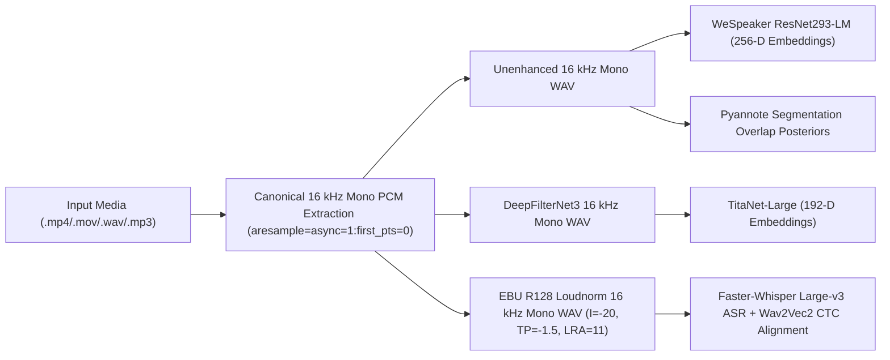

# ConvoFuse — Audio Conditioning & Dual-View Diarization Integration Report

**Module**: [`convofuse/audio_diarization_adapter.py`](file:///home/priyanka/chaitanya/Multi-View-Speaker-Representation-Learning/convofuse/audio_diarization_adapter.py)  

---

## 1. Canonical Audio Ingestion & Task-Specific Conditioning (Part 3.1–3.2)

`CanonicalAudioProcessor` and `TaskSpecificAudioPaths` implement the research-validated multi-stream audio routing architecture:

- **Validation Checks**: Every WAV stream is verified for file existence, non-zero byte size, sample rate (`16000 Hz`), channel count (`1`), sample count, duration in seconds, absence of `NaN`/`Inf` values, and SHA-256 hash digest.

---

## 2. Two-Model Speaker Representation & Affinity Fusion (Part 3.3–3.4)

ConvoFuse integrates the frozen Stage 5A.1 and Stage 5B.4 dual-encoder diarization pipeline:

1. **Subsegmentation**: Speech intervals from Silero VAD (`C62`: threshold `0.35`, min silence `0.25s`, speech pad `0.10s`) are segmented into 1.5s windows with 0.75s step.
2. **Complementary Encoders**:
   - `TitaNet-Large` (`nvidia/speakerverification_en_titanet_large`): 192-D L2-normalized embeddings extracted from DFN-conditioned audio.
   - `WeSpeaker ResNet293-LM` (`wespeaker_en_voxceleb_CAM++_LM` / ResNet293-LM ONNX): 256-D L2-normalized embeddings extracted from raw 16 kHz mono audio.
3. **Affinity Normalization & Fusion**:
   - Independent cosine similarity matrices $S_{\text{TitaNet}}$ and $S_{\text{WeSpeaker}}$ are normalized row-wise over off-diagonal entries ($z$-score normalization followed by min-max scaling to $[0, 1]$).
   - Fused affinity matrix: $S_{\text{fused}} = 0.5\,\tilde{S}_{\text{TitaNet}} + 0.5\,\tilde{S}_{\text{WeSpeaker}}$ (Condition J / Stage 5B.4 E20) or LORO-clipped reliability-gated fusion $w \in [0.35, 0.65]$ (Condition K).
4. **Clustering**: Calibrated `NME-SC` (`max_RP_threshold = 0.15`, `sparse_search = True`, `max_num_speakers = 8`) estimates speaker count automatically without oracle speaker count.

---

## 3. Temporal Word-to-Speaker Association & Overlap Metadata (Part 3.6–3.7)

Implemented in [`build_baseline_convofuse_words`](file:///home/priyanka/chaitanya/Multi-View-Speaker-Representation-Learning/convofuse/audio_diarization_adapter.py#L370-L494):

1. **Temporal Association**: Invokes `orchestrate_words` (`research_stages/stage6_generative_refinement/word_orchestrator.py`) using exact word-turn intersection duration (`max_overlap_speaker`) with a `0.5s` midpoint tolerance collar for boundary words.
2. **Unassigned Words**: Words with zero speaker overlap and distance $> 0.5\text{s}$ from any diarization segment receive `baseline_speaker_id = "UNK"` and `attribution_status = "UNASSIGNED_UNK"`.
3. **Overlap Metadata Enrichment**:
   - Queries both multi-speaker RTTM intervals and the Stage 5B.2 frame-level overlap posterior cache (`<rec_id>_mono_overlap.npz`).
   - Populates `OverlapMetadata` (`is_overlapping_speech`, `overlapping_speakers`, `overlap_durations_sec`, `frame_overlap_prob_mean`, `frame_overlap_prob_max`, `overlap_posterior_source`, `simultaneous_attribution_supported = False`, and explicit `limitation_note`).
