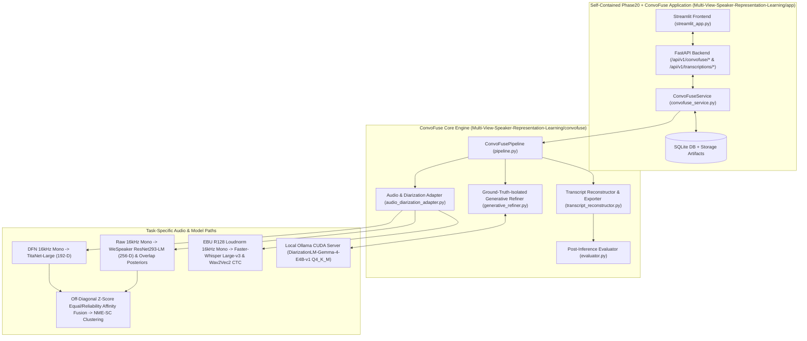

# ConvoFuse — End-to-End System Architecture

**Framework**: `ConvoFuse`  

---

## 1. Unified System Architecture Diagram

---

## 2. Package & File Inventory

### A. Research Repository (`/home/priyanka/chaitanya/Multi-View-Speaker-Representation-Learning`)
- [`convofuse/__init__.py`](file:///home/priyanka/chaitanya/Multi-View-Speaker-Representation-Learning/convofuse/__init__.py) — Package exports.
- [`convofuse/contracts.py`](file:///home/priyanka/chaitanya/Multi-View-Speaker-Representation-Learning/convofuse/contracts.py) — Canonical data structures, 15-stage lifecycle enum, `SpeakerIdentityMapper`, and TPST decision/rejection enums.
- [`convofuse/audio_diarization_adapter.py`](file:///home/priyanka/chaitanya/Multi-View-Speaker-Representation-Learning/convofuse/audio_diarization_adapter.py) — `CanonicalAudioProcessor`, `TaskSpecificAudioPaths`, `resolve_benchmark_frozen_inputs`, `load_overlap_posterior_timeline`, and `build_baseline_convofuse_words`.
- [`convofuse/generative_refiner.py`](file:///home/priyanka/chaitanya/Multi-View-Speaker-Representation-Learning/convofuse/generative_refiner.py) — `OllamaDiarizationLMClient`, `extract_text_and_spk_strict`, `align_completion_tags_to_hypothesis`, and `ConvoFuseGenerativeRefiner`.
- [`convofuse/transcript_reconstructor.py`](file:///home/priyanka/chaitanya/Multi-View-Speaker-Representation-Learning/convofuse/transcript_reconstructor.py) — `reconstruct_turns`, `build_speaker_summaries`, `format_readable_transcript`, `export_convofuse_artifacts`, and `to_phase20_transcript_result_dict`.
- [`convofuse/evaluator.py`](file:///home/priyanka/chaitanya/Multi-View-Speaker-Representation-Learning/convofuse/evaluator.py) — Post-inference evaluation (`evaluate_post_inference`).
- [`convofuse/pipeline.py`](file:///home/priyanka/chaitanya/Multi-View-Speaker-Representation-Learning/convofuse/pipeline.py) — `ConvoFusePipeline` orchestrator.
- [`convofuse/cli.py`](file:///home/priyanka/chaitanya/Multi-View-Speaker-Representation-Learning/convofuse/cli.py) — CLI and sequential R01–R08 benchmark runner.
- [`convofuse/tests/test_convofuse.py`](file:///home/priyanka/chaitanya/Multi-View-Speaker-Representation-Learning/convofuse/tests/test_convofuse.py) — Unit & integration test suite.

### B. Copied & Integrated ConvoFuse Application inside Research Repository (`/home/priyanka/chaitanya/Multi-View-Speaker-Representation-Learning/app`)
- [`app/backend/services/convofuse_service.py`](file:///home/priyanka/chaitanya/Multi-View-Speaker-Representation-Learning/app/backend/services/convofuse_service.py) — Application service layer resolving Repository B paths self-contained relative to `app/`.
- [`app/backend/api/v1/endpoints/convofuse.py`](file:///home/priyanka/chaitanya/Multi-View-Speaker-Representation-Learning/app/backend/api/v1/endpoints/convofuse.py) — REST API router.
- [`app/backend/api/v1/router.py`](file:///home/priyanka/chaitanya/Multi-View-Speaker-Representation-Learning/app/backend/api/v1/router.py) — Registers `/api/v1/convofuse`.
- [`app/frontend/api_client.py`](file:///home/priyanka/chaitanya/Multi-View-Speaker-Representation-Learning/app/frontend/api_client.py) — ConvoFuse client methods.
- [`app/frontend/streamlit_app.py`](file:///home/priyanka/chaitanya/Multi-View-Speaker-Representation-Learning/app/frontend/streamlit_app.py) — Extended Streamlit UI.
- [`app/tests/test_convofuse_api.py`](file:///home/priyanka/chaitanya/Multi-View-Speaker-Representation-Learning/app/tests/test_convofuse_api.py) — FastAPI + Repository B independence integration test suite.
