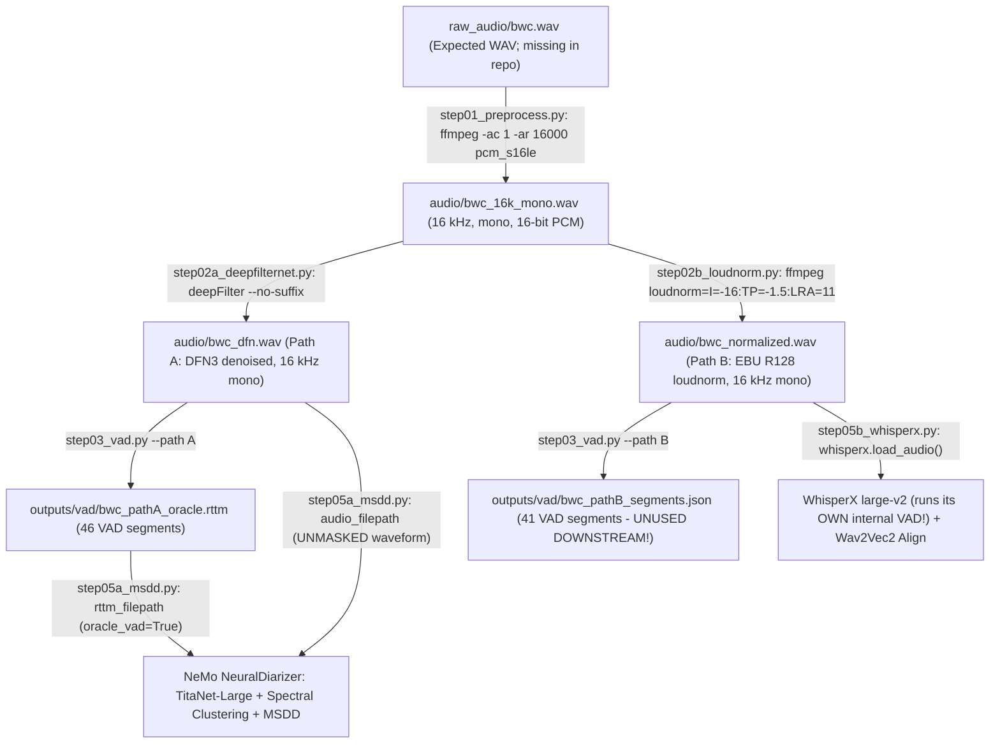

# 02 — Execution Pipeline Audit (`phase20_standalone`)

**Audit Status:** `VERIFIED`  
**Primary Orchestrator:** [`phase20_standalone/run_phase20.py`](file:///home/priyanka/chaitanya/Multi-View-Speaker-Representation-Learning/phase20_standalone/run_phase20.py#L1-L63)  
**Shared Implementation Core:** [`phase20_standalone/scripts/common.py`](file:///home/priyanka/chaitanya/Multi-View-Speaker-Representation-Learning/phase20_standalone/scripts/common.py#L1-L853)

---

## 1. Complete 15-Stage Execution Table

In [`phase20_standalone/run_phase20.py`](file:///home/priyanka/chaitanya/Multi-View-Speaker-Representation-Learning/phase20_standalone/run_phase20.py#L38-L59), `main()` defines a hardcoded list `steps` of 15 sequential `subprocess.run(cmd, cwd=base_dir, check=True)` invocations for `--recording bwc` (default):

| Stage | Script | Entrypoint | Input File(s) & Format | Model / Checkpoint | Preprocessing / Operations | Key Config Parameters | Output File(s) & Format | Dependencies Called | Device | Silent Fallback Behavior |
|---|---|---|---|---|---|---|---|---|---|---|
| **1. GT Conversion** | [`scripts/step00_ground_truth.py`](file:///home/priyanka/chaitanya/Multi-View-Speaker-Representation-Learning/phase20_standalone/scripts/step00_ground_truth.py#L121-L161) | `main()` -> `convert_ground_truth()` | `ground_truth/bwc.txt` (raw text transcript) | None (Regex parser) | Parses `HEADER_PATTERN`, runs `apply_legacy_reference_curation()`, drops `duration <= 0` from RTTM only. | Hardcoded curation rules for `bwc` (`19-20s`, `134-135s`, etc.) | `ground_truth_json/bwc.json` (48 segs), `ground_truth_rttm/bwc.rttm` (37 segs) | `common.write_json`, `common.write_rttm` | CPU | None (raises `ValueError` on format/negative duration). |
| **2. Audio Preprocess** | [`scripts/step01_preprocess.py`](file:///home/priyanka/chaitanya/Multi-View-Speaker-Representation-Learning/phase20_standalone/scripts/step01_preprocess.py#L11-L20) | `main()` | `raw_audio/bwc.wav` (Expected WAV; **missing locally**) | `ffmpeg` CLI (`6.1.1`) | Downmixes to mono (`-ac 1`), resamples to 16 kHz (`-ar 16000`), encodes 16-bit PCM (`pcm_s16le`). | `-vn -acodec pcm_s16le -ar 16000 -ac 1` | `audio/bwc_16k_mono.wav` (16 kHz mono PCM WAV) | `common.run_command` -> `ffmpeg` | CPU | None (`check=True` fails if `raw_audio/bwc.wav` missing). |
| **3. DeepFilterNet (Path A)** | [`scripts/step02a_deepfilternet.py`](file:///home/priyanka/chaitanya/Multi-View-Speaker-Representation-Learning/phase20_standalone/scripts/step02a_deepfilternet.py#L13-L35) | `main()` | `audio/bwc_16k_mono.wav` (16 kHz mono WAV) | `DeepFilterNet3` (`deepFilter` CLI, internally 48 kHz) | Upsamples 16k->48k inside DFN3, applies spectral masking + ERB filterbank, downsamples back to 16 kHz. | `--output-dir <dir> --no-suffix` | `audio/bwc_dfn.wav` (16 kHz mono WAV) | `shutil.which("deepFilter")`, `common.run_command` | GPU / CPU | **YES (`L27-33`)**: If `deepFilter` binary missing or `--allow-fallback`, silently copies `bwc_16k_mono.wav` to `bwc_dfn.wav`! |
| **4. Loudnorm (Path B)** | [`scripts/step02b_loudnorm.py`](file:///home/priyanka/chaitanya/Multi-View-Speaker-Representation-Learning/phase20_standalone/scripts/step02b_loudnorm.py#L11-L20) | `main()` | `audio/bwc_16k_mono.wav` (16 kHz mono WAV) | `ffmpeg` `loudnorm` filter | EBU R128 loudness normalization (`I=-16 LUFS`, `TP=-1.5 dBTP`, `LRA=11`), keeps 16 kHz mono PCM. | `-af loudnorm=I=-16:TP=-1.5:LRA=11 -ar 16000 -ac 1` | `audio/bwc_normalized.wav` (16 kHz mono WAV) | `common.run_command` -> `ffmpeg` | CPU | None. |
| **5. Path A VAD** | [`scripts/step03_vad.py`](file:///home/priyanka/chaitanya/Multi-View-Speaker-Representation-Learning/phase20_standalone/scripts/step03_vad.py#L318-L403) | `main()` (`--path A`) | `audio/bwc_dfn.wav` (16 kHz DFN-enhanced WAV) | `pyannote/segmentation-3.0` (`pytorch_model.bin`, 5.95 MB) | Runs `VoiceActivityDetection(onset=0.6, offset=0.4)`, then `postprocess_segments()` (merge gap `<0.25s`, pad `±0.05s`, filter `<0.10s`). | `onset=0.6, offset=0.4, min_duration_off=0.25, pad_onset=0.05, pad_offset=0.05, min_duration_on=0.10` | `outputs/vad/bwc_pathA_segments.json` (46 segs), `outputs/vad/bwc_pathA_oracle.rttm` (46 segs) | `run_pyannote_vad`, `postprocess_segments`, `write_rttm` | CUDA (`cuda:0`) / CPU | **YES (`L243-301, L333-351`)**: Falls back to energy VAD (`-35 dBFS`), or copies GT `bwc.rttm` if audio missing! |
| **6. Path B VAD** | [`scripts/step03_vad.py`](file:///home/priyanka/chaitanya/Multi-View-Speaker-Representation-Learning/phase20_standalone/scripts/step03_vad.py#L318-L403) | `main()` (`--path B`) | `audio/bwc_normalized.wav` (16 kHz loudnorm WAV) | `pyannote/segmentation-3.0` | Same VAD model and post-processing, but executed on **Path B loudnorm audio** (not Path A!). | Same as Path A | `outputs/vad/bwc_pathB_segments.json` (41 segs), `outputs/vad/bwc_pathB_oracle.rttm` (41 segs) | Same as Path A | CUDA / CPU | Same silent fallback as Path A. |
| **7. VAD Evaluation** | [`scripts/step04_vad_eval.py`](file:///home/priyanka/chaitanya/Multi-View-Speaker-Representation-Learning/phase20_standalone/scripts/step04_vad_eval.py#L11-L29) | `main()` | `bwc_pathA_segments.json`, `bwc_pathB_segments.json`, `ground_truth_rttm/bwc.rttm` | `pyannote.metrics` `DetectionPrecisionRecallFMeasure` | Evaluates Path A and Path B speech intervals against union of reference RTTM intervals (`collar=0.0`). | `collar=0.0` | `metrics/bwc_vad_metrics.json` (Path A F1=`0.8068`, Path B F1=`0.8026`) | `common.evaluate_vad_segments` | CPU | Arithmetic 1D interval overlap fallback if `pyannote.metrics` missing. |
| **8. WhisperX ASR (Path B)** | [`scripts/step05b_whisperx.py`](file:///home/priyanka/chaitanya/Multi-View-Speaker-Representation-Learning/phase20_standalone/scripts/step05b_whisperx.py#L14-L85) | `main()` | `audio/bwc_normalized.wav` (**Does NOT use `bwc_pathB_segments.json`!**) | Faster-Whisper `large-v2` + `WAV2VEC2_ASR_LARGE_LV60K_960H` | Transcribes `bwc_normalized.wav` using WhisperX's internal VAD, then runs Wav2Vec2 word forced alignment. | `batch_size=16, compute_type="float16" (GPU) / "int8" (CPU), language="en"` | `outputs/whisperx/bwc.json` (18 segs, 465 words with `[start, end, score]`) | `whisperx.load_model`, `whisperx.load_align_model`, `whisperx.align` | CUDA / CPU | **YES (`L52-60`)**: If `whisperx` missing, generates synthetic words evenly spaced from `ground_truth_json/bwc.json`! |
| **9. NeMo MSDD (Path A)** | [`scripts/step05a_msdd.py`](file:///home/priyanka/chaitanya/Multi-View-Speaker-Representation-Learning/phase20_standalone/scripts/step05a_msdd.py#L13-L68) | `main()` | `audio/bwc_dfn.wav` + `outputs/vad/bwc_pathA_oracle.rttm` | `diar_msdd_telephonic` + `titanet_large` + `vad_multilingual_marblenet` | Builds manifest with `oracle_vad=True`, extracts 5-scale TitaNet 192-D embeddings, spectral clustering, MSDD overlap decoding. | `window=[1.5,1.2,1.0,0.8,0.5]`, `shift=[0.75,0.6,0.5,0.4,0.25]`, `weights=[1,2,3,3,3]`, `max_rp_threshold=0.25`, `sigmoid_threshold=[0.7]` | `outputs/msdd/pred_rttms/bwc_dfn.rttm` copied to `outputs/msdd/bwc.rttm` (30 segs, all `speaker_0`) | `common.default_msdd_config`, `NeuralDiarizer(cfg=cfg).diarize()` | CUDA / CPU | **YES (`L27-33`)**: If `nemo` missing, copies `ground_truth_rttm/bwc.rttm` (renaming all speakers to `speaker_0`, `speaker_1`, ...)! |
| **10. ASR Evaluation** | [`scripts/step06b_asr_eval.py`](file:///home/priyanka/chaitanya/Multi-View-Speaker-Representation-Learning/phase20_standalone/scripts/step06b_asr_eval.py#L11-L17) | `main()` | `outputs/whisperx/bwc.json`, `ground_truth_json/bwc.json` | `jiwer` (`3.0.4`) | Lowercases, strips punctuation (`r"[^\w\s']"`), computes WER, MER, WIL, WIP, CER. | Text normalization regex `r"[^\w\s']"` | `metrics/bwc_asr_metrics.json` (WER=`0.3244`, CER=`0.1976`) | `common.evaluate_asr` | CPU | Edit-distance fallback if `jiwer` missing. |
| **11. Diarization Eval** | [`scripts/step06a_diar_eval.py`](file:///home/priyanka/chaitanya/Multi-View-Speaker-Representation-Learning/phase20_standalone/scripts/step06a_diar_eval.py#L11-L17) | `main()` | `outputs/msdd/bwc.rttm`, `ground_truth_rttm/bwc.rttm` | `pyannote.metrics` (`DiarizationErrorRate`, `JaccardErrorRate`) | Evaluates DER (`collar=0.0, skip_overlap=False`), DER (`collar=0.25, skip_overlap=True`), and JER (`collar=0.0`). | `(0.0, False)` and `(0.25, True)` | `metrics/bwc_diar_metrics.json` (DER=`0.4471`, DER_0.25=`0.3241`, JER=`0.8424`) | `common.evaluate_diarization` | CPU | Frame-discretized fallback if `pyannote.metrics` missing. |
| **12. Attribution Fusion** | [`scripts/step07_fusion.py`](file:///home/priyanka/chaitanya/Multi-View-Speaker-Representation-Learning/phase20_standalone/scripts/step07_fusion.py#L11-L19) | `main()` | `outputs/whisperx/bwc.json` + `outputs/msdd/bwc.rttm` | None (Interval overlap + nearest-turn drift search) | Assigns each WhisperX word to MSDD speaker with max temporal overlap, else nearest MSDD segment within `0.5s`, else global dominant speaker. | `max_nearest_distance=0.5` | `fusion/bwc_attributed_words.json` (465 words), `fusion/bwc_attributed_segments.json` (11 turns), `fusion/bwc_transcript.txt` | `common.fuse_transcript_and_diarization` | CPU | Assigns `"UNKNOWN"` only if MSDD RTTM is completely empty. |
| **13. Fusion Evaluation** | [`scripts/step08_fusion_eval.py`](file:///home/priyanka/chaitanya/Multi-View-Speaker-Representation-Learning/phase20_standalone/scripts/step08_fusion_eval.py#L11-L17) | `main()` | `fusion/bwc_attributed_words.json`, `ground_truth_json/bwc.json` | Greedy co-occurrence mapping (`common.evaluate_fusion`) | Matches each GT word to nearest hypothesis word within `±2.0s` (preferring identical normalized token within `±0.75s`), builds co-occurrence matrix, maps `pred_speaker -> gt_speaker` greedily. | Word match window `±2.0s`, token-match window `±0.75s` | `metrics/bwc_fusion_metrics.json` (Speaker Acc=`0.9027`, WAE=`0.0973`, Evaluated words=`401/485`) | `common.evaluate_fusion` | CPU | Built-in pure Python. |
| **14. Aggregate Report** | [`scripts/step09_aggregate_report.py`](file:///home/priyanka/chaitanya/Multi-View-Speaker-Representation-Learning/phase20_standalone/scripts/step09_aggregate_report.py#L11-L80) | `main()` | `metrics/bwc_{vad,asr,diar,fusion}_metrics.json` | None | Merges 4 metric JSONs into single JSON, single-row CSV, and Markdown report. | None | `metrics/bwc_all_metrics.json`, `metrics/bwc_metrics_table.csv`, `reports/bwc_summary.md` | `common.read_json`, `common.write_json` | CPU | None. |
| **15. Phase 19 Comparison** | [`scripts/step10_compare_phase19.py`](file:///home/priyanka/chaitanya/Multi-View-Speaker-Representation-Learning/phase20_standalone/scripts/step10_compare_phase19.py#L78-L160) | `main()` | `phase20_standalone/metrics/bwc_all_metrics.json` vs. `experiments/phase19_11A_repro/...` | None | Compares Phase 20 metrics against Phase 19 (or embedded `PHASE19_FALLBACK` constants). | Tolerance `1e-4` | `reports/phase19_vs_phase20_comparison.md`, `.csv` | `common.read_json` | CPU | Uses hardcoded `PHASE19_FALLBACK` dict (`L16-39`) if Phase 19 directory absent. |

---

## 2. Detailed Stage Audits (`Phase B1–B5`)

### B1. Audio Preprocessing & Actual Audio Routing (`VERIFIED`)

Tracing the exact file paths in [`phase20_standalone/scripts/common.py`](file:///home/priyanka/chaitanya/Multi-View-Speaker-Representation-Learning/phase20_standalone/scripts/common.py#L99-L148) (`recording_paths()`) establishes the true audio routing graph:

**Verified Routing Conclusions (`VERIFIED`):**
1. **What reaches TitaNet & NeMo MSDD:** `audio/bwc_dfn.wav` (16 kHz mono, DeepFilterNet3-processed, **NOT loudness-normalized**, and **NOT zero-masked**) together with `outputs/vad/bwc_pathA_oracle.rttm` (46 VAD intervals).
2. **What reaches WhisperX:** `audio/bwc_normalized.wav` (16 kHz mono, EBU R128 loudness-normalized to `-16 LUFS`, **NOT DeepFilterNet-processed**).
3. **What reaches Pyannote VAD:** Both! `step03_vad.py` is called twice (`--path A` on `bwc_dfn.wav` and `--path B` on `bwc_normalized.wav`). However, `bwc_pathB_segments.json` is **only** used in `step04_vad_eval.py` for metric reporting and is **never passed to WhisperX** in [`step05b_whisperx.py`](file:///home/priyanka/chaitanya/Multi-View-Speaker-Representation-Learning/phase20_standalone/scripts/step05b_whisperx.py#L43-L68)!

### B2. VAD and Segmentation (`VERIFIED`)

In [`phase20_standalone/scripts/step03_vad.py`](file:///home/priyanka/chaitanya/Multi-View-Speaker-Representation-Learning/phase20_standalone/scripts/step03_vad.py#L140-L240):
- **Model & Checkpoint:** `pyannote/segmentation-3.0` (`Model.from_pretrained("pyannote/segmentation-3.0")`), wrapped in `pyannote.audio.pipelines.VoiceActivityDetection`.
- **Two-Stage Parameter Application:**
  1. `pipeline.instantiate({"onset": 0.6, "offset": 0.4, "min_duration_on": 0.0, "min_duration_off": 0.0})` (`L181–194`).
  2. Custom Python post-processing in `postprocess_segments()` (`L72–123`):
     - **Padding:** Each raw interval `[start, end]` is padded by `pad_onset = 0.05s` and `pad_offset = 0.05s` (`[max(0.0, start - 0.05), min(duration, end + 0.05)]`).
     - **Merging (`min_duration_off = 0.25s`):** Any two consecutive padded intervals separated by a gap $\le 0.25\text{s}$ are merged into a single contiguous segment.
     - **Filtering (`min_duration_on = 0.10s`):** Any merged segment shorter than $0.10\text{s}$ is discarded.
- **External RTTM Generation:** `step03_vad.py` (`L392`) writes `outputs/vad/bwc_pathA_oracle.rttm` with dummy speaker label `"speech"` (`SPEAKER bwc_dfn 1 <start> <dur> <NA> <NA> speech <NA> <NA>`). Notice that the RTTM recording ID is set to `audio_path.stem` (`bwc_dfn`) so that NeMo's `ClusteringDiarizer` matches `uniq_id = "bwc_dfn"` from `bwc_pathA_msdd_manifest.json` (`L389–395`).
- **Are frame-level VAD probabilities saved?**
  - **NO (`VERIFIED`):** `VoiceActivityDetection( waveform )` returns a binary `pyannote.core.Annotation` object (`timeline = annotation.get_timeline().support()`), and `step03_vad.py` serializes only binary `[start, end, duration]` intervals to `bwc_pathA_segments.json`.
  - **Can frame-level VAD posteriors be extracted for the proposed reliability estimator?** **YES (`VERIFIED`):** The underlying `Model.from_pretrained("pyannote/segmentation-3.0")` (or `pyannote.audio.Inference(model, window="sliding")`) outputs frame-level powerset/multilabel logits over 7 classes (non-speech, 3 single-speaker classes, 3 overlapping-speaker classes) at ~16.8 ms frame resolution (270 samples stride at 16 kHz). Summing speech class probabilities yields both **frame-level VAD confidence $p_{\text{speech}}(t)$** and **frame-level overlap probability $p_{\text{overlap}}(t)$** directly from the already-loaded `pyannote/segmentation-3.0` model!

### B3. ASR and Word-Timestamp Alignment (`VERIFIED`)

In [`phase20_standalone/scripts/step05b_whisperx.py`](file:///home/priyanka/chaitanya/Multi-View-Speaker-Representation-Learning/phase20_standalone/scripts/step05b_whisperx.py#L43-L79):
- **Transcription Model:** `whisperx.load_model("large-v2", device=device, compute_type="float16" if cuda else "int8")` (`faster-whisper` CTranslate2 backend, `large-v2` `model.bin` 3,094 MB).
- **Alignment Model:** `whisperx.load_align_model(language_code="en", device=device)` which loads torchaudio's `WAV2VEC2_ASR_LARGE_LV60K_960H` (`wav2vec2_fairseq_large_lv60k_asr_ls960.pth`, 1,262 MB).
- **Output Format (`outputs/whisperx/bwc.json`):**
  - Top-level keys: `"language": "en"`, `"segments": [...]` (18 segments), `"word_segments": [...]` (465 words).
  - Each word entry contains `{"word": str, "start": float, "end": float, "score": float}` (where `score` is Wav2Vec2 acoustic forced-alignment posterior confidence in $[0, 1]$).

### B4 & B5. Diarization and Speaker Attribution Fusion (`VERIFIED`)

In [`phase20_standalone/scripts/common.py`](file:///home/priyanka/chaitanya/Multi-View-Speaker-Representation-Learning/phase20_standalone/scripts/common.py#L602-L674) (`fuse_transcript_and_diarization()`):
1. **Word Extraction:** Collects all words from `whisperx_payload["word_segments"]` (or flattens `segment["words"]`).
2. **Primary Attribution (Interval Overlap, `L621–631`):** For a word with interval $[w_{\text{start}}, w_{\text{end}}]$, sums overlap duration $\max(0, \min(w_{\text{end}}, d_{\text{end}}) - \max(w_{\text{start}}, d_{\text{start}}))$ per speaker across all MSDD RTTM intervals $[d_{\text{start}}, d_{\text{end}}]$. If any speaker has positive overlap, assigns $\arg\max_s \text{overlap}(s)$ with `"attribution_method": "overlap"`.
3. **Secondary Attribution (Drift-Aware Nearest Neighbor, `L632–646`):** If a word falls entirely in a diarization gap (zero overlap), computes temporal distance from word midpoint $w_{\text{mid}} = (w_{\text{start}} + w_{\text{end}})/2$ to the nearest boundary of every MSDD segment. If the minimum distance is $\le \text{max\_nearest\_distance}$ ($0.5\text{s}$), assigns that segment's speaker with `"attribution_method": "nearest"`.
4. **Tertiary Fallback (Dominant Speaker, `L647–649`):** If no MSDD segment is within $0.5\text{s}$, assigns the recording-wide dominant speaker (`dominant_speaker`, the speaker with maximum total RTTM duration) with `"attribution_method": "dominant_fallback"`.
5. **Turn Grouping (`L660–673`):** Consecutive words assigned to the same speaker with inter-word gap $\le 1.5\text{s}$ are merged into contiguous speaker turns in `fusion/bwc_attributed_segments.json`.

---

## 3. Verified Code vs. Documentation Discrepancies (`Rule 1`)

| # | Claim in Base Paper (`papers/2607.24958v1.pdf`) or Repo Docs | Actual Executing Code Behavior (`phase20_standalone/`) | Severity |
|---|---|---|---|
| **D1** | **Paper Sec. 4.1–4.2 (pp. 8, 11, 33):** Claims a single shared VAD stage produces a unified temporal speech timeline shared by Path A and Path B. | [`run_phase20.py`](file:///home/priyanka/chaitanya/Multi-View-Speaker-Representation-Learning/phase20_standalone/run_phase20.py#L46-L47) runs `step03_vad.py` **twice independently**: Path A (`bwc_dfn.wav`) yields **46 segments** ($108.32\text{s}$), Path B (`bwc_normalized.wav`) yields **41 segments** ($108.08\text{s}$). Furthermore, [`step05b_whisperx.py`](file:///home/priyanka/chaitanya/Multi-View-Speaker-Representation-Learning/phase20_standalone/scripts/step05b_whisperx.py#L61-L68) ignores `bwc_pathB_segments.json` completely and uses WhisperX's internal VAD! | **HIGH** |
| **D2** | **Paper Sec. 4.3 (p. 12, Eq. $x_{\text{masked}}(t) = x(t)\cdot m(t)$):** Claims a binary speech mask is multiplied into the waveform prior to TitaNet extraction. | [`step05a_msdd.py`](file:///home/priyanka/chaitanya/Multi-View-Speaker-Representation-Learning/phase20_standalone/scripts/step05a_msdd.py#L38-L61) does **not** mask the waveform. It passes unmasked `bwc_dfn.wav` and `bwc_pathA_oracle.rttm` (`oracle_vad=True`) to NeMo `NeuralDiarizer`. Zero-masking exists only in the legacy [`run_final_hardened_pipeline.py`](file:///home/priyanka/chaitanya/Multi-View-Speaker-Representation-Learning/run_final_hardened_pipeline.py#L56-L59) which uses `pyannote/speaker-diarization-3.1`, not NeMo MSDD. | **HIGH** |
| **D3** | **Paper Sec. 3.2 vs. Sec. 5.1 (pp. 4–5, 15–17):** Introduces an 8-recording benchmark (31m31s, 41 speakers) in Tables 1–2, then presents Tables 3–6 as the benchmark evaluation results. | Tables 3–6 report the exact single-recording numbers of `bwc` (`175.46s`, 484 ref words, 465 hyp words, DER=`0.4471`, JER=`0.8424`, WER=`0.3244`, Speaker Acc=`0.9027`) from [`phase20_standalone/metrics/bwc_all_metrics.json`](file:///home/priyanka/chaitanya/Multi-View-Speaker-Representation-Learning/phase20_standalone/metrics/bwc_all_metrics.json#L1-L43). | **CRITICAL** |
| **D4** | **Paper Sec. 5.1.4 (Table 6, p. 17) & `IMPLEMENTATION_REPORT.md`:** Reports `Speaker Attribution Accuracy = 90.27%` (`WAE = 9.73%`) as evidence of strong multi-speaker attribution. | In [`outputs/msdd/bwc.rttm`](file:///home/priyanka/chaitanya/Multi-View-Speaker-Representation-Learning/phase20_standalone/outputs/msdd/bwc.rttm#L1-L30) and [`metrics/bwc_fusion_metrics.json`](file:///home/priyanka/chaitanya/Multi-View-Speaker-Representation-Learning/phase20_standalone/metrics/bwc_fusion_metrics.json#L1-L15), NeMo MSDD suffered **complete single-speaker collapse**, predicting `speaker_0` for 100% of speech! Because `Speaker_1` utters 362 of 401 evaluated words ($90.27\%$), collapsing all 4 speakers into 1 speaker yields $90.27\%$ Speaker Accuracy while `JER = 0.8424` exposes that 3 of 4 speakers have $0.0$ recall. | **CRITICAL** |
| **D5** | **`phase20_standalone/README.md`:** Claims standalone reproducibility via `python run_phase20.py --recording bwc`. | Running `run_phase20.py` in a fresh clone fails at Step 01 because `raw_audio/bwc.wav` is missing (only `<repo_root>/raw_audio/*.mp3` exists), and if `--allow-fallback` or missing libraries occur in Steps 02a/03/05a/05b, the scripts silently copy ground-truth annotations as model predictions. | **HIGH** |
| **D6** | **`phase20_standalone/scripts/{cpwer,sawer,attribution_metrics,timeline_metrics,fusion_metrics,speaker_mapping}.py`:** Six standalone metric modules exist in `phase20_standalone/scripts/`. | **Dead code in Phase 20 execution (`VERIFIED`):** None of those 6 modules is imported or called by `run_phase20.py` or `step00..step10`. All evaluations in `step04..step08` call functions inside [`common.py`](file:///home/priyanka/chaitanya/Multi-View-Speaker-Representation-Learning/phase20_standalone/scripts/common.py#L465-L780) instead. | **MEDIUM** |
