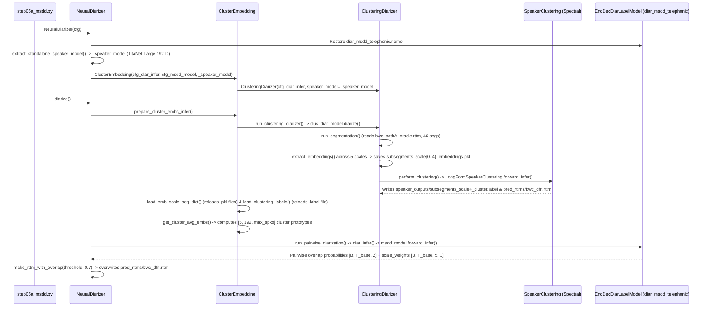

# 04 — NeMo MSDD Integration & Clustering Audit

**Audit Status:** `VERIFIED`  
**Primary Repo Files:** [`phase20_standalone/scripts/step05a_msdd.py`](file:///home/priyanka/chaitanya/Multi-View-Speaker-Representation-Learning/phase20_standalone/scripts/step05a_msdd.py#L13-L68), [`phase20_standalone/scripts/common.py`](file:///home/priyanka/chaitanya/Multi-View-Speaker-Representation-Learning/phase20_standalone/scripts/common.py#L286-L348)  
**NeMo Internal Source Verified:** `nemo/collections/asr/models/msdd_models.py` (`EncDecDiarLabelModel`, `ClusterEmbedding`, `NeuralDiarizer`), `nemo/collections/asr/models/clustering_diarizer.py` (`ClusteringDiarizer`), `nemo/collections/asr/parts/utils/speaker_utils.py`, `nemo/collections/asr/parts/utils/longform_clustering.py`

---

## 1. End-to-End Execution Trace Inside `NeuralDiarizer.diarize()` (`Phase B4 & C4`)

When [`step05a_msdd.py`](file:///home/priyanka/chaitanya/Multi-View-Speaker-Representation-Learning/phase20_standalone/scripts/step05a_msdd.py#L51-L52) executes `model = NeuralDiarizer(cfg=cfg); model.diarize()`, the following exact sequence runs (`VERIFIED` from `msdd_models.py` L990–1445):



---

## 2. Stage 1 of MSDD: Multiscale Spectral Clustering (`ClusteringDiarizer`)

### 2.1 How Multiscale Embeddings Are Stacked & Clustered (`VERIFIED`)
1. **`get_embs_and_timestamps()` (`speaker_utils.py`):**
   - For each recording `uniq_id`, stacks the 5 scale embedding tensors `E_0, E_1, E_2, E_3, E_4` along `dim=0` into a single 2D tensor `emb_t` of shape **`[sum_k N_k, D]`** (for `bwc`, `[899, 192]`; for `karen`, `[6871, 192]`) and `multiscale_segment_counts = [N_0, N_1, N_2, N_3, N_4]`.
2. **Scale Mapping to Base Scale (`get_scale_mapping_argmat()`):**
   - Scale 4 (`0.5s` window, `0.25s` shift, $N_4 = 300$ on `bwc`) is the **base scale** (`base_scale_index = 4`).
   - For each coarse scale $k \in \{0, 1, 2, 3\}$, every base-scale segment $t \in \{0, \dots, N_4 - 1\}$ is mapped to the index $m \in \{0, \dots, N_k - 1\}$ in scale $k$ whose temporal midpoint is closest to segment $t$'s midpoint, producing `scale_mapping[k]` of shape `[N_4]`.
3. **Multiscale Cosine Affinity Matrix (`LongFormSpeakerClustering`):**
   - For each scale $k \in \{0, \dots, 4\}$, embeddings are mapped to the base-scale length $N_4$ via `scale_mapping[k]`, L2-normalized, and used to compute a scale-specific cosine similarity matrix $S^{(k)} \in \mathbb{R}^{N_4 \times N_4}$.
   - The 5 cosine affinity matrices are linearly combined using `multiscale_weights = [1, 2, 3, 3, 3]`:
     $$A = \frac{\sum_{k=0}^{4} w_k S^{(k)}}{\sum_{k=0}^{4} w_k}$$
4. **Graph Pruning, Laplacian Eigengap, and Spectral Clustering:**
   - Controlled by `clustering.parameters` in [`common.py`](file:///home/priyanka/chaitanya/Multi-View-Speaker-Representation-Learning/phase20_standalone/scripts/common.py#L319-L326):
     - `oracle_num_speakers = False`
     - `max_num_speakers = 10`
     - `enhanced_count_thres = 80` (if $N_4 \ge 80$, adds virtual anchor points if estimated speaker count is small)
     - `max_rp_threshold = 0.25` ($p$-percentile thresholding parameter for binarizing/pruning affinity matrix $A$)
     - `sparse_search_volume = 30` (grid search over 30 $p$-values up to `max_rp_threshold` to maximize silhouette/eigengap criterion)
   - Estimated cluster labels $\hat{c}_t \in \{0, \dots, \hat{K}-1\}$ for each base-scale segment $t \in \{0, \dots, N_4 - 1\}$ are written to `speaker_outputs/subsegments_scale4_cluster.label`.

### 2.2 CRITICAL ARCHITECTURE FINDING: Spectral Clustering Is Dimension-Agnostic & Rotation-Invariant (`VERIFIED`)
- Inspecting `LongFormSpeakerClustering` and `ClusterEmbedding.get_base_clus_label_dict()` (`msdd_models.py` L775: `emb_dim = emb_scale_seq_dict[0][uniq_id][0].shape[0]`) confirms that **NeMo's multiscale spectral clustering stage has ZERO hardcoded dependency on `D = 192`!**
- Any embedding dimension $D$ (e.g., $D = 192$, $D = 256$, or concatenated $D = 448$) works natively in `ClusteringDiarizer` and `LongFormSpeakerClustering`, because clustering operates strictly on the $N_4 \times N_4$ pairwise cosine similarity matrices $S^{(k)}_{ij} = \frac{\langle \mathbf{z}^{(k)}_i, \mathbf{z}^{(k)}_j \rangle}{\|\mathbf{z}^{(k)}_i\|_2 \|\mathbf{z}^{(k)}_j\|_2}$.

---

## 3. Stage 2 of MSDD: Neural Multiscale Diarization Decoder (`EncDecDiarLabelModel`)

### 3.1 How `ClusterEmbedding` & `EncDecDiarLabelModel` Consume Embeddings (`VERIFIED`)
1. **Disk Reload (`ClusterEmbedding.load_emb_scale_seq_dict`, `msdd_models.py` L957–980):**
   - `ClusterEmbedding` reloads `subsegments_scale{0..4}_embeddings.pkl` and `subsegments_scale4_cluster.label` from `out_dir/speaker_outputs/`.
2. **Coarse-Scale Label Propagation (`assign_labels_to_longer_segs`, `L717–752`):**
   - Assigns each coarse-scale segment $m$ the statistical `mode()` of the base-scale cluster labels mapped to $m$.
3. **Cluster-Average Prototype Calculation (`get_cluster_avg_embs`, `L778–837`):**
   - For each scale $k \in \{0, \dots, 4\}$ and each discovered cluster $s \in \{0, \dots, \hat{K}-1\}$, averages all embeddings in scale $k$ assigned to cluster $s$:
     $$\bar{\mathbf{e}}^{(k)}_s = \frac{1}{|C^{(k)}_s|} \sum_{i \in C^{(k)}_s} \mathbf{e}^{(k)}_i \in \mathbb{R}^{D}$$
   - Stores `avg_embs` of shape `[5, D, max_num_speakers]`.
4. **Pairwise Neural Decoding (`AudioToSpeechMSDDInferDataset` & `diar_infer`, `L1312–1360`):**
   - For $\hat{K} \ge 2$ discovered speakers, creates $\binom{\hat{K}}{2}$ speaker pairs $(s_1, s_2)$.
   - If `split_infer = True` (`common.py` L336) with `diar_window_length = 50` (`common.py` L338, i.e. $50 \times 0.25\text{s} = 12.5\text{s}$ windows), recomputes local cluster-average embeddings inside each 50-step window (`get_range_clus_avg_emb`, `L1270–1310`).
   - Calls `self.msdd_model.forward_infer(input_signal=sess_emb_seq, input_signal_length=sess_sig_lengths, emb_vectors=sess_emb_vectors, targets=None)` where:
     - `input_signal` (`ms_emb_seq`) has shape **`[B, T_win, 5, 192]`** (`T_win = 50`, `scale_n = 5`, `emb_dim = 192`).
     - `emb_vectors` (`ms_avg_embs`) has shape **`[B, 5, 192, 2]`** (cluster prototypes for the pair of speakers across 5 scales).
5. **Inside `self.msdd` (`EncDecDiarLabelModel.msdd` submodule in `diar_msdd_telephonic.nemo`):**
   - The pretrained `msdd_module` applies learned 1D convolutions/linear layers (`conv_init`, `conv_mid`, scale-attention weights `scale_weights` of shape `[B, T_win, 5, 1]`, and a 2-layer BiLSTM of hidden size 256) to compare `ms_emb_seq` (`[B, T, 5, 192]`) against `ms_avg_embs` (`[B, 5, 192, 2]`), outputting pairwise per-step sigmoid probabilities `preds` of shape **`[B, T_win, 2]`**.
   - Pairwise predictions are averaged across all pairs containing speaker $s$ (`get_pred_mat`, `L1113–1151`) and thresholded at `sigmoid_threshold = 0.7` (`make_rttm_with_overlap`, `L1422–1433`) to produce the final RTTM (`outputs/msdd/pred_rttms/bwc_dfn.rttm`).

### 3.2 CRITICAL ARCHITECTURAL CONSTRAINT: Frozen `diar_msdd_telephonic` Requires `D = 192` in TitaNet's Exact Coordinate Basis (`VERIFIED`)
Because `diar_msdd_telephonic.nemo` is a pretrained neural network trained jointly with `titanet_large`:
1. **Dimensionality Lock (`D = 192`):** Its input projection layers have weight matrices shaped for `emb_dim = 192` and `scale_n = 5`. Passing a 256-D or 448-D vector into `msdd_model.forward_infer()` raises a `RuntimeError: mat1 and mat2 shapes cannot be multiplied`.
2. **Coordinate-Space Lock (Why Arbitrary 192-D Projections Break Frozen MSDD):** Even if a multi-view fusion module outputs a 192-D vector $\mathbf{z} \in \mathbb{R}^{192}$, if $\mathbf{z}$ is rotated or shifted relative to TitaNet-Large's native 192-D coordinate basis, the frozen CNN/attention layers inside `diar_msdd_telephonic` receive out-of-distribution feature coordinates!
3. **Solution — Residual Anchor Alignment in TitaNet's 192-D Space (`INFERRED` / Architecturally Grounded):**
   - For **Stage 1 (Multiscale Spectral Clustering)**, any dimension $D$ works immediately via cosine affinity $A_{ij}$.
   - For **Stage 2 (Frozen MSDD Neural Decoder)**, either:
     - **(Option A — Zero-Shot / Residual Adapter in 192-D TitaNet Space):** Form the fused embedding as a residual refinement anchored in TitaNet's native 192-D space:
       $$\mathbf{z}_{\text{fused}} = \text{Norm}\!\left(\mathbf{e}_{\text{TitaNet}} + \alpha \cdot g_{\theta}(\mathbf{e}_{\text{TitaNet}}, P(\mathbf{e}_{\text{ResNet293}}), \mathbf{q})\right) \in \mathbb{R}^{192}$$
       where $P: \mathbb{R}^{256} \to \mathbb{R}^{192}$ is an orthogonal Procrustes / linear alignment matrix fitted to align ResNet293-LM embeddings to TitaNet's 192-D space, OR
     - **(Option B — Decoupled Architecture):** Use the fused multi-view embeddings (`256-D` or `448-D`) to drive **Multiscale Spectral Clustering (`clus_test_label_dict`)**—which is where the single-speaker collapse actually occurs!—while keeping native `titanet_large` 192-D embeddings for the MSDD overlap boundary refinement step (`emb_seq_test` and `emb_sess_test_dict`)!
   - Look at `msdd_models.py` (`L1179–1184`):
     ```python
     def get_emb_clus_infer(self, cluster_embeddings):
         self.msdd_model.emb_sess_test_dict = cluster_embeddings.emb_sess_test_dict
         self.msdd_model.clus_test_label_dict = cluster_embeddings.clus_test_label_dict
         self.msdd_model.emb_seq_test = cluster_embeddings.emb_seq_test
     ```
     In `NeuralDiarizer`, `clus_test_label_dict` (the base-scale cluster assignments from spectral clustering) is **completely decoupled** from `emb_seq_test`! Moreover, when `ClusteringDiarizer` collapses `bwc` to 1 speaker (`speaker_0`), MSDD cannot recover any additional speakers because MSDD only runs pairwise refinement over the clusters discovered by `ClusteringDiarizer`!

---

## 4. Root Cause of the Single-Speaker Collapse on `bwc` (`VERIFIED`)

Inspecting [`phase20_standalone/outputs/msdd/bwc.rttm`](file:///home/priyanka/chaitanya/Multi-View-Speaker-Representation-Learning/phase20_standalone/outputs/msdd/bwc.rttm#L1-L30), [`experiments/phase11_dfn_ablation/outputs_phase11A/diarization/speaker_outputs/subsegments_scale4_cluster.label`](file:///home/priyanka/chaitanya/Multi-View-Speaker-Representation-Learning/experiments/phase11_dfn_ablation/outputs_phase11A/diarization/speaker_outputs/subsegments_scale4_cluster.label#L1-L300), and [`KAREN_VS_PHASE11A_MSDD_AUDIT.md`](file:///home/priyanka/chaitanya/Multi-View-Speaker-Representation-Learning/KAREN_VS_PHASE11A_MSDD_AUDIT.md#L1-L80) establishes:
1. In `subsegments_scale4_cluster.label` for `bwc`, all 300 base-scale subsegments are labeled `speaker_0`.
2. Why? In `bwc`, `Speaker_1` (the police officer wearing the body-worn camera) speaks for `107.0s` out of `123.0s` (`87.0%` of all speech), while `Speaker_2`, `Speaker_3`, and `Speaker_4` utter brief 1–2 second responses (`"yeah"`, `"no"`, `"that was a bit of a cheap shot weren't it mate"`).
3. With `max_rp_threshold = 0.25` and `enhanced_count_thres = 80` (`N_4 = 300 >= 80`), NeMo's `LongFormSpeakerClustering` adds synthetic anchor embeddings and searches for the eigengap. Because TitaNet's embeddings on short `0.5s–1.5s` BWC segments have noisy cosine similarities, the spectral eigengap peaks at $\hat{K} = 1$, collapsing all 300 segments into `speaker_0`!
4. Once `ClusteringDiarizer` outputs $\hat{K} = 1$ speaker (`speaker_0`), `NeuralDiarizer`'s pairwise MSDD decoder has **zero speaker pairs** ($\binom{1}{2} = 0$) to discriminate and outputs `speaker_0` for all 30 RTTM segments!
