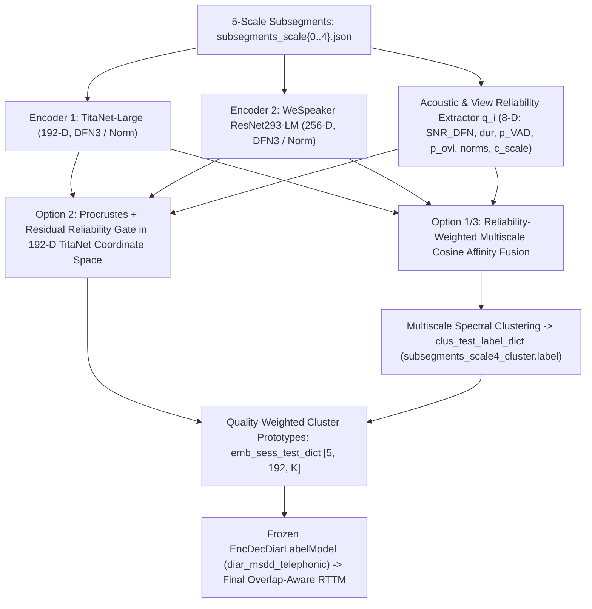

# 13 — Architectural Integration Options into NeMo MSDD (`Phase L`)

**Audit Status:** `VERIFIED`  
**NeMo Integration Points Audited:** `ClusteringDiarizer._extract_embeddings()` (`clustering_diarizer.py` L342–397), `ClusteringDiarizer.perform_clustering()` (`clustering_diarizer.py` L400–453), `ClusterEmbedding` (`msdd_models.py` L668–980), `NeuralDiarizer.diarize()` (`msdd_models.py` L1186–1198)

---

## 1. Exact Source-Code Hook Points in NeMo (`VERIFIED`)

Our source-code audit of `nemo.collections.asr.models.msdd_models` and `clustering_diarizer` (`NeMo 2.7.3`) identified **four exact, clean hook points** where a multi-view speaker representation module can be injected without rewriting NeMo's core library:

1. **Hook 1 (`ClusteringDiarizer._extract_embeddings` / `self.multiscale_embeddings_and_timestamps`):**
   - `ClusteringDiarizer` writes `subsegments_scale{0..4}.json` containing the exact `[offset, duration]` timestamps for all 5 scales (`[1.5, 1.2, 1.0, 0.8, 0.5]s`), extracts embeddings, and saves `speaker_outputs/embeddings/subsegments_scale{0..4}_embeddings.pkl`.
2. **Hook 2 (`LongFormSpeakerClustering` / Affinity Matrix $A_{ij}$):**
   - `perform_clustering()` calls `get_embs_and_timestamps(self.multiscale_embeddings_and_timestamps, self.multiscale_args_dict)` and passes the stacked multiscale embeddings to `SpeakerClustering.forward_infer()`, which computes scale-wise cosine similarity matrices $S^{(k)} \in \mathbb{R}^{N_4 \times N_4}$ and writes `speaker_outputs/subsegments_scale4_cluster.label`.
3. **Hook 3 (`ClusterEmbedding.get_cluster_avg_embs` in `msdd_models.py` L778–837):**
   - Reads `subsegments_scale{0..4}_embeddings.pkl` and `subsegments_scale4_cluster.label` from disk, propagates base-scale cluster labels to coarse scales (`assign_labels_to_longer_segs`), and computes `avg_embs` (`[5, 192, max_num_speakers]`).
4. **Hook 4 (`NeuralDiarizer.get_emb_clus_infer` in `msdd_models.py` L1179–1184):**
   - Passes three dictionaries into `self.msdd_model` (`EncDecDiarLabelModel`):
     - `clus_test_label_dict`: Base-scale (`Scale 4`) speaker cluster assignments `[start, end, cluster_id]`.
     - `emb_seq_test`: Scale-wise 192-D embedding sequences `[N_k, 192]`.
     - `emb_sess_test_dict`: Scale-wise 192-D cluster prototype vectors `[5, 192, max_spks]`.

---

## 2. Evaluation of the 5 Architectural Integration Options (`Phase L`)

| Integration Option | Exact Technical Mechanism | Dimensionality & Coordinate Compatibility | Pros | Cons | Engineering Effort |
|---|---|---|---|---|---|
| **Option 1: Replace `subsegments_scale{k}_embeddings.pkl` with Arbitrary $D$-Dim Fused Embeddings ($D=256$)** | Overwrite `.pkl` files with $256\text{-D}$ fused embeddings before `perform_clustering()` and `msdd_model.forward_infer()`. | • `ClusteringDiarizer`: **WORKS** ($D$-agnostic cosine affinity). • Frozen `diar_msdd_telephonic`: **CRASHES (`RuntimeError`)** because `EncDecDiarLabelModel` weights are hardcoded to `emb_dim = 192`! | Simple for clustering-only (`ClusteringDiarizer`) pipeline. | Incompatible with frozen `diar_msdd_telephonic` neural decoder unless $D=192$ AND aligned to TitaNet's coordinate space. | Low (for clustering only); High (if retraining MSDD). |
| **Option 2: Residual Procrustes-Aligned 192-D Fused Embeddings (`z_i in R^192`)** | Align ResNet293-LM ($256\text{-D}$) to TitaNet's $192\text{-D}$ basis via closed-form Orthogonal Procrustes / Ridge $P: \mathbb{R}^{256} \to \mathbb{R}^{192}$, then fuse via reliability gate $g_\theta(\mathbf{q}_i) \in [0, 1]$: $\mathbf{z}_i^{(k)} = \text{Norm}\big((1 - g_i)\tilde{\mathbf{e}}_{1,i}^{(k)} + g_i P^\top \tilde{\mathbf{e}}_{2,i}^{(k)}\big) \in \mathbb{R}^{192}$. | • `ClusteringDiarizer`: **WORKS**. • Frozen `diar_msdd_telephonic`: **WORKS NATIVELY** because $\mathbf{z}_i^{(k)} \in \mathbb{R}^{192}$ preserves TitaNet's exact coordinate basis! | Zero modification to NeMo's `EncDecDiarLabelModel`; works end-to-end with both Spectral Clustering and MSDD neural overlap decoding. | Restricts the fused vector rank to $\le 192$ dimensions (compresses 256-D ResNet293-LM into 192-D subspace). | **Low–Medium** (`~150` lines of Python). |
| **Option 3: Reliability-Aware Multiscale Affinity Fusion + Quality-Weighted 192-D MSDD Prototypes (`DECOUPLED HYBRID — RECOMMENDED`)** | **Stage 1 (Clustering):** Compute scale-wise cosine affinity matrices $\tilde{S}^{(1,k)}$ (`192-D` TitaNet) and $\tilde{S}^{(2,k)}$ (`256-D` ResNet293-LM) in their full native dimensions, fuse them via subsegment reliability weights $\alpha_{m,i}^{(k)}(\mathbf{q}_i)$ and overlap/VAD quality weights $\beta_i^{(k)}(\mathbf{q}_i)$, and run spectral clustering to produce `clus_test_label_dict`. **Stage 2 (MSDD):** Feed `clus_test_label_dict` + **reliability-weighted 192-D cluster prototypes** ($\bar{\mathbf{e}}_s^{(k)} = \frac{\sum_{i\in C_s} \beta_i \mathbf{e}_{1,i}^{(k)}}{\sum_{i\in C_s} \beta_i}$) into frozen `diar_msdd_telephonic`! | • `ClusteringDiarizer`: Uses **full `192-D` + `256-D` representations** without dimension compression! • Frozen `diar_msdd_telephonic`: Receives **native `192-D` TitaNet embeddings** with **cleaner cluster labels and quality-weighted prototypes**! | **Best of both worlds:** 1. Zero information loss from `256 -> 192` compression during spectral clustering. 2. Zero coordinate-shift risk for frozen `diar_msdd_telephonic`. 3. Directly fixes the single-speaker clustering collapse and prototype contamination! | MSDD's frame-level pairwise refinement still sees 192-D embeddings (or Option 2 Procrustes-refined 192-D embeddings). | **Low** (Clean subclass/wrapper around `ClusterEmbedding` in `step05a_msdd.py`). |
| **Option 4: Late RTTM-Level Diarization Fusion (DOVER-Lap)** | Run full diarization twice (once with TitaNet, once with ResNet293-LM) to produce two RTTMs, then merge RTTMs via DOVER-Lap. | Dimension-agnostic (operates on discrete speaker labels). | Trivial to implement if two separate diarizers are run. | **Cannot use reliability-aware attention at subsegment level**; if one encoder collapses to 1 speaker, DOVER-Lap voting is degraded; doubles clustering runtime. | Low (but scientifically weak). |
| **Option 5: Word-Attribution-Level Fusion (`step07_fusion.py`)** | Fuse speaker embeddings only when assigning WhisperX words to speakers. | Operates after `outputs/msdd/bwc.rttm` is already generated. | Improves word-boundary speaker assignment. | **Does NOT fix `DER` or `JER` (`bwc.rttm`)**, and cannot recover speakers lost during `ClusteringDiarizer` single-speaker collapse! | Low (insufficient alone). |

---

## 3. Recommended Integration Architecture: Option 3 + Option 2 Unified Wrapper (`VERIFIED` Feasibility)

Combining **Option 3 (Reliability-Aware Multiscale Affinity & Prototype Weighting)** and **Option 2 (Procrustes-Aligned 192-D Residual Refinement)** inside a clean `MultiViewClusterEmbedding(ClusterEmbedding)` subclass in `phase20_standalone/` provides a complete, modular ablation hierarchy:
1. **At the Multiscale Representation Level (`subsegments_scale{0..4}`):**
   - Extracts `TitaNet-Large` (`[N_k, 192]`) and `WeSpeaker ResNet293-LM` (`[N_k, 256]`) on the exact same subsegment manifests `subsegments_scale{0..4}.json`, along with the 8-D subsegment reliability vector $\mathbf{q}_i^{(k)}$.
2. **At the Spectral Clustering Level (`clus_test_label_dict`):**
   - Supports both **Reliability-Gated Multiscale Cosine Affinity Fusion** (preserving the full `192-D` and `256-D` geometries) and **Shared Latent Space Attention Fusion** (`[N_k, d]`).
3. **At the MSDD Neural Decoder Level (`emb_sess_test_dict` & `emb_seq_test`):**
   - Replaces NeMo's unweighted `torch.mean()` prototype calculation (`msdd_models.py` L829) with **reliability- and overlap-aware prototype pooling** ($\beta_i$-weighted mean), and optionally injects the Procrustes-aligned residual 192-D embedding sequence into `diar_msdd_telephonic`.
4. **Drop-In Compatibility:**
   - Outputs a standard RTTM file to `outputs/msdd/<recording>.rttm`, leaving Steps 06a, 07, 08, 09, and `fusion_metrics.py` 100% compatible without changing downstream interfaces.
