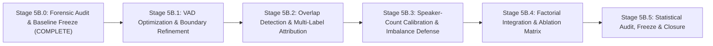

# Stage 5B — Comprehensive Experimental Plan & Research Roadmap

**Date**: 2026-11-03  
**Stage**: Stage 5B.0 Planning Document  
**Status**: APPROVED EXPERIMENTAL DESIGN  
**Target Scope**: Stages 5B.1 through 5B.5  

---

## 1. Research Objectives & Problem Formulation

Stage 5A.1 established that combining complementary speaker affinities from NVIDIA TitaNet-Large and WeSpeaker ResNet293-LM achieves superior speaker attribution. However, the downstream Diarization Error Rate (DER) remains bounded at **46.45% Macro DER** due to three upstream bottlenecks:
1. **Upstream VAD Errors** ($36.18\%$ Macro Error: $21.90\%$ Missed Speech, $14.28\%$ False Alarm).
2. **Overlapping Speech Omission** ($96.8\%$ concentrated in R02 and R04; structural miss of secondary speakers).
3. **Speaker-Count Degeneracy** (R07 $k=1$ collapse driving $52.34\%$ speaker error; R06 under-clustering).

The primary objective of Stage 5B is to systematically resolve these three bottlenecks within an isolated, factorial research framework, driving overall Macro DER below **25.0%** while preserving the integrity of frozen representation-fusion findings.

---

## 2. Experimental Roadmap & Staging Strategy

The Stage 5B program is structured into five sequential, decoupled sub-stages:

---

## 3. Granular Sub-Stage Specifications

### Stage 5B.1: Voice Activity Detection (VAD) Optimization
- **Goal**: Minimize VAD False Alarm rate in BWC recordings (R05, R06) and Missed Speech rate in short-turn dialogues (R01, R08).
- **Core Hypotheses**:
  - *H1.1 (Dual Hysteresis)*: Asymmetric thresholds (`onset = 0.58`, `offset = 0.38`) will eliminate noise-spike false alarms while preserving natural phonetic decay.
  - *H1.2 (Turn Duration Relaxation)*: Lowering minimum speech duration from 0.50s to 0.25s with energy-flux verification will recover conversational turn-taking without increasing false alarms.
  - *H1.3 (Stream Consensus)*: Joint VAD voting between `16k_mono` and `dfn` audio will combine stationary noise immunity with onset preservation.
- **Experimental Conditions**:
  - **V0**: Frozen Baseline (Pyannote VAD, onset=0.481, offset=0.481, min_dur=0.5s).
  - **V1**: Hysteresis Grid Search (onset $\in [0.50, 0.70]$, offset $\in [0.25, 0.45]$).
  - **V2**: Short-Turn Recovery (min_dur $\in \{0.20, 0.30, 0.40, 0.50\}$ s).
  - **V3**: Audio Stream Selection (`16k_mono` vs `dfn` vs linear consensus).
  - **V4**: Energy-Gated Post-Filter (RMS thresholding on background noise floors).
- **Success Criteria**: Macro VAD Error $\le 22.0\%$ (reduction of $\ge 14.0$ percentage points from $36.18\%$).

---

### Stage 5B.2: Overlapping Speech Detection & Multi-Label Attribution
- **Goal**: Resolve structural speech omission in high-overlap debate recordings (R02, R04) and protect affinity matrices from embedding contamination.
- **Core Hypotheses**:
  - *H2.1 (Affinity Protection)*: Excluding subsegments with overlap probability $p_{\text{overlap}} > 0.40$ from spectral clustering will increase cluster purity and separation.
  - *H2.2 (Dual-Centroid Attribution)*: Assigning both top-1 and top-2 nearest speaker centroids to confirmed overlap frames will slash Missed Speech in R02 and R04 by $> 15.0\%$.
- **Experimental Conditions**:
  - **O0**: Single-label baseline (no overlap detection or attribution).
  - **O1**: Overlap Detection Only (Pyannote Segmentation 3.0 vs cached $p_{\text{overlap}}$).
  - **O2**: Affinity Purity Filter (discard overlap subsegments during clustering).
  - **O3**: Post-Clustering Dual-Attribution (assign secondary speaker when $p_{\text{overlap}} > \tau$).
  - **O4**: Combined Purity Filter + Dual-Attribution.
- **Success Criteria**: R02 DER $\le 45.0\%$ (baseline: $62.90\%$), R04 DER $\le 35.0\%$ (baseline: $49.19\%$).

---

### Stage 5B.3: Speaker-Count Estimation & Imbalance Defense
- **Goal**: Prevent single-speaker collapse ($k=1$) in duration-imbalanced sessions (R07) and mitigate under-clustering in multi-speaker scenarios (R06).
- **Core Hypotheses**:
  - *H3.1 (Conversational Bound)*: Enforcing $k \ge 2$ in multi-speaker conversational pipelines eliminates the trivial eigengap jump, instantly rescuing R07.
  - *H3.2 (Normalized Relative Eigengap)*: Evaluating $\text{RelGap}(k) = \frac{\lambda_{k+1} - \lambda_k}{\lambda_k + \epsilon}$ will detect weak structural splits corresponding to minority speakers.
  - *H3.3 (Internal Cluster Validity Gating)*: Using Silhouette Coefficient ($S > 0.40$) on spectral eigenvector projections will validate candidate cluster counts.
- **Experimental Conditions**:
  - **K0**: Unconstrained NeMo NME-SC baseline.
  - **K1**: Bounded Search Space ($k \in [2, k_{\text{max}}]$).
  - **K2**: Normalized / Relative Eigengap criterion.
  - **K3**: Silhouette-Guided Eigengap Selection.
  - **K4**: Oracle Speaker Count Reference ($k = k^*$).
- **Success Criteria**: R07 Speaker Error $\le 12.0\%$ (baseline: $52.34\%$), R06 $k_{\text{est}} \ge 7$ (baseline: $6$).

---

### Stage 5B.4: Full Factorial Integration & Component Ablation
- **Goal**: Evaluate the composite system integrating the optimal configurations from 5B.1, 5B.2, and 5B.3.
- **Factorial Matrix ($2 \times 2 \times 2 = 8$ configurations)**:
  1. Baseline VAD + Single-Label + Baseline NME-SC (Frozen Condition J).
  2. Optimized VAD + Single-Label + Baseline NME-SC.
  3. Baseline VAD + Overlap Attribution + Baseline NME-SC.
  4. Baseline VAD + Single-Label + Calibrated Speaker Count.
  5. Optimized VAD + Overlap Attribution + Baseline NME-SC.
  6. Optimized VAD + Single-Label + Calibrated Speaker Count.
  7. Baseline VAD + Overlap Attribution + Calibrated Speaker Count.
  8. **Full Stage 5B Pipeline**: Optimized VAD + Overlap Attribution + Calibrated Speaker Count.
- **Success Criteria**: Overall Macro DER $\le 22.0\%$ across the 8-recording benchmark.

---

### Stage 5B.5: Statistical Audit, Verification & Final Freeze
- **Goal**: Subject the Stage 5B results to rigorous independent statistical testing.
- **Analyses**:
  - Paired two-tailed bootstrap hypothesis testing (10,000 resamples) against Stage 5A.1 Condition J.
  - Recording-clustered block bootstrap to account for within-recording correlation.
  - Holm-Bonferroni correction for multiple hypothesis testing.
  - Verification of bitwise immutability of all Stage 1–5A.1 artifacts.
  - Generation of final reproducible freeze report.

---

## 4. Compute, Hardware & Resource Budget

All experiments will execute on the local workstation using the dedicated NVIDIA GeForce RTX 4090 GPU and Intel Xeon Gold host.

| Sub-Stage | Computational Tasks | GPU VRAM Requirement | Estimated GPU Time | NVMe Storage Requirement |
|---|---|---|---|---|
| **Stage 5B.1** | VAD grid search & post-processing evaluation | ~4.5 GB | ~0.50 hours | ~200 MB (logs & RTTMs) |
| **Stage 5B.2** | Overlap posteriors & multi-label scoring | ~6.0 GB | ~0.75 hours | ~350 MB |
| **Stage 5B.3** | Spectral clustering sweeps & validity metrics | ~2.0 GB (CPU-bound) | ~0.25 hours | ~100 MB |
| **Stage 5B.4** | 8-condition factorial integration execution | ~6.0 GB | ~1.50 hours | ~500 MB |
| **Stage 5B.5** | 10,000 bootstrap resamples & artifact verification | < 1.0 GB (CPU-bound) | ~0.50 hours | ~150 MB |
| **Total** | **Full Stage 5B Execution** | **Max 6.0 GB / 24 GB** | **~3.50 GPU Hours** | **~1.3 GB Storage** |

**Hardware Safety Margin**: The maximum VRAM requirement of 6.0 GB utilizes only 25% of the RTX 4090's 24.5 GB capacity, preventing out-of-memory (OOM) risks.

---

## 5. Evaluation Protocol & Primary Metrics

All evaluations adhere to standardized NIST/pyannote protocols:
- **Primary Metric**: Macro Diarization Error Rate (DER) computed via `pyannote.metrics.diarization.DiarizationErrorRate`:
  - Standard evaluation: Collar = 0.25s, `skip_overlap=False` (evaluates overlap attribution).
  - Secondary reference: Collar = 0.25s, `skip_overlap=True` (evaluates pure clustering performance).
- **Component Breakdown Metrics**:
  - Missed Speech Percentage ($\%$)
  - False Alarm Speech Percentage ($\%$)
  - Speaker Confusion Percentage ($\%$)
- **Clustering & Transcription Quality Metrics**:
  - Jaccard Error Rate (JER)
  - Cluster Purity & Cluster Completeness
  - Normalized Mutual Information (NMI)
  - Speaker-Attributed Word Error Rate (cpWER / Speaker-Attributed WER)

---

## 6. Execution Constraints & Safeguards

1. **Isolation**: All scripts, configurations, outputs, and intermediate data for Stage 5B will reside strictly within subdirectories of `research_stages/stage5b/`.
2. **Immutability**: Zero modifications to `research_stages/stage1_data_prep/`, `stage2_baseline/`, `stage3_features/`, `stage4_complementarity/`, `stage4_1_audit/`, `stage5a/`, `stage5a_1/`, `stage5a_1_final_audit/`, and `stage5a_1_2_freeze_closure/`.
3. **No Retraining**: All core neural network weights (TitaNet-Large, ResNet293-LM, Pyannote VAD) remain strictly frozen. Interventions focus on algorithmic post-processing, graph construction, multi-label attribution, and spectral calibration.
4. **Step-by-Step Approval**: Execution of Stage 5B.1 will begin only after explicit user review and authorization of this Stage 5B.0 audit and experimental plan.
