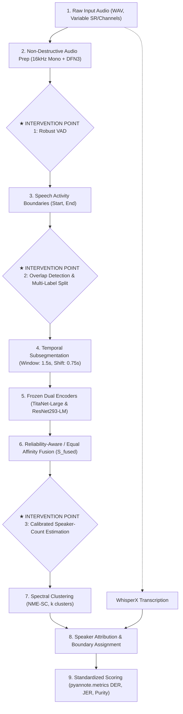

# Stage 5B.0 — Pipeline Dependency Map & Architecture Specification

**Date**: 2026-11-03  
**Stage**: Stage 5B.0  
**Status**: APPROVED ARCHITECTURE  
**Target Scope**: Modular Pipeline Integration for Stage 5B  

---

## 1. High-Level Pipeline Architecture

The speaker diarization and attribution pipeline operates in nine discrete, modular stages. This document specifies the exact data contracts, tensor dimensions, algorithmic interfaces, and failure propagation characteristics between stages, highlighting the three critical intervention points for Stage 5B.

---

## 2. Stage-by-Stage Data Contracts & Interfaces

### Stage 1: Non-Destructive Audio Preparation
- **Inputs**: Raw source WAV audio file `data/audio/{recording_id}.wav`.
- **Processing**:
  - Resampling to 16,000 Hz, single channel (mono), 16-bit signed PCM.
  - Path A enhancement: DeepFilterNet3 spectral masking and noise suppression.
  - Path B standard: Peak/LUFS loudness normalization without nonlinear filtering.
- **Outputs**:
  - `audio/16k_mono/{recording_id}.wav`
  - `audio/dfn/{recording_id}.wav`
- **Integrity Guarantee**: Source files are read-only; outputs are verified for sample rate, zero NaNs, and clipping.

---

### Stage 2: Voice Activity Detection (VAD) — [INTERVENTION POINT 1]
- **Current Baseline**:
  - Pretrained `PyanNet` (`assets/pytorch_model.bin`) running on 16kHz audio.
  - Sliding frame analysis: 16ms frame stride.
  - Post-processing heuristics: Onset threshold = 0.481, Offset threshold = 0.481, Minimum speech duration = 0.5s, Minimum silence duration = 0.3s.
- **Defects Identified**:
  - High false alarms on continuous background noise (R05: 37.79% FA, R06: 41.33% FA).
  - Excessive missed speech on soft, conversational turns due to 0.5s minimum speech cutoff.
  - Signal degradation when running VAD on DFN-filtered audio (DFN attenuates soft word-final consonants).
- **Stage 5B Intervention (Point 1)**:
  - Optimize dual-threshold hysteresis (`onset`, `offset`).
  - Introduce acoustic SNR-conditioned threshold adaptation or energy-based secondary verification.
  - Retain short turns (reduce minimum speech duration to 0.2s–0.3s) while applying non-speech filtering.
  - Determine optimal VAD input stream (16k_mono vs DFN vs ensemble).

---

### Stage 3: Temporal Subsegmentation & Overlap Detection — [INTERVENTION POINT 2]
- **Current Baseline**:
  - Each continuous VAD segment is chopped into uniform overlapping windows of length $W = 1.5$ seconds with stride $S = 0.75$ seconds.
  - Segments shorter than $W$ are padded or kept as single subsegments.
  - Single-speaker assumption: Every subsegment is assumed to contain exactly one speaker.
- **Defects Identified**:
  - In conversational debates (R02: 34.6% overlap, R04: 51.1% overlap), speech turns overlap heavily.
  - The current pipeline discards the secondary speaker, leading directly to 49.33% Miss in R02 and 28.52% Miss in R04.
  - When overlapping speech is encoded into a single embedding, the embedding is a contaminated mixture, pulling the cluster centroid into confusion.
- **Stage 5B Intervention (Point 2)**:
  - Overlap segment detection: Identify multi-speaker regions using Pyannote segmentation posteriors ($p_{\text{overlap}} > \tau$).
  - Dual-attribution mechanism: Assign two speaker labels to confirmed overlap intervals during downstream RTTM generation.
  - Embedding purity filter: Exclude high-overlap subsegments from affinity matrix construction and cluster estimation, re-attributing them post-clustering using nearest-centroid projection.

---

### Stage 4: Dual Representation Feature Extraction
- **Inputs**: Temporal subsegment intervals $[t_{\text{start}}, t_{\text{end}}]$ and audio files.
- **Processing**:
  - Path A: NVIDIA TitaNet-Large on `audio/dfn/{recording_id}.wav` $\rightarrow z_A \in \mathbb{R}^{192}$, $||z_A||_2 = 1$.
  - Path B: WeSpeaker ResNet293-LM on `audio/16k_mono/{recording_id}.wav` $\rightarrow z_B \in \mathbb{R}^{256}$, $||z_B||_2 = 1$.
- **Outputs**:
  - Saved feature cache: `features/{recording_id}_titanet_dfn.npz` and `features/{recording_id}_resnet_16k.npz`.
  - Feature matrix dimensions: $N \times 192$ and $N \times 256$, where $N$ is the number of subsegments.

---

### Stage 5: Affinity Matrix Construction & Fusion
- **Processing**:
  - Compute raw cosine similarities: $S_A = Z_A Z_A^T \in \mathbb{R}^{N \times N}$, $S_B = Z_B Z_B^T \in \mathbb{R}^{N \times N}$.
  - Min-max or unit-interval affinity normalization: $S_A^{\text{norm}} = \frac{S_A - \min(S_A)}{\max(S_A) - \min(S_A)}$.
  - Equal Fusion (Condition J): $S_{\text{fused}} = 0.5 \cdot S_A^{\text{norm}} + 0.5 \cdot S_B^{\text{norm}}$.
  - Reliability-Aware Fusion (Condition G/K): Weighting based on frame SNR or logistic gate.

---

### Stage 6: Speaker-Count Estimation & Spectral Clustering — [INTERVENTION POINT 3]
- **Current Baseline**:
  - Normalized Maximum Eigengap Spectral Clustering (NME-SC, NeMo implementation).
  - Neighborhood sparsification: Parameter $p \in [p_{\text{min}}, p_{\text{max}}]$ (e.g. 1% to 30% of $N$) keeps the top-$p$ neighbors per row.
  - Laplacian construction: $L_{\text{sym}} = I - D^{-1/2} S_{\text{sparsified}} D^{-1/2}$.
  - Eigen-decomposition: Eigenvalues $\lambda_1 \le \lambda_2 \le \dots \le \lambda_{k_{\text{max}}}$.
  - Eigengap formula: $k_{\text{est}} = \text{argmax}_{1 \le k \le k_{\text{max}}} (\lambda_{k+1} - \lambda_k) + 1$.
- **Defects Identified**:
  - Single-speaker collapse in R07: Ground truth has 87% Speaker 1 and 12% Speaker 2. Because of this massive imbalance, $\lambda_2 - \lambda_1$ dominates all higher eigengaps across all candidate $p$ values, forcing $k_{\text{est}} = 1$. This results in 52.34% speaker error!
  - Under-clustering in R06: 9 ground-truth speakers clustered into 5–6 because peripheral speakers with short turns have small graph connectivity.
- **Stage 5B Intervention (Point 3)**:
  - Multi-scale eigengap analysis: Disallow $k=1$ when secondary graph connectivity exceeds a non-triviality threshold.
  - Threshold-based eigengap / relative eigengap ratio: $\text{gap}_k / \sum_{i} \text{gap}_i$.
  - Silhouette / Davies-Bouldin validation: Verify embedding separation in $k$-means projection before accepting $k_{\text{est}}$.
  - Fallback calibration: Floor minimum speaker count to $k \ge 2$ when conversation dynamics indicate turn-taking.

---

### Stage 7: Downstream Attribution, ASR Alignment & Scoring
- **Processing**:
  - Map cluster indices to contiguous speech segments.
  - In overlap regions (Point 2), assign both primary and secondary speaker labels.
  - Word-level attribution: WhisperX words are aligned with speaker intervals.
  - Scoring: `pyannote.metrics.diarization.DiarizationErrorRate(collar=0.25, skip_overlap=False)`.
- **Metrics Computed**:
  - Overall DER = Missed Speech + False Alarm + Speaker Confusion.
  - JER (Jaccard Error Rate).
  - Cluster Purity, NMI, and B-Cubed F1.

---

## 3. Modular Decoupling & Isolation Principles

To ensure scientific validity during Stage 5B:
1. **Zero Contamination**: Modifications to VAD (Point 1), Overlap (Point 2), and Speaker-Count (Point 3) must be evaluated in strict, factorial isolation before end-to-end combination.
2. **Standard Collar**: All DER metrics are reported with collar = 0.25s, both with overlap evaluation (`skip_overlap=False`) and without overlap evaluation (`skip_overlap=True`) to maintain rigorous comparability.
3. **Reproducibility Guarantee**: Every experiment configuration must be declared via JSON configs with deterministic random seeds.
