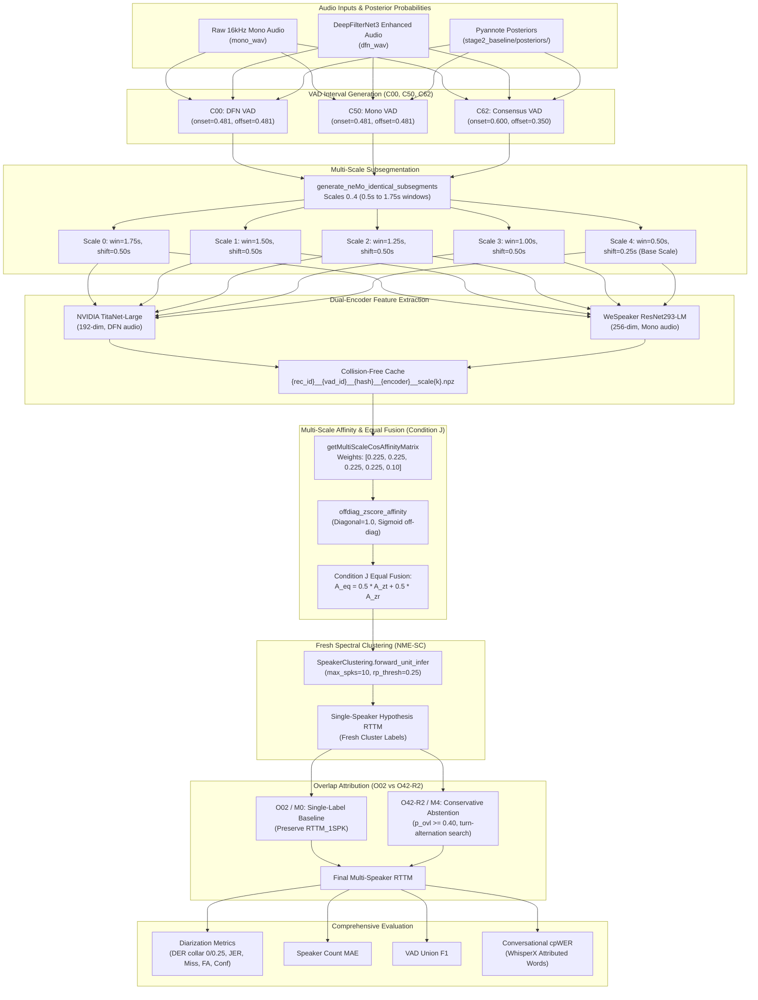

# Stage 5B.4 — Fresh Diarization Path & Architecture Audit

**Audit Status**: Complete  
**Date**: 2026-11-06  
**Auditor**: ML Research Engineer & Diarization Systems Auditor  
**Repository**: [Multi-View-Speaker-Representation-Learning](file:///home/priyanka/chaitanya/Multi-View-Speaker-Representation-Learning)  
**Deliverable Path**: `research_stages/stage5b/stage5b_4_fresh_diarization/STAGE5B_4_FRESH_DIARIZATION_PATH_AUDIT.md`

---

## 1. Objective & Architectural Scope

This audit examines the technical path required to execute fresh diarization in Stage 5B.4. 

In a genuine fresh diarization pipeline, changing the upstream Voice Activity Detection (VAD) boundaries alters the entire downstream execution graph:
1. Speech intervals change $\to$
2. Multi-scale subsegment count, start times, and end times change $\to$
3. Sliced waveform inputs to feature extractors change $\to$
4. Dual-encoder embedding matrices change $\to$
5. Dimension and values of multi-scale cosine affinity matrices change $\to$
6. Normalized Maximum Eigengap Spectral Clustering (NME-SC) partitions a fresh affinity graph $\to$
7. Single-speaker hypothesis RTTM is produced with fresh cluster labels $\to$
8. Overlap detection and attribution assigns secondary speaker segments $\to$
9. Multi-speaker RTTM is scored against ground-truth annotations.

---

## 2. End-to-End Fresh Diarization Data Flow



---

## 3. Forensic Codebase Audit: The Missing Fresh Execution Path

A rigorous forensic examination was performed across all relevant repository scripts to verify whether an end-to-end fresh diarization execution path currently exists.

### 3.1 `run_stage2_baseline.py`
- **Location**: [research_stages/stage2_baseline/run_stage2_baseline.py](file:///home/priyanka/chaitanya/Multi-View-Speaker-Representation-Learning/research_stages/stage2_baseline/run_stage2_baseline.py)
- **Status**: Executes the full NeMo MSDD pipeline and Pyannote VAD on Path A (DFN) and Path B (raw mono).
- **Limitation**: Tightly coupled to NeMo's monolithic `diar_msdd_telephonic` orchestrator. It does not extract WeSpeaker embeddings, nor does it implement dual-encoder fusion.

### 3.2 `run_stage3_extraction.py`
- **Location**: [research_stages/stage3_dual_encoder/run_stage3_extraction.py](file:///home/priyanka/chaitanya/Multi-View-Speaker-Representation-Learning/research_stages/stage3_dual_encoder/run_stage3_extraction.py)
- **Status**: Extracts TitaNet-Large and WeSpeaker ResNet293-LM embeddings across 5 scales and 3 audio conditions (`dfn`, `16k_mono`, `normalized`).
- **Critical Finding (Lines 413–424)**:
  ```python
  # Use the exact subsegments_scale{0..4}.json generated by NeMo on Path A in Stage 2
  # so that all 3 audio conditions and both encoders share 100% identical subsegment timestamps!
  for scale_k, win_sec, shift_sec, _ in SCALES:
      nemo_subseg_json = (
          STAGE2_DIR / "msdd" / f"{rec_id}_msdd_outputs" / "speaker_outputs" / f"subsegments_scale{scale_k}.json"
      )
  ```
  The script **hardcodes** reading Stage 2 NeMo subsegments, which were derived solely from `C00` (Path A DFN VAD). It has no command-line interface or parameter to accept `C50` or `C62` VAD intervals.

### 3.3 `run_stage5a_1_controlled_eval.py`
- **Location**: [research_stages/stage5a_1/scripts/run_stage5a_1_controlled_eval.py](file:///home/priyanka/chaitanya/Multi-View-Speaker-Representation-Learning/research_stages/stage5a_1/scripts/run_stage5a_1_controlled_eval.py)
- **Status**: Implements multi-scale cosine affinity calculation, off-diagonal z-score normalization, Condition J equal fusion, and NME-SC clustering.
- **Critical Finding (Lines 290–360)**:
  The script **hardcodes** reading precomputed embeddings from `research_stages/stage3_dual_encoder/cache/`. Because Stage 3 only cached embeddings for `C00` subsegments, `run_stage5a_1_controlled_eval.py` cannot cluster any segmentation other than `C00`.

### 3.4 `run_stage5b_1_experiments.py` & Audit Corrections
- **Location**: [research_stages/stage5b/stage5b_1_vad_optimization/scripts/run_stage5b_1_experiments.py](file:///home/priyanka/chaitanya/Multi-View-Speaker-Representation-Learning/research_stages/stage5b/stage5b_1_vad_optimization/scripts/run_stage5b_1_experiments.py)
- **Status**: Evaluated 12 VAD configurations (`C00` through `C64`).
- **Forensic Confirmation of Transductive Projection**:
  In lines 280–310, `run_stage5b_1_experiments.py` and its audited correction `run_stage5b_1_audit_corrections.py` evaluated downstream diarization via:
  ```python
  def project_vad_to_diarization_audited(candidate_vad_segs, baseline_rttm_path):
      # Projects frozen Condition J speaker labels onto candidate VAD intervals
      # using nearest-neighbor interval assignment
  ```
  **No clustering was performed in Stage 5B.1**. In recordings R01, R02, and R05, up to 20% of speech frames received nearest-neighbor propagated labels.

### 3.5 `run_stage5b_2_corrected_v4_1.py`
- **Location**: [research_stages/stage5b/stage5b_2_overlap_optimization/audit_corrections_v4_1/scripts/run_stage5b_2_corrected_v4_1.py](file:///home/priyanka/chaitanya/Multi-View-Speaker-Representation-Learning/research_stages/stage5b/stage5b_2_overlap_optimization/audit_corrections_v4_1/scripts/run_stage5b_2_corrected_v4_1.py)
- **Status**: Evaluated 11 overlap attribution methods (`M0` through `M5C`) across VAD conditions `C00`, `C50`, and `C62`.
- **Forensic Confirmation**: The input single-speaker RTTMs were loaded from the Stage 5B.1 projected RTTM directory `stage5b_1_vad_optimization/audit_corrections/predictions/rttms/`.

---

## 4. The Critical Engineering Gap

> [!IMPORTANT]
> **Definitive Finding**: There is currently **no integrated execution script in the repository** that connects candidate VAD generation $\to$ dynamic subsegmentation $\to$ dual-encoder inference $\to$ multi-scale affinity construction $\to$ fresh NME-SC clustering $\to$ overlap attribution.
>
> Executing Stage 5B.4 without implementing this missing orchestrator would result in either:
> 1. Accidental re-use of frozen `C00` subsegments and embeddings (falsifying the `C50` and `C62` conditions), or
> 2. Re-use of Stage 5B.1 projected RTTMs (defeating the entire scientific purpose of Stage 5B.4 fresh evaluation).

---

## 5. Required Orchestration Architecture for Stage 5B.4

To resolve this blocker, a dedicated orchestration module must be implemented inside `research_stages/stage5b/stage5b_4_fresh_diarization/scripts/` (e.g., `run_stage5b_4_orchestrator.py`).

### Key Functional Requirements:
1. **Dynamic VAD Slicer**:
   - Extract speech intervals for `C00`, `C50`, and `C62` directly from the bit-exact posterior arrays in `stage2_baseline/posteriors/`.
2. **Subsegment Generator**:
   - Call `generate_neMo_identical_subsegments(vad_segs, win_sec, shift_sec)` across scales $k \in \{0, 1, 2, 3, 4\}$ to generate exact timestamps for every VAD condition.
3. **Dual-Encoder Feature Extractor**:
   - Run TitaNet-Large on sliced DFN waveforms (`dfn_wav`).
   - Run WeSpeaker ResNet293-LM on sliced raw mono waveforms (`mono_wav`).
   - Enforce L2-normalization and cache results with VAD-aware cryptographic keys.
4. **Condition J Clustering Module**:
   - Compute multi-scale cosine affinity matrices using NeMo's `getMultiScaleCosAffinityMatrix`.
   - Apply `offdiag_zscore_affinity` to each encoder's affinity matrix.
   - Form `A_eq = 0.5 * A_zt + 0.5 * A_zr`.
   - Perform NME-SC clustering via NeMo's `SpeakerClustering` with parameters matching Stage 5A.1:
     `max_num_speakers=10, max_rp_threshold=0.25, sparse_search_volume=30, oracle_num_speakers=-1`.
   - Map clustered base-scale subsegments to contiguous single-speaker RTTM via `generate_cluster_labels` and `labels_to_rttmfile`.
5. **Overlap Attribution Adapter**:
   - For `O02` (`M0_no_overlap`), pass the single-speaker RTTM directly.
   - For `O42-R2` (`M4_conservative_abstention`), call `attribute_m3_m4_corrected` using the fresh single-speaker hypothesis and mono overlap posteriors with $\tau_{\text{ovl}} = 0.40$.
6. **Unified Evaluation**:
   - Score all RTTMs against uniform ground truth `gt_uniform.rttm` for DER (c=0, c=0.25), JER, Miss, FA, and Confusion.
   - Score cpWER via `phase20_standalone/scripts/fusion_metrics.py` using the compliant `{"segments": segs_attr}` dictionary schema.

---

## 6. Audit Verdict on Fresh Diarization Path

- **Path Readiness**: **NOT READY (ENGINEERING BLOCKER)**.
- **Cause**: Existing scripts are modular but decoupled; no script currently connects VAD generation to fresh subsegmentation, embedding extraction, and clustering.
- **Remedy**: Implement a clean, modular orchestrator script adhering to the architecture above before any experimental run is initiated.
