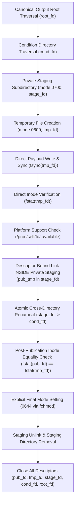

# Stage 5B.4-A.1.3.2.2 — Implementation Report
**Document ID**: `STAGE5B_4_A1_3_2_2_IMPLEMENTATION_REPORT.md`  
**Date**: November 10, 2026  
**Status**: COMPLETE / VERIFIED  
**Baseline Git HEAD**: `2c7c185` ("Stage 5B.4-A.1.3.2.1 — Final Security and Integration Closure")  
**Workspace**: `research_stages/stage5b/stage5b_4_fresh_diarization/a1_remediation/a1_3_2_2_rttm_atomic_publication/`

---

## 1. Background and Motivation

During the independent source-code audit of Stage 5B.4-A.1.3.2.1, a residual pathname substitution race was identified in the RTTM output writer (`output_path_guard.py`):

> *In Stage 5B.4-A.1.3.2.1, `revalidate_and_write_rttm()` wrote temporary RTTM contents using a file descriptor, closed the file descriptor upon exiting `os.fdopen()`, verified the temporary file using `os.stat(tmp_filename, dir_fd=cond_fd, follow_symlinks=False)`, and published it via `os.rename(tmp_filename, filename, src_dir_fd=cond_fd, dst_dir_fd=cond_fd)`.*
>
> *Because both `os.stat` and `os.rename` resolved the temporary file by its directory pathname `tmp_filename`, an actor with write access to the condition directory could substitute or overwrite the directory entry between verification and publication. Consequently, the published inode was not descriptor-bound or cryptographically bound to the inode that passed verification.*

Stage 5B.4-A.1.3.2.2 was authorized as a targeted micro-correction to eliminate this race condition without reopening any prior architectural or security finding.

---

## 2. Implementation Architecture

The micro-correction refactors `revalidate_and_write_rttm()` into an end-to-end descriptor-bound lifecycle:

### Detailed Sequence of Operations:

1. **Root and Condition Traversal**:
   - `root_fd = os.open(output_root, os.O_RDONLY | os.O_DIRECTORY | os.O_NOFOLLOW)`
   - `cond_fd = os.open(cond_id, os.O_RDONLY | os.O_DIRECTORY | os.O_NOFOLLOW, dir_fd=root_fd)`
   - Pre-existing destination is inspected via `os.stat(filename, dir_fd=cond_fd, follow_symlinks=False)`:
     - Symlinks are strictly prohibited and immediately rejected with `OutputSecurityError`.
     - Directories are rejected with `OutputSecurityError`.

2. **Private Staging Directory**:
   - Staging directory name: `.stage_{rec_id}_{pid}_{token}`
   - Created with restrictive mode `0700` inside `cond_fd`: `os.mkdir(stage_name, mode=0o700, dir_fd=cond_fd)`
   - Opened as a directory descriptor: `stage_fd = os.open(stage_name, os.O_RDONLY | os.O_DIRECTORY | os.O_NOFOLLOW, dir_fd=cond_fd)`
   - The `0700` permissions prevent any other local user on the system from enumerating or modifying entries within the staging directory.

3. **Temporary File Creation and Retained Descriptor**:
   - Created relative to `stage_fd` with `O_WRONLY | os.O_CREAT | os.O_EXCL | os.O_NOFOLLOW` and mode `0600`.
   - The resulting `tmp_fd` is retained continuously throughout the write, verification, and publication lifecycle.
   - The file is **never closed or reopened by pathname**.

4. **Payload Write and Direct Inode Verification**:
   - Formatted RTTM lines are encoded to UTF-8 bytes and written directly via `os.write(tmp_fd, chunk)` in a loop.
   - `os.fsync(tmp_fd)` commits data to persistent storage.
   - Inode verification is executed via `st_tmp = os.fstat(tmp_fd)`:
     - Regular file: `stat.S_ISREG(st_tmp.st_mode) is True`
     - Link count: `st_tmp.st_nlink == 1`
     - Size: `st_tmp.st_size == expected_bytes`
     - Mode: `stat.S_IMODE(st_tmp.st_mode) == 0o600`
   - If any verification check fails, publication is aborted immediately.

5. **Descriptor-Bound Atomic Publication via Private Staging Containment**:
   - Platform support is verified: `/proc/self/fd/{tmp_fd}` is checked, and `os.rename` in `os.supports_dir_fd` is asserted.
   - The verified descriptor is linked **INSIDE `stage_fd`** as `.pub_tmp_{rec_id}_{pid}_{token}.rttm` using:
     `os.link(f"/proc/self/fd/{tmp_fd}", pub_tmp_name, dst_dir_fd=stage_fd)`
   - Because `pub_tmp_name` is created inside `stage_fd` (mode `0700`), it is completely protected from unprivileged processes with write access to `cond_dir`. No ephemeral directory entry is ever exposed in `cond_dir`.
   - Atomic replacement: `os.rename(pub_tmp_name, filename, src_dir_fd=stage_fd, dst_dir_fd=cond_fd)` atomically links the destination directory entry directly from the private staging directory in a single syscall.
   - Pre-existing destination inodes are never opened with `O_TRUNC` or modified. Any external hard link to a previous destination inode retains 100% of its data byte-identically.

6. **Post-Publication Inode Identity Verification & Safe Cleanup**:
   - The published destination is opened relative to `cond_fd`:
     `pub_fd = os.open(filename, os.O_RDONLY | os.O_NOFOLLOW, dir_fd=cond_fd)`
   - Its inode and device identity are compared directly against the verified temporary descriptor:
     `st_pub = os.fstat(pub_fd)`
     `assert st_pub.st_dev == st_tmp.st_dev and st_pub.st_ino == st_tmp.st_ino`
   - If a mismatch occurs, the pipeline fails closed immediately without performing unsafe pathname-based unlinks, which could race with concurrent entries.
   - Explicit final mode setting: `os.fchmod(pub_fd, 0o644)`.
   - `pub_fd` is closed.

7. **Staging Cleanup and Error Handling**:
   - The staging directory entry `tmp_filename` is unlinked via `os.unlink(tmp_filename, dir_fd=stage_fd)`.
   - `tmp_fd` is closed.
   - `stage_fd` is closed.
   - Staging directory is removed: `os.rmdir(stage_name, dir_fd=cond_fd)`.
   - In all `finally` blocks, any unlinked ephemeral links in `stage_fd`, staging files, staging directories, and open file descriptors are guaranteed to be closed and cleaned up.

---

## 3. Remediated Files and Code Artifacts

1. **`scripts/output_path_guard.py`**:
   - Updated module docstrings and comments, removing all references to the obsolete `ftruncate` workflow.
   - Refactored `revalidate_and_write_rttm()` with the descriptor-bound creation, staging directory containment, direct `fstat()` verification, `/proc/self/fd` linking inside `stage_fd`, direct cross-directory atomic `renameat`, post-publication inode match check without unsafe unlinks, and guaranteed cleanup.
   - Integrated deterministic test hooks (`_test_hook_after_create`, `_test_hook_after_verify`, `_test_hook_after_link`, `_test_hook_after_rename`, `_test_publication_mechanism_override`).
2. **`scripts/path_utils.py`**:
   - Added `get_a1_3_2_2_dir()`.
3. **`scripts/verify_manifest.py`**:
   - Added `A1_3_2_1_MANIFEST.json` to the protected baseline manifests (now 13 baselines).
   - Configured `A1_3_2_2_MANIFEST.json` as the default deliverables manifest.
4. **`tests/test_rttm_descriptor_bound_publication.py`**:
   - Implemented 18 comprehensive adversarial tests covering all required failure modes, race attempts, hard link preservations, post-rename substitution detection, and cleanup safety.
5. **`tests/test_manifest_validation.py`**:
   - Updated baseline count assertion to 13 protected manifests.

---

## 4. Verification Verdict

All 18 adversarial tests passed (100%).  
All 69 A.1.3.2.2 tests passed (100%).  
All 304 regression tests across historical suites passed (100%).  
All 13 protected baseline manifests verified untouched (100%).
