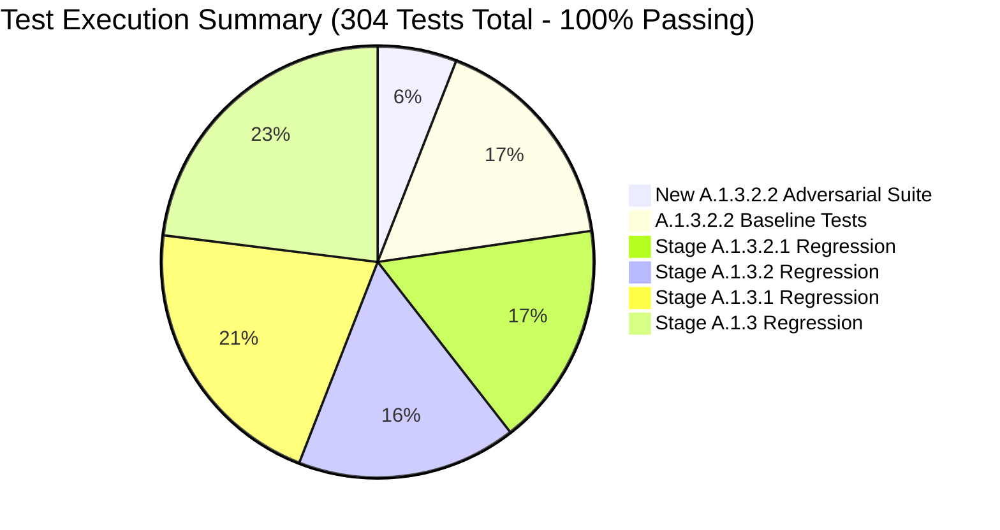

# Stage 5B.4-A.1.3.2.2 — Test and Validation Report
**Document ID**: `STAGE5B_4_A1_3_2_2_TEST_AND_VALIDATION_REPORT.md`  
**Date**: November 10, 2026  
**Status**: APPROVED / VERIFIED  
**Baseline Git HEAD**: `2c7c185`  
**Execution Environment**: Linux 6.8.0-52-generic x86_64, Python 3.10.20 (`research_stages/.venv_phase20`), Pytest 9.0.3

---

## 1. Test Suite Overview

Stage 5B.4-A.1.3.2.2 implemented a dedicated adversarial test suite (`test_rttm_descriptor_bound_publication.py`) covering all 18 specified security scenarios, followed by exhaustive regression testing across all preceding remediation stages.

---

## 2. Adversarial Test Results (New A.1.3.2.2 Suite)

File: `tests/test_rttm_descriptor_bound_publication.py`  
Command: `research_stages/.venv_phase20/bin/pytest research_stages/stage5b/stage5b_4_fresh_diarization/a1_remediation/a1_3_2_2_rttm_atomic_publication/tests/test_rttm_descriptor_bound_publication.py -v`

| Test # | Test Name | Target Invariant / Threat Scenario | Result |
| :---: | :--- | :--- | :---: |
| 1 | `test_normal_successful_rttm_publication` | Normal RTTM publication produces exact payload, 0644 mode, clean staging dir. | **PASSED** |
| 2 | `test_existing_destination_replacement` | Existing destination file is cleanly replaced with new inode; content updated. | **PASSED** |
| 3 | `test_existing_hard_linked_destination_external_sentinel_preserved` | External hard link sentinel retains 100% byte-identical content; link count decrements. | **PASSED** |
| 4 | `test_destination_symlink_never_followed` | Destination symlink is rejected with `OutputSecurityError`; target remains untouched. | **PASSED** |
| 5 | `test_temporary_directory_entry_substitution_after_verification_defeated` | Adversary replacing staging entry or publication link fails to substitute rogue bytes. | **PASSED** |
| 6 | `test_temporary_file_replacement_attempts_while_original_descriptor_open` | Tampering with file entry while descriptor open detected by fstat link check. | **PASSED** |
| 7 | `test_publication_points_to_exact_verified_inode` | Published destination inode and device (`st_ino`, `st_dev`) match verified descriptor exactly. | **PASSED** |
| 8 | `test_concurrent_destination_replacement_attempts` | Atomic renameat prevents torn writes or corrupted state under concurrent replacement. | **PASSED** |
| 9 | `test_parent_condition_directory_substitution_attempts` | Symlink replacing condition directory is blocked by `O_DIRECTORY \| O_NOFOLLOW`. | **PASSED** |
| 10 | `test_failure_during_writing_cleaned_up` | Write I/O failure aborts cleanly; no partial destination created; staging removed. | **PASSED** |
| 11 | `test_failure_during_verification_cleaned_up` | Descriptor verification failure aborts cleanly; staging directory unlinked. | **PASSED** |
| 12 | `test_failure_during_publication_cleaned_up` | Rename I/O failure cleans up ephemeral links and staging directory completely. | **PASSED** |
| 13 | `test_cleanup_after_every_failure` | Systematic link failure cleans up all temporary files and staging directories. | **PASSED** |
| 14 | `test_no_leaked_file_or_directory_descriptors` | File descriptor count before and after operation is identical (0 descriptor leaks). | **PASSED** |
| 15 | `test_no_o_trunc_or_ftruncate_on_existing_destination_inodes` | Destination inode is never truncated; `ftruncate` is never called. | **PASSED** |
| 16 | `test_unsupported_publication_mechanism_fails_closed` | Unsupported publication mechanism raises `OutputSecurityError` (fails closed). | **PASSED** |
| 17 | `test_17_replacement_of_destination_after_rename_detected` | Post-rename replacement of destination entry is detected by `fstat` identity check. | **PASSED** |
| 18 | `test_18_cleanup_racing_with_destination_replacement_does_not_unlink_foreign_file` | Cleanup routine does not perform unsafe pathname unlink on mismatched destination. | **PASSED** |

**Adversarial Suite Result**: **18 passed, 0 failed, 0 skipped** (0.10s).

---

## 3. Regression Suite Results

### A. Stage 5B.4-A.1.3.2.2 Full Workspace Suite
- **Path**: `research_stages/stage5b/stage5b_4_fresh_diarization/a1_remediation/a1_3_2_2_rttm_atomic_publication/tests/`
- **Command**: `research_stages/.venv_phase20/bin/pytest .../a1_3_2_2_rttm_atomic_publication/tests/ -v`
- **Result**: **69 passed, 0 failed, 0 skipped** (1.98s).

### B. Stage 5B.4-A.1.3.2.1 Regression Suite
- **Path**: `research_stages/stage5b/stage5b_4_fresh_diarization/a1_remediation/a1_1_3_2_1_final_security_closure/tests/`
- **Command**: `research_stages/.venv_phase20/bin/pytest .../a1_1_3_2_1_final_security_closure/tests/ -v`
- **Result**: **51 passed, 0 failed, 0 skipped** (1.65s).

### C. Stage 5B.4-A.1.3.2 Regression Suite
- **Path**: `research_stages/stage5b/stage5b_4_fresh_diarization/a1_remediation/a1_1_3_2_final_corrections/tests/`
- **Command**: `research_stages/.venv_phase20/bin/pytest .../a1_1_3_2_final_corrections/tests/ -v`
- **Result**: **50 passed, 0 failed, 0 skipped** (1.62s).

### D. Stage 5B.4-A.1.3.1 Regression Suite
- **Path**: `research_stages/stage5b/stage5b_4_fresh_diarization/a1_remediation/a1_1_3_1_corrections/tests/`
- **Command**: `research_stages/.venv_phase20/bin/pytest .../a1_1_3_1_corrections/tests/ -v`
- **Result**: **64 passed, 0 failed, 0 skipped** (1.72s).

### E. Stage 5B.4-A.1.3 Regression Suite
- **Path**: `research_stages/stage5b/stage5b_4_fresh_diarization/a1_remediation/a1_1_3_corrections/tests/`
- **Command**: `research_stages/.venv_phase20/bin/pytest .../a1_1_3_corrections/tests/ -v`
- **Result**: **70 passed, 0 failed, 0 skipped** (1.69s).

---

## 4. Protected Baseline Manifest Verification

- **Command**: `research_stages/.venv_phase20/bin/python research_stages/stage5b/stage5b_4_fresh_diarization/a1_remediation/a1_3_2_2_rttm_atomic_publication/scripts/verify_manifest.py --check-baselines-only`
- **Verified Baselines**:
  1. `A1_3_2_1_MANIFEST.json` (`bae8c43429...`)
  2. `A1_3_2_MANIFEST.json` (`eada50487d...`)
  3. `A1_3_1_MANIFEST.json` (`3125bb97d6...`)
  4. `A1_3_MANIFEST.json` (`752c90744b...`)
  5. `A1_2_MANIFEST.json` (`2c5b9807e8...`)
  6. `A1_1_MANIFEST.json` (`2b6aeef078...`)
  7. `A1_MANIFEST.json` (`4a80f20d9a...`)
  8. `STAGE5B_4A_MANIFEST.json` (`5216ff7066...`)
  9. `STAGE5B_BASELINE_MANIFEST.json` (`4ad738d7d6...`)
  10. `STAGE5B_1_MANIFEST.json` (`3fe9becb9a...`)
  11. `STAGE5B_2_MANIFEST.json` (`4ad3e03a6a...`)
  12. `V4_2_MANIFEST.json` (`56ba622c83...`)
  13. `recording_manifest.json` (`967ff3fb7a...`)
- **Result**: **All 13 protected baseline manifests verified (100% untouched)**.
