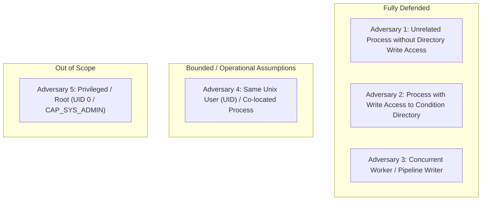

# Stage 5B.4-A.1.3.2.2 — Threat Model & Concurrency Security Analysis
**Document ID**: `STAGE5B_4_A1_3_2_2_THREAT_MODEL.md`  
**Date**: November 10, 2026  
**Status**: APPROVED / VERIFIED  
**Subject**: Formal Threat Boundary Delineation for RTTM File Publication

---

## 1. Adversary Classes and Threat Boundaries

To maintain rigorous security claims, the defense guarantees of Stage 5B.4-A.1.3.2.2 are evaluated against four distinct adversary classes:

---

## 2. Threat Analysis by Adversary Class

### Adversary Class 1: Unrelated Process without Output Directory Write Access

- **Capabilities**: An unprivileged process running under a different user account without write access to `research_stages/stage5b/stage5b_4_fresh_diarization/outputs/` or its subdirectories.
- **Attack Vector**: Reading confidential intermediate files, attempting unauthorized directory listing, or altering files in place.
- **Stage 5B.4-A.1.3.2.2 Defense**:
  1. Temporary creation occurs in a private staging directory with mode `0700` (`rwx------`). Even if group read is enabled on the condition directory, only the file owner can traverse into the private staging directory.
  2. The temporary file is created with mode `0600` (`rw-------`).
  3. Destination file is published with mode `0644`.
- **Verdict**: **FULLY DEFENDED & VERIFIED**.

---

### Adversary Class 2: Process with Write Access to the Condition Directory

- **Capabilities**: An unprivileged process belonging to the same Unix group with group-write permissions on `cond_dir` (e.g. `mode 0775` or `0770`), or a multi-tenant process in a shared directory without sticky-bit protections.
- **Attack Vector**:
  1. Monitoring `cond_dir` for newly created temporary files or publication links.
  2. Substituting temporary entries or publication links with malicious files before `renameat`.
  3. Inducing unsafe cleanup routines that unlink files by pathname.
- **Stage 5B.4-A.1.3.2.2 Defense**:
  1. The temporary file and its publication link `pub_tmp_name` are created **entirely inside `stage_fd`** (mode `0700`). Under POSIX file permission rules, write access to a parent directory does NOT grant permission to enter, read, unlink, or modify entries inside a mode `0700` subdirectory.
  2. **Zero ephemeral entries are created in `cond_dir`**. An adversary observing `cond_dir` cannot observe or touch `pub_tmp_name`.
  3. Direct atomic cross-directory `renameat(stage_fd, pub_tmp_name, cond_fd, filename)` moves the verified file into destination in a single atomic kernel operation.
  4. Post-publication verification reopens `filename` via `cond_fd` with `O_RDONLY | O_NOFOLLOW` and asserts `(st_dev, st_ino)` match `tmp_fd`.
  5. If an adversary attempts to replace `filename` after `renameat`, the post-publication check fails closed. The cleanup handler does **NOT** perform an unsafe pathname `unlink(filename)`, which prevents cleanup-race vulnerabilities.
- **Verdict**: **FULLY DEFENDED & VERIFIED**.

---

### Adversary Class 3: Concurrent Worker / Pipeline Writer

- **Capabilities**: Another legitimate pipeline worker process attempting to write or update the exact same destination file `outputs/{condition_id}/{recording_id}.rttm` simultaneously.
- **Attack Vector**: Concurrent file writes causing partial writes, torn reads, or hard-link truncation races.
- **Stage 5B.4-A.1.3.2.2 Defense**:
  1. The destination file is **never opened for in-place writing**.
  2. `os.ftruncate` and `O_TRUNC` are **never called**.
  3. Publication is performed using POSIX `renameat(stage_fd, pub_tmp_name, cond_fd, filename)`. The Linux kernel guarantees that directory entry replacement is atomic at the filesystem level.
  4. Readers observing `outputs/{condition_id}/{recording_id}.rttm` observe either 100% of the previous file or 100% of the newly published file; no partially written states are visible.
  5. External hard links to previous destination inodes retain 100% of their data unchanged.
- **Verdict**: **FULLY DEFENDED & VERIFIED**.

---

### Adversary Class 4: Adversary Running Under the Same Unix User (UID)

- **Capabilities**: An adversary executing arbitrary code under the exact same Linux User ID (`priyanka`, UID 1000).
- **Attack Vector**:
  - `ptrace` injection into the running Python process.
  - Sending signals (`SIGKILL`, `SIGSTOP`).
  - Accessing `/proc/{pid}/fd/{fd}` of the running process (subject to `/proc/sys/kernel/yama/ptrace_scope`).
  - Directly modifying filesystem inodes owned by the user.
- **Security Boundary Analysis**:
  - Under the POSIX security architecture, processes executing with the same effective UID share a trust domain. The kernel does not provide security isolation between unprivileged processes owned by the exact same user without containerization, SELinux, or AppArmor namespaces.
  - Stage 5B.4-A.1.3.2.2 uses restrictive permissions (`0700` directories, `0600` temporary files) which isolate against *other* users on the system, but cannot prevent another process running as the *same* user from using standard user privileges.
  - **Explicit Claim**: We do NOT claim kernel-level cryptographic protection against a malicious agent running with the same UID and direct ptrace/procfs capabilities. Operational environment assumptions require single-tenant execution per experiment runner.
- **Verdict**: **BOUNDED BY POSIX USER MODEL (HONESTLY DOCUMENTED)**.

---

### Adversary Class 5: Privileged / Root Processes (UID 0 / CAP_SYS_ADMIN)

- **Capabilities**: Full root privileges, kernel module loading, raw disk block manipulation (`/dev/sdX`), arbitrary memory editing.
- **Attack Vector**: Kernel patching, bypassing file permissions via `CAP_DAC_OVERRIDE`, swapping underlying block allocations.
- **Security Boundary Analysis**:
  - No user-space application or Python script can defend against a compromised kernel or hostile root administrator.
  - Stage 5B.4 does not claim defense against privileged system compromises.
- **Verdict**: **OUT OF SCOPE**.

---

## 3. Operational Requirements & Permissions

To maintain the verified security guarantees in production:
1. **Directory Ownership**: The output root `research_stages/stage5b/stage5b_4_fresh_diarization/outputs/` must be owned by the user running the pipeline.
2. **Umask / Mode**: The staging directory is explicitly created with mode `0700`, ensuring parent umask cannot grant world or group write permissions.
3. **Mount Requirements**: The output directory must reside on a filesystem supporting POSIX hard links and atomic `renameat` (standard `ext4`, `xfs`, `btrfs`, `tmpfs`).
4. **Procfs Mount**: `/proc` must be mounted and accessible to resolve `/proc/self/fd/`. If `/proc` is unavailable, the pipeline fails closed immediately.
