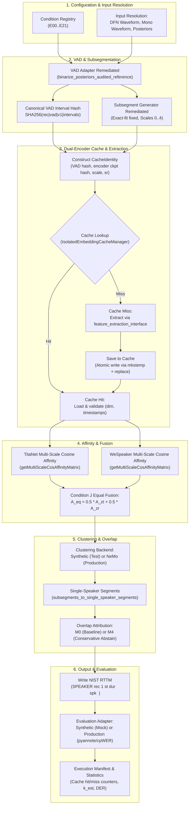

# Stage 5B.4-A.1 — Pipeline Architecture & Orchestrator Execution Flow

**Execution Status**: Architecture Specified & Synthetically Validated  
**Date**: 2026-11-06  
**Auditor**: Senior ML Research Engineer & Diarization Systems Auditor  
**Repository**: [Multi-View-Speaker-Representation-Learning](file:///home/priyanka/chaitanya/Multi-View-Speaker-Representation-Learning)  
**Deliverable Path**: `research_stages/stage5b/stage5b_4_fresh_diarization/a1_remediation/reports/STAGE5B_4_A1_ARCHITECTURE_AND_EXECUTION_FLOW.md`

---

## 1. End-to-End Orchestrator Execution Flow

The remediation establishes a unified control flow implemented in [`orchestrator.py`](file:///home/priyanka/chaitanya/Multi-View-Speaker-Representation-Learning/research_stages/stage5b/stage5b_4_fresh_diarization/a1_remediation/scripts/orchestrator.py):

---

## 2. Module Responsibilities & Inter-Module Data Structures

### 2.1 [`condition_registry.py`](file:///home/priyanka/chaitanya/Multi-View-Speaker-Representation-Learning/research_stages/stage5b/stage5b_4_fresh_diarization/a1_remediation/scripts/condition_registry.py)
- **Role**: Single authoritative registry mapping condition IDs (`E00` through `E21`) to immutable dataclasses (`VADConfig`, `OverlapConfig`).
- **Data Emitted**: `ExperimentCondition` containing `vad_config` (onset, offset, min_duration_on/off) and `overlap_config` (method_id, tau_overlap, min_turn_dur_sec, max_gap_sec).

### 2.2 [`vad_adapter_remediated.py`](file:///home/priyanka/chaitanya/Multi-View-Speaker-Representation-Learning/research_stages/stage5b/stage5b_4_fresh_diarization/a1_remediation/scripts/vad_adapter_remediated.py)
- **Role**: Loads precomputed frame posteriors read-only and applies verified hysteresis thresholding matching Stage 5B.1.
- **Data Emitted**: `List[Dict[str, float]]` containing ordered `{"start": float, "end": float, "duration": float}` intervals, and a 64-char `canonical_interval_hash`.

### 2.3 [`subsegment_generator_remediated.py`](file:///home/priyanka/chaitanya/Multi-View-Speaker-Representation-Learning/research_stages/stage5b/stage5b_4_fresh_diarization/a1_remediation/scripts/subsegment_generator_remediated.py)
- **Role**: Partitions VAD intervals into multi-scale sliding windows (scales 0..4) without exact-fit duplicate subsegments.
- **Data Emitted**: `Dict[int, List[Dict[str, Any]]]` mapping scale index $k \in \{0..4\}$ to subsegment metadata records (`start`, `end`, `duration`, `scale`, `parent_interval_idx`, `subsegment_idx`).

### 2.4 [`feature_extraction_interface.py`](file:///home/priyanka/chaitanya/Multi-View-Speaker-Representation-Learning/research_stages/stage5b/stage5b_4_fresh_diarization/a1_remediation/scripts/feature_extraction_interface.py)
- **Role**: Production-facing waveform extraction contracts for TitaNet (192d) and WeSpeaker (256d).
- **Data Emitted**: `EmbeddingResult` containing L2-normalized 1D float32 embedding, pre-normalization L2 norm, dimension, encoder name, sample rate, and duration.

### 2.5 [`isolated_embedding_cache.py`](file:///home/priyanka/chaitanya/Multi-View-Speaker-Representation-Learning/research_stages/stage5b/stage5b_4_fresh_diarization/a1_remediation/scripts/isolated_embedding_cache.py)
- **Role**: Manages atomic storage and loading under `stage5b_4_fresh_diarization/cache/`. Enforces path traversal and symlink containment checks.
- **Data Emitted**: 2D float32 array `embeddings` of shape `(N, D)` and 1D float32 array `l2_norms`.

### 2.6 [`affinity_fusion_remediated.py`](file:///home/priyanka/chaitanya/Multi-View-Speaker-Representation-Learning/research_stages/stage5b/stage5b_4_fresh_diarization/a1_remediation/scripts/affinity_fusion_remediated.py)
- **Role**: Computes multi-scale cosine affinity mapped to base scale 4, off-diagonal z-score normalization, and equal-weight fusion.
- **Data Emitted**: 2D square float32 tensor $A_{\text{eq}}$ with diagonal 1.0 and off-diagonal bounded in $[0, 1]$.

### 2.7 [`clustering_backends.py`](file:///home/priyanka/chaitanya/Multi-View-Speaker-Representation-Learning/research_stages/stage5b/stage5b_4_fresh_diarization/a1_remediation/scripts/clustering_backends.py)
- **Role**: Interfaces for fresh spectral clustering. Distinctly separates `SyntheticSpectralClusteringBackend` (CPU/unit tests) from `NeMoProductionClusteringBackend` (CUDA/Stage 5A.1 parameters).
- **Data Emitted**: `Tuple[List[str], int]` containing assigned speaker labels `["speaker_0", "speaker_1", ...]` and estimated speaker count $\hat{K}$.

### 2.8 [`overlap_adapter_remediated.py`](file:///home/priyanka/chaitanya/Multi-View-Speaker-Representation-Learning/research_stages/stage5b/stage5b_4_fresh_diarization/a1_remediation/scripts/overlap_adapter_remediated.py)
- **Role**: Evaluates turn alternation around detected overlap regions ($\tau=0.40$). Assigns secondary speaker turns under M4 or preserves single-speaker hypothesis under M0.
- **Data Emitted**: `Tuple[List[Dict[str, Any]], Dict[str, Any]]` containing final multi-label segments and attribution statistics.

### 2.9 [`rttm_adapter_remediated.py`](file:///home/priyanka/chaitanya/Multi-View-Speaker-Representation-Learning/research_stages/stage5b/stage5b_4_fresh_diarization/a1_remediation/scripts/rttm_adapter_remediated.py)
- **Role**: Merges contiguous subsegments and writes canonical NIST RTTM files.
- **Data Emitted**: File path of written RTTM.

### 2.10 [`evaluation_adapters.py`](file:///home/priyanka/chaitanya/Multi-View-Speaker-Representation-Learning/research_stages/stage5b/stage5b_4_fresh_diarization/a1_remediation/scripts/evaluation_adapters.py)
- **Role**: Evaluates hypothesis RTTMs against reference RTTMs. Separates `SyntheticEvaluationAdapter` from `ProductionEvaluationAdapter`.
- **Data Emitted**: Comprehensive dictionary of evaluation metrics (`der_collar0`, `der_collar025`, `jer`, `miss`, `false_alarm`, `confusion`, `k_error`).

---

## 3. Error Propagation & Safe Failure Behavior

1. **Unsupported Audio / Sample Rate**: Raises `InvalidAudioError` with explicit diagnostics before model execution.
2. **Dimension Mismatch**: If model returns unexpected dimensions (e.g. 128 instead of 192), raises `DimensionMismatchError`.
3. **Cache Path Traversal**: If path component contains `..` or illegal characters, raises `CacheSecurityError`.
4. **Prohibited Stage 3 Path**: If cache root points to Stage 3, raises `CacheSecurityError`.
5. **Unauthorized Execution**: If CLI `run` is invoked without `--authorize-inference`, raises `PermissionError` (exit code 1).
6. **Backend Unavailability**: If CLI `run` is invoked with `--authorize-inference` but the production backend is unverified/unimplemented, raises `NotImplementedError` (exit code 2). No success manifest or empty RTTM is generated.
