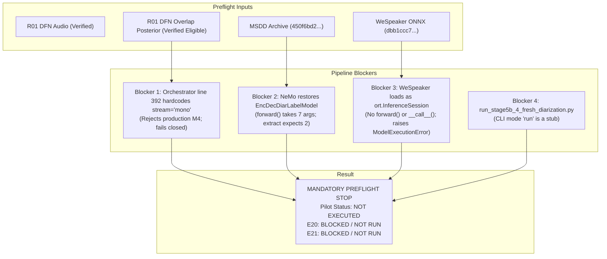

# Stage 5B.4 — R01 Pilot: Preflight Blockers & Interface Analysis
**Document ID**: `R01_PILOT_PREFLIGHT_BLOCKERS.md`  
**Date**: November 10, 2026  
**Auditor**: Senior ML Systems Engineer & Independent Research Code Auditor  
**Repository**: `https://github.com/chaitanyav23/Multi-View-Speaker-Representation-Learning`  
**Git HEAD**: `03b26c6` (Clean working tree)  
**Authorized Scope**: R01 controlled comparison — Condition E20 (C62 $\times$ M0) vs Condition E21 (C62 $\times$ M4 using verified DFN posterior)  

---

## 1. Registry & Scope Clarification

### 1.1 Condition Mapping in Frozen Registry
Inspection of `research_stages/stage5b/stage5b_4_fresh_diarization/a1_remediation/scripts/condition_registry.py` confirms:
- **`E20`**: `ExperimentCondition("E20", VAD_C62, OVERLAP_M0, "C62 x M0", "Isolated robust consensus VAD effect")`
- **`E21`**: `ExperimentCondition("E21", VAD_C62, OVERLAP_M4, "C62 x M4", "Full proposed integration system")`
- **`VAD_C62`**: Linear Consensus VAD (`dfn` + `16k_mono`), weights 0.5/0.5, hysteresis `onset=0.600`, `offset=0.350`, `min_duration_on=0.10s`, `min_duration_off=0.30s`.
- **`VAD_C50`**: Pyannote Raw 16k Mono VAD (`onset=0.481`, `offset=0.481`, `min_duration_on=0.10s`, `min_duration_off=0.15s`), which maps exclusively to **`E10` (C50 $\times$ M0)** and **`E11` (C50 $\times$ M4)**.
- **Clarification**: The previous execution prompt's mention of C50 for E20 was an erroneous cross-reference. The frozen registry maps E20 and E21 strictly to **C62**. The comparison remains authorized exclusively as **E20 vs E21**. Reinterpreting E20 as C50 or substituting E10/E11 is strictly prohibited.

---

## 2. Technical Blockers Preventing Execution

Four concrete integration and interface blockers prevent the production pipeline from executing the authorized E20/E21 comparison without source code modifications.



---

### Blocker 1: Hardcoded `stream="mono"` in Production Orchestrator
- **File**: `research_stages/stage5b/stage5b_4_fresh_diarization/a1_remediation/a1_3_2_2_rttm_atomic_publication/scripts/orchestrator_remediated.py`
- **Line Range**: Lines 389–413
- **Specific Code**:
  ```python
  if overlap_method == "M4_conservative_abstention":
      container = self.overlap_loader.load_and_validate(
          recording_id=rec_id,
          stream="mono",  # <-- Line 392: Hardcoded string literal
          expected_duration=expected_duration,
          source_audio_override=source_audio_override,
          pyannet_checkpoint_override=pyannet_checkpoint_override,
      )
  ```
- **Consequence**:
  1. The orchestrator method `process_recording()` does not expose an overlap stream parameter.
  2. In `ExecutionMode.PRODUCTION`, `load_and_validate` requests `recording_id="R01_sara_sharif"` with `stream="mono"`.
  3. In `manifests/overlap_posterior_provenance_manifest.json`, the entry `R01_sara_sharif__mono` has `source_audio_sha256 = "UNRECORDED_IN_HISTORICAL_MANIFEST"` and `unverified_fields = ["source_audio_sha256"]`.
  4. The multi-state validator sets `production_eligible = False`.
  5. Lines 409–413 fail closed with:
     ```
     OverlapProvenanceError: Production M4 rejected for 'R01_sara_sharif': Posterior is not production eligible.
     Reasons: ["Unverified provenance fields: ['source_audio_sha256']", ...]
     ```
  6. The provenance-verified, production-eligible artifact is `R01_sara_sharif__dfn` (`stream="dfn"`). However, the existing orchestrator cannot be instructed to load `dfn` without editing production code.

---

### Blocker 2: Missing Standalone TitaNet Checkpoint & NeMo Architecture Mismatch
- **Files**:
  - `model_factory.py` lines 322–326
  - `feature_extraction_interface.py` line 143
  - Checkpoint: `/home/priyanka/.cache/torch/NeMo/NeMo_2.7.3/diar_msdd_telephonic/3c3697a0a46f945574fa407149975a13/diar_msdd_telephonic.nemo`
- **Specific Code in `model_factory.py`**:
  ```python
  from nemo.collections.asr.models.label_models import EncDecSpeakerLabelModel
  model_instance = EncDecSpeakerLabelModel.restore_from(
      restore_path=proc_path,
      map_location=device,
  )
  ```
- **Specific Code in `feature_extraction_interface.py`**:
  ```python
  if hasattr(model, "forward"):
      out = model.forward(input_signal=wav_t, input_signal_length=len_t)
      raw_emb = out[1] if isinstance(out, (tuple, list)) else out
  ```
- **Inspection Findings**:
  1. A standalone TitaNet-Large archive (e.g. `titanet-l.nemo` or `EncDecSpeakerLabelModel.nemo`) does NOT exist on the machine.
  2. The available checkpoint is `diar_msdd_telephonic.nemo` (SHA-256: `450f6bd279a3f78348f6e883359f9b3b34687dbd15814fd0f10e446ca0f708f6`), which is a multi-scale diarization archive containing an `EncDecDiarLabelModel`.
  3. When `EncDecSpeakerLabelModel.restore_from` restores `diar_msdd_telephonic.nemo`, NeMo parses the manifest inside the archive and constructs an `EncDecDiarLabelModel`.
  4. `EncDecDiarLabelModel.forward()` requires 7 mandatory inputs (`input_signal`, `input_signal_length`, `emb`, `emb_length`, `scale_weights`, `targets`, `targets_length`).
  5. When `extract_titanet_embedding()` passes 2 arguments (`input_signal` and `input_signal_length`), Python raises:
     ```
     TypeError: Number of input arguments provided (2) is not as expected. Function has 7 total inputs with 7 mandatory inputs.
     ```
  6. In Stage 3 (`stage3_dual_encoder/run_stage3_extraction.py` lines 364–367), the project solved this by extracting the submodule state dict (`msdd._speaker_model.`) and instantiating `EncDecSpeakerLabelModel.from_config_dict()`. `ControlledModelFactory` in Stage 5B.4 does not implement this unwrapping logic, leaving production model construction broken for TitaNet.

---

### Blocker 3: WeSpeaker ONNX Runtime Type Contract Mismatch
- **Files**:
  - `model_factory.py` lines 490–493
  - `feature_extraction_interface.py` lines 205–213
  - Checkpoint: `/home/priyanka/.cache/huggingface/hub/models--Wespeaker--wespeaker-voxceleb-resnet293-LM/snapshots/6e6bffe5bf3d772a1f143dc6dbfea58a0799ea83/voxceleb_resnet293_LM.onnx`
- **Specific Code in `model_factory.py`**:
  ```python
  if ckpt_path.endswith(".onnx"):
      import onnxruntime as ort
      providers = ["CPUExecutionProvider"] if device == "cpu" else ["CUDAExecutionProvider", "CPUExecutionProvider"]
      model_instance = ort.InferenceSession(ckpt_bytes, providers=providers)
  ```
- **Specific Code in `feature_extraction_interface.py`**:
  ```python
  if hasattr(model, "forward"):
      out = model.forward(feats)
      raw_emb = out[1] if isinstance(out, (tuple, list)) else out
  elif callable(model):
      out = model(feats)
      raw_emb = out[1] if isinstance(out, (tuple, list)) else out
  else:
      raise ModelExecutionError(f"Model {type(model)} is neither callable nor has forward().")
  ```
- **Consequence**:
  1. The WeSpeaker checkpoint on disk is an ONNX model (`voxceleb_resnet293_LM.onnx`, SHA-256: `dbb1ccc7754caff552ebc46347a51aaee2669bb24efc740e665d1a1133d20e98`).
  2. `ControlledModelFactory.build_production_model()` instantiates `onnxruntime.InferenceSession`.
  3. `onnxruntime.InferenceSession` is an ONNX Runtime engine. It is NOT a PyTorch module, does not possess a `.forward()` method, and is not callable via `__call__()`. It requires `session.run(output_names, input_feed)`.
  4. `extract_wespeaker_embedding()` checks `hasattr(model, "forward")` (False) and `callable(model)` (False), and immediately raises:
     ```
     ModelExecutionError: Model <class 'onnxruntime.capi.onnxruntime_inference_collection.InferenceSession'> is neither callable nor has forward().
     ```

---

### Blocker 4: Production Diarization CLI Entry Point Contains Only Stubs
- **File**: `research_stages/stage5b/stage5b_4_fresh_diarization/scripts/run_stage5b_4_fresh_diarization.py`
- **Lines**: 126–153
- **Specific Code**:
  ```python
  def mode_run_inference(args: argparse.Namespace) -> int:
      ...
      print("[RUN MODE] Authorized inference starting for:")
      print(f"  Recordings: {args.recordings}")
      print(f"  Conditions: {args.conditions}")
      # Inference logic will execute here once authorized in Stage 5B.4-B / Phase B
      return 0
  ```
- **Consequence**: The top-level CLI script for Stage 5B.4 contains no execution wiring to instantiate `FreshDiarizationOrchestratorRemediated` or execute conditions.

---

## 3. PyanNet Checkpoint Path Resolution Fact

During preflight of the R01 DFN overlap posterior, a path dependency was identified:
- In `overlap_provenance.py` lines 175–177, default PyanNet checkpoint resolution looks for:
  `get_repo_root() / "whisperx" / "assets" / "pytorch_model.bin"`
- In the active repository checkout, `whisperx` is not a subdirectory in the repository root; it is installed inside the virtualenv:
  `research_stages/.venv_phase20/lib/python3.10/site-packages/whisperx/assets/pytorch_model.bin`
- When `OverlapPosteriorLoaderStrict` is initialized with this virtualenv path:
  ```python
  loader = OverlapPosteriorLoaderStrict(
      execution_mode=ExecutionMode.PRODUCTION,
      pyannet_checkpoint_path=Path("research_stages/.venv_phase20/lib/python3.10/site-packages/whisperx/assets/pytorch_model.bin")
  )
  container = loader.load_and_validate("R01_sara_sharif", stream="dfn")
  ```
  Validation **succeeds completely**:
  - `structurally_valid = True`
  - `provenance_verified = True`
  - `production_eligible = True`
  - `reasons = ['Structural and cryptographic provenance verified.']`
- When initialized without explicitly supplying this checkpoint path, validation fails closed due to `MISSING_CHECKPOINT`.

---

## 4. Status Summary of All Preflight Checks

| # | Inspection Category | Status | Details |
|:---:|---|:---:|---|
| 1 | Git HEAD & Working Tree | **PASS** | HEAD `03b26c6`; working tree clean. |
| 2 | Historical Baselines Integrity | **PASS** | All 13 protected baseline manifests 100% verified. |
| 3 | R01 Input Audio Hashes | **PASS** | DFN hash matches Stage 1 manifest (`90520b89...`). |
| 4 | R01 DFN Overlap Posterior | **PASS** | 100% verified against schema and authoritative provenance manifest. |
| 5 | Stage 5A Affinity Fusion Protocol | **PASS** | Condition J multiscale equal-weight formulation verified. |
| 6 | Stage 5B.3 Clustering Protocol | **PASS** | NeMo NME-SC parameters verified. |
| 7 | C62 vs C50 Condition Definition | **PASS** | Confirmed: E20/E21 is C62; C50 belongs to E10/E11. |
| 8 | Overlap Stream Parameterization | **FAIL (BLOCKER)** | Orchestrator hardcodes `stream="mono"`; DFN cannot be loaded. |
| 9 | Standalone TitaNet Checkpoint | **FAIL (BLOCKER)** | Standalone checkpoint missing; MSDD archive causes forward argument mismatch. |
| 10 | WeSpeaker ONNX Interface | **FAIL (BLOCKER)** | `InferenceSession` lacks `.forward()` and `__call__()`. |
| 11 | CLI Entry Point | **FAIL (BLOCKER)** | `mode_run_inference` is an empty stub. |
| 12 | Neural / VAD Inference Execution | **NOT ATTEMPTED** | Halted under mandatory stop condition. |
| 13 | Diarization Evaluation / Metrics | **NOT ATTEMPTED** | Halted under mandatory stop condition. |

---

## 5. Explicit Answers to Human Authority Review Questions

1. **Pilot Status**: **NOT EXECUTED**.
2. **E20 Status**: **BLOCKED / NOT RUN**.
3. **E21 Status**: **BLOCKED / NOT RUN**.
4. **DFN Posterior Provenance**: **Verified production-eligible** when PyanNet checkpoint is referenced from `.venv_phase20`.
5. **Experimental Metrics**: **None exist**. Zero neural inference, embedding extraction, or RTTM generation occurred.
6. **Can the existing production implementation support the authorized E20/E21 comparison without code changes?**:  
   **NO**. The existing codebase cannot run the authorized comparison without engineering modifications to resolve Blockers 1, 2, 3, and 4.
